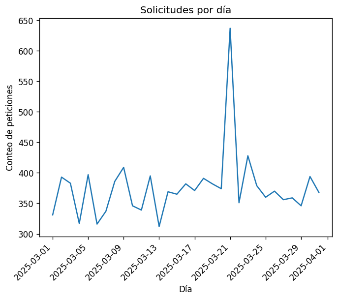
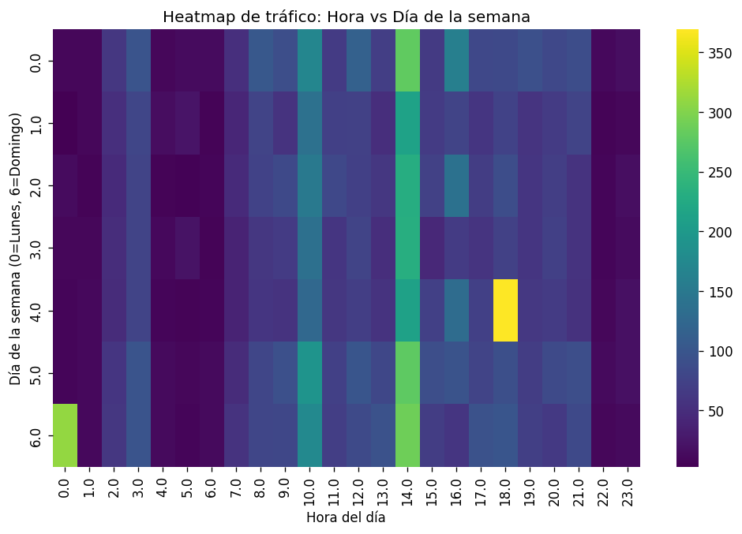

# Informe PR1 - Alejandro Torres Ansio

### 1. Resumen ejecutivo

En este informe presento el análisis forense y de calidad de datos realizado sobre un registro de tráfico web correspondiente a marzo de 2025, compuesto por 11.775 eventos heterogéneos. El objetivo principal ha sido depurar y normalizar el dataset para discriminar el tráfico orgánico legítimo frente a diversas campañas de ataque automatizado. A lo largo del documento detallo la metodología de preprocesado, expongo los hallazgos del análisis exploratorio (EDA) y defino reglas de detección heurísticas que han permitido identificar y aislar con éxito patrones de fuerza bruta, escaneo de vulnerabilidades, inyecciones sintácticas y disrupciones volumétricas (micro-DDoS) basándome en la evidencia técnica del tráfico.

### 2. Metodología y limpieza

El preprocesado del dataset original (11.775 registros y 24 variables) se ha regido por las dimensiones de calidad del dato de DAMA (completitud, validez, consistencia y unicidad). En la auditoría inicial, he distinguido los nulos estructurales o condicionales (como el 96% de vacíos en `waf_action` o el 74,6% en `query_string`, coherentes con peticiones legítimas a recursos estáticos) de los datos perdidos reales, concentrados fundamentalmente en `bytes_sent` (3,24%).

La evaluación de unicidad confirmó la ausencia de filas duplicadas o colisiones en la clave `event_id`. No obstante, el protocolo forense establecido ante posibles fallos de ingesta habría sido aplicar una deduplicación conservando la primera ocurrencia de la tupla `(timestamp, src_ip, host, url_path, http_method)` para evitar el inflado artificial de las volumetrías de ataque.

Durante la fase de normalización, he estandarizado los métodos HTTP y forzado la conversión numérica de los bytes transferidos. El parseo de los timestamps a UTC mediante el forzado de errores (`errors='coerce'`) evidenció 132 registros con fechas corruptas (1,12%). Para preservar la integridad del análisis temporal y no introducir sesgos que invalidarían la detección volumétrica de ráfagas, la decisión metodológica ha sido mantenerlos como `NaT`. Finalmente, la clasificación mediante la librería nativa `ipaddress` arrojó que el 99,52% de los orígenes operan bajo rangos IP privados en una topología donde la correspondencia lógica entre el host y el puerto de destino presenta un 100% de consistencia estructural.

### 3. EDA (Análisis Exploratorio)

El análisis de los ritmos de tráfico revela una clara estacionalidad semanal, concentrando el mayor volumen de peticiones en los días laborables centrales en torno a las 14:00 horas (ver `heatmap_hora_dia.png`). Sin embargo, al aislar los errores, los códigos de cliente (4xx) y servidor (5xx) rompen esta tendencia natural y se agrupan en franjas de madrugada o durante eventos muy concentrados. El caso más extremo es el pico de más de 630 solicitudes registrado el 21 de marzo frente a una media habitual de 350 peticiones diarias. Este comportamiento temporal sugiere fuertemente la ejecución de campañas automatizadas programadas fuera de los horarios de máxima vigilancia.

**Figura 1.** Evolución de las peticiones diarias destacando la disrupción volumétrica del 21 de marzo (micro-DDoS).

Al evaluar el impacto por infraestructura (ver `status_por_host.png`), el host `www.zenargo.es` concentra de manera abrumadora la mayor tasa de errores del ecosistema mediante una acumulación masiva de códigos 4xx. En el extremo opuesto, los endpoints dedicados a recursos estáticos como `cdn.kaluma.io` sirven el contenido con la máxima eficiencia, registrando el percentil 95 (p95) más bajo y estable. Esta optimización contrasta con la distribución general de los tiempos de respuesta, cuyo histograma (`histograma_response_time.png`) evidencia frecuencias de latencia elevadas que solo decaen superados los 400 milisegundos.

**Figura 2.** Mapa de calor (Día vs Hora) que evidencia la concentración del tráfico en horas centrales y anomalías de madrugada.

Finalmente, la categorización de entidades confirma que los navegadores legítimos (`browser`) dominan el tráfico total acaparando casi la totalidad de las respuestas exitosas (ver `status_por_uafamily.png`). La amenaza real proviene de las herramientas de red (`tool`) y automatismos (`bot`), los cuales generan una proporción desproporcionada de errores 404 al bombardear rutas de autenticación como `/wp-login.php` (líder en el `top_url_paths.png`). Esta actividad está impulsada de forma crítica por la insistencia de la IP `203.0.113.250` (`top_ips_404.png`), confirmando patrones de fuerza bruta y escaneo. Por su parte, los agentes raros (`rare`) representan una fracción residual y estática que simplemente sondea el servidor sin consolidar flujos válidos. Adicionalmente, el análisis de la profundidad de ruta revela que los errores de servidor (5xx) se concentran mayoritariamente en los niveles más superficiales del árbol de directorios (`insight_path_depth_status.png`).

### 4. Detección de patrones y campañas

He diseñado reglas heurísticas apoyadas en ventanas temporales, expresiones regulares e identificadores del WAF para aislar el tráfico malicioso, consolidando las métricas de validación por agente (ua_family) y eficacia de bloqueo perimetral.

#### **Reconocimiento (Scanner 404/403)**

La regla evalúa ráfagas de ≥10 errores de cliente en ventanas de 2 minutos por origen. La evidencia señala que la IP `203.0.113.250` ejecuta el escáner de madrugada barriendo 28 hosts distintos, destacando su agresividad contra endpoints críticos de administración. Como respalda la figura `top_ips_404.png`, esta IP es la amenaza volumétrica principal de 404s, generando 481 eventos (agentes `tool` y `rare`) con apenas un 14,14% de intercepción del WAF.

#### **Fuerza bruta a WordPress**

Condicionada a ventanas de ≥5 peticiones POST por minuto contra `/wp-login.php`. Se concentra en horas centrales y medianoches para enmascararse en el tráfico legítimo. Las métricas arrojan 1.244 eventos originados por solo 2 IPs contra un único host. Su ejecución depende al 100% de agentes automatizados (`tool`) y eludió por completo los filtros del WAF (0% bloqueos).

#### **Inyecciones Sintácticas (SQLi, LFI, XSS, CMDi)**

Detectadas mediante el cruce de expresiones regulares (por ejemplo: `UNION SELECT` o `../`) con los identificadores `waf_rule_id`. Estas campañas se concentran en franjas de tarde y madrugada. Agrupan 433 eventos distribuidos entre decenas de IPs que sondean simultáneamente toda la infraestructura (26-28 hosts afectados). Su evidencia técnica es innegable al registrar una eficacia de intercepción del WAF del 100% (exceptuando XSS con un 67,7%) operando íntegramente bajo herramientas de red.

#### **Disrupciones Volumétricas (Micro-DDoS y Rate Limiting)**

La regla de micro-DDoS aísla intervalos anómalos de >50 req/min hacia un mismo host con escalada de errores. La evidencia confirma que el host `www.kaluma.io` sufrió una disrupción el 21 de marzo en el intervalo exacto de 18:47 a 18:48 horas, sumando 300 eventos desde 26 IPs distintas con un 0% de bloqueos WAF (fenómeno visible en `req_por_dia.png`). Paralelamente, se aislaron 265 eventos de Rate Limiting (códigos 429) originados por una sola IP.

#### **Discusión de falsos positivos y negativos**

Al evaluar la robustez de las heurísticas, el cruce con los User-Agents revela riesgos críticos de falsos positivos en los ataques volumétricos. La campaña de Rate Limiting, ejecutada al 100% por navegadores legítimos (`browser`), tiene altas probabilidades de ser tráfico orgánico operando tras un proxy corporativo o CG-NAT donde múltiples usuarios comparten una IP pública. Del mismo modo, el Micro-DDoS podría confundirse con un pico de popularidad legítimo (flash crowd). Por el contrario, el modelo adolece de falsos negativos frente a fuerza bruta low and slow (por debajo del umbral de 5 req/min) o inyecciones ofuscadas en Base64 que evaden las expresiones regulares. Para mitigarlo, es perentorio complementar las reglas estáticas con huellas de sesión (cookies/fingerprinting) y análisis de anomalías.

### 5. Conclusiones y acciones recomendadas

El análisis forense revela una brecha estructural en el perímetro de seguridad: mientras que el WAF neutraliza eficazmente las inyecciones sintácticas (con un 100% de bloqueo en SQLi, CMDi y LFI), la infraestructura es completamente ciega (0% de intercepción) frente a los ataques volumétricos y el reconocimiento automatizado. Para mitigar estas vulnerabilidades, es prioritario implementar las siguientes acciones tácticas:

- **Despliegue estratégico de honeypots (Prioridad Alta):** Es la contramedida más efectiva para neutralizar a los escáneres nocturnos. Implementar endpoints trampa (directorios falsos invisibles para la navegación legítima) garantiza que cualquier intento de acceso provenga de un bot malicioso. Esta "trampa de miel" permite capturar la firma del atacante y bloquear su IP por reputación en el cortafuegos perimetral, cortando la cadena de ataque antes de que tenga la oportunidad de iniciar la fase de fuerza bruta.
- **Endurecimiento del Rate Limit:** Aplicar políticas restrictivas de limitación de peticiones a nivel de servidor web o balanceador de carga. Se debe estrangular drásticamente la concurrencia permitida por IP en rutas críticas de autenticación (`/wp-login.php`) y en los recursos de consumo intensivo (`/api/v1/items`) para neutralizar tanto la fuerza bruta como el abuso de cuota.
- **Monitoreo de anomalías y ajuste del WAF:** Refinar las expresiones regulares del WAF para prevenir tácticas de evasión por ofuscación. Paralelamente, se debe integrar la ingesta de los logs en un sistema de monitoreo en tiempo real, configurando alertas automatizadas (mediante herramientas de análisis de tráfico) ante picos súbitos de latencia o escaladas de errores 5xx para contener los ataques micro-DDoS en sus primeros segundos.