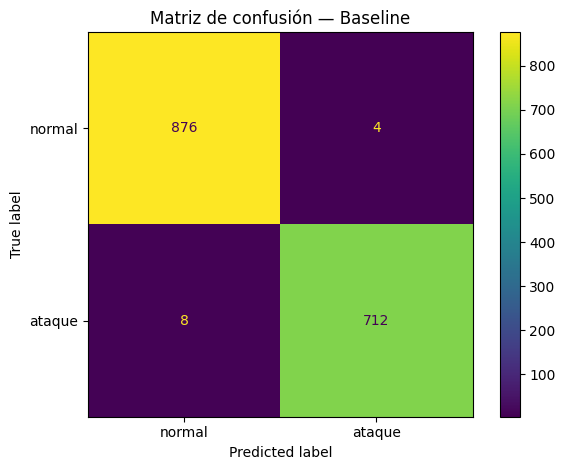
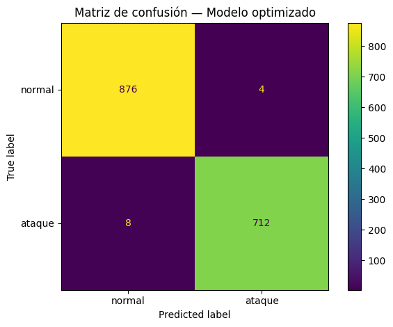
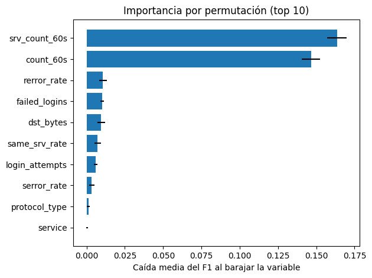

# PR2 - Detección de Intrusiones con Random Forest

## 1. Resumen ejecutivo

En esta práctica construí un detector de intrusiones binario con Random Forest sobre un dataset sintético de 8000 flujos de red, con tráfico normal y cuatro familias de ataque. Preparé los datos con One-Hot, imputación por mediana y una división estratificada 80/20. El baseline obtuvo un F1 de 0,9916 en test, con 8 ataques sin detectar y 4 falsas alarmas. Tras probar 72 combinaciones de hiperparámetros con validación cruzada, el mejor modelo solo cambió el número de árboles (200) y dio las mismas métricas en test, así que la optimización no mejoró el baseline. Las variables que más pesan son count_60s y srv_count_60s, y no veo un sobreajuste importante (F1 de 0,9936 en CV y 0,9916 en test). Como los datos son sintéticos, estos resultados no se pueden extrapolar a tráfico real.

## 2. Datos y preprocesado

Empecé cargando el CSV en un DataFrame y revisando su estructura: son 8000 flujos y 19 columnas. Tres de ellas son categóricas (protocol_type, service y flag) y las pasé a One-Hot. Al quitar las cuatro columnas que el enunciado excluye (flow_id, timestamp, is_attack y attack_family) quedaron 15 variables de entrada: 3 categóricas y 12 numéricas.

Solo hay nulos en dos columnas: bytes_ratio, con 72 flujos, y login_attempts, con 71, es decir, un 0,9 % en cada una. Como son pocos, no eliminé esas filas y los imputé con la mediana dentro del pipeline, para que se calcule solo con los datos de entrenamiento. Preferí la mediana a la media porque las dos columnas están muy sesgadas: en bytes_ratio la media es 10,6 y la mediana 1,66, y en login_attempts la media es 0,70 y la mediana 0. El README habla también de nulos en failed_logins y de un flag OTH, pero en mis datos no hay ni lo uno ni lo otro.

En cuanto a las clases, 4400 flujos son normales (55 %) y 3600 son ataques (45 %), así que el desbalanceo es leve. Aun así, un modelo que dijera siempre «normal» acertaría el 55 % de las veces, por lo que la accuracy por sí sola no me basta y tuve en cuenta también precision, recall y F1, como indica el módulo para el tráfico desbalanceado. Dentro de los ataques, la familia más pequeña es webattack, con un 8 %.

Por último, las variables de volumen tienen colas largas hacia la derecha: en src_bytes la mediana es 11 554 y el máximo 300 000, y en duration son 2,03 y 71,3 segundos, algo que se ve en los histogramas. Además, las escalas varían mucho entre columnas. No eliminé esos valores extremos porque, según el módulo, un volumen de bytes o una duración anormales pueden delatar un ataque, aunque no he comprobado a qué clase pertenecen. Tampoco escalé las variables, ya que el modelo es un Random Forest, formado por árboles de decisión.

Para la entrada del modelo definí X con esas 15 variables e y con is_attack. Monté un ColumnTransformer con dos bloques: un OneHotEncoder con handle_unknown='ignore' para las tres categóricas y un SimpleImputer con la mediana para las 12 numéricas. En lugar de dejar las numéricas en passthrough, como sugiere el enunciado, usé el imputador porque hay nulos en dos de ellas. Después dividí los datos en un 80 % para entrenar (6400 flujos) y un 20 % para test (1600), de forma estratificada y con semilla 42, y en los tres conjuntos la proporción de ataques es del 45 %.

Los nulos los dejé sin tratar hasta este punto a propósito: en el conjunto de entrenamiento hay 61 en bytes_ratio y 55 en login_attempts, y el imputador calcula las medianas solo con esos datos, de modo que el test no influye en ningún valor del preprocesado. Como comprobación, apliqué el preprocesador al conjunto de entrenamiento y salieron 33 columnas, las 21 del One-Hot (3 protocolos, 12 servicios y 6 flags) más las 12 numéricas, sin ningún nulo.

La ventaja de usar ColumnTransformer es que puedo tratar cada tipo de columna de forma distinta dentro de un solo objeto. Con Pipeline encadeno ese preprocesado con el modelo, así que los mismos pasos se aplican siempre igual al entrenar y al predecir con datos nuevos. Además, el preprocesado se ajusta solo con los datos de entrenamiento, lo que evita que información del test se cuele en el modelo. Esto importa sobre todo en la validación cruzada, donde el proceso se repite en cada pliegue.

## 3. Resultados: baseline frente a optimizado

Como referencia entrené un Random Forest con los ajustes por defecto de scikit-learn (100 árboles, sin límite de profundidad, min_samples_split=2, min_samples_leaf=1 y max_features='sqrt'), dentro de un pipeline con el preprocesador anterior. Sobre los 1600 flujos de test obtuve una accuracy de 0,9925, una precision de 0,9944, un recall de 0,9889 y un F1 de 0,9916. La matriz de confusión (Figura 1a) muestra 876 flujos normales bien clasificados, 712 ataques detectados, 4 falsas alarmas y 8 ataques que el modelo no detectó.

El modelo falla más por falsos negativos (8) que por falsos positivos (4), y eso se nota en que el recall es algo menor que la precision. En un IDS el falso negativo es el error más delicado, porque es un ataque que pasa sin que nadie lo vea, mientras que un falso positivo es una alerta falsa que hay que revisar. Según el módulo, si la prioridad es no dejar pasar ninguna amenaza hay que aceptar más falsos positivos, pero estos también cuentan, ya que demasiadas falsas alarmas producen fatiga en los analistas. No he comprobado a qué familias de ataque pertenecen los 8 que se escapan.

Para mejorar el baseline usé GridSearchCV sobre el pipeline completo, con validación cruzada estratificada de 5 pliegues y el F1 como métrica de selección. El espacio de búsqueda lo construí alrededor de los valores que aparecen en el módulo: 100 y 200 árboles, porque a partir de ahí el rendimiento se estabiliza; profundidad máxima sin límite, 10 y 20, para ver el efecto de limitarla; min_samples_leaf 1 y 2; min_samples_split 2 y 5; y max_features con 'sqrt' y con el 30 % y el 50 % de las variables. No incluí 'log2' porque con 33 columnas da el mismo número de variables que 'sqrt'. Son 72 combinaciones y 360 entrenamientos, y guardé todos los resultados en cv_results.csv.

La mejor combinación fue 200 árboles, sin límite de profundidad, min_samples_split=2, min_samples_leaf=1 y max_features='sqrt', con un F1 de 0,9936 en validación cruzada. Coincide con el baseline en todo salvo en el número de árboles (200 en lugar de 100). El baseline obtuvo un F1 de 0,9932 en la misma validación cruzada, una diferencia de 0,0004 que es menor que la variación entre pliegues (alrededor de 0,002). En test, el modelo optimizado dio las mismas métricas (Tabla 1) y la misma matriz de confusión (Figura 1b) que el baseline, con una accuracy de 0,9925, una precision de 0,9944, un recall de 0,9889 y un F1 de 0,9916, así que el F1 no mejora y tampoco cambia el equilibrio entre precision y recall.

| Métrica | Baseline | Optimizado |
| --- | --- | --- |
| Accuracy (test) | 0,9925 | 0,9925 |
| Precision (test) | 0,9944 | 0,9944 |
| Recall (test) | 0,9889 | 0,9889 |
| F1 (test) | 0,9916 | 0,9916 |
| F1 en validación cruzada | 0,9932 (± 0,0021) | 0,9936 (± 0,0018) |
| Falsos positivos / falsos negativos | 4 / 8 | 4 / 8 |

*Tabla 1. Métricas del baseline y del modelo optimizado, en test y en validación cruzada.*

El hiperparámetro que más influyó fue max_features: el F1 medio fue 0,9930 con 'sqrt', 0,9920 con el 30 % de las variables y 0,9914 con el 50 %. Mi interpretación es que, como explica el módulo, mirar menos variables en cada división hace que los árboles se parezcan menos entre sí y que el conjunto vote mejor. El resto de parámetros cambió el F1 medio en 0,0003 como máximo, así que apenas influyeron.

Figura 1a. Matriz de confusión del baseline sobre los 1600 flujos de test.

Figura 1b. Matriz de confusión del modelo optimizado sobre los 1600 flujos de test.

## 4. Interpretabilidad

Para ver qué variables usa el modelo calculé la importancia por permutación sobre el mejor modelo y el conjunto de test: se baraja cada columna y se mide cuánto cae el F1. Dos variables dominan con diferencia: srv_count_60s, con una caída del F1 de 0,16, y count_60s, con 0,15. El resto está por debajo de 0,011: rerror_rate, failed_logins, dst_bytes, same_srv_rate, login_attempts y serror_rate aportan algo, y las demás (src_bytes, bytes_ratio, duration, pkts, flag y service) tienen una importancia prácticamente nula.

Me parece razonable para un IDS. count_60s y srv_count_60s cuentan las conexiones de los últimos 60 segundos, y según el README son altas en DoS (count_60s) y en PortScan (srv_count_60s). Además, failed_logins y login_attempts tienen sentido para la fuerza bruta, y rerror_rate y serror_rate para las conexiones fallidas, que el módulo cita como indicadores de reconocimiento y de fuerza bruta. Hay que tener en cuenta que el dataset es sintético, así que estas importancias reflejan cómo se generaron los datos, y que una variable con importancia casi nula no significa que no tenga información, solo que el modelo no la necesita teniendo las otras.

Para valorar el sobreajuste comparé el F1 del mejor modelo en entrenamiento (1,0000), en validación cruzada (0,9936) y en test (0,9916). La diferencia entre CV y test es de 0,0019, parecida a la variación entre pliegues (±0,0018), así que no la considero una señal de sobreajuste. El 1,0 en entrenamiento es esperable porque el modelo no limita la profundidad (max_depth=None) y el módulo advierte de que, sin límite, los árboles pueden memorizar los datos de entrenamiento; la caída hasta 0,9916 en test es pequeña, de 0,0084. Por eso no veo un sobreajuste importante. Si quisiera reducirlo, limitaría la profundidad, como hace el módulo con 10 niveles, y en mi búsqueda eso costaba muy poco (un F1 medio de 0,9920 con max_depth=10 frente a 0,9922 sin límite). Eso sí, el test sale del mismo dataset sintético, así que no demuestra que el modelo funcionara igual con datos distintos.

Figura 2. Importancia de las variables por permutación (caída media del F1), top 10.

## 5. Riesgos y recomendaciones en ciberseguridad

El principal riesgo de un IDS como este es el coste de cada tipo de error. En mi test hubo 8 ataques sin detectar y 4 falsas alarmas sobre 1600 flujos. Un falso negativo deja pasar un ataque sin que nadie lo vea, mientras que un falso positivo le hace perder tiempo al analista y, si se acumulan, provoca fatiga por exceso de alertas, algo que el módulo señala como uno de los objetivos a evitar. El módulo también explica, en el ejemplo de la red neuronal, que si la prioridad es no dejar pasar ninguna amenaza se puede bajar el umbral de decisión para subir el recall, aceptando más falsos positivos. En esta práctica no he cambiado el umbral, así que no sé cuánto variarían mis resultados.

Hay otros dos límites que tengo presentes. El primero es que los datos son sintéticos y con solo cuatro tipos de ataque, por lo que un F1 de 0,99 no es algo que pueda esperarse con tráfico real. El segundo es el drift: el tráfico y los ataques cambian con el tiempo, y un modelo entrenado una sola vez va perdiendo rendimiento. Como mejoras futuras, siguiendo lo que indica el módulo, reentrenaría el modelo periódicamente, ajustaría el umbral según lo que se quiera priorizar y cruzaría sus predicciones con reglas heurísticas. También probaría class_weight='balanced', que el módulo usa en su ejemplo, y la clasificación por familias de ataque, que he dejado como parte opcional sin hacer.

## 6. Reflexión personal

Elegí Random Forest sobre todo por cómo encaja con estos datos. Tengo variables categóricas y numéricas mezcladas, con colas largas y escalas muy distintas, y los árboles las manejan sin tener que escalarlas ni asumir relaciones lineales. También me gustó que se pueda interpretar, ya que pude ver qué variables pesan más con la importancia por permutación y comprobar que tenían sentido para un IDS. Y me pareció robusto: según el módulo, al votar muchos árboles se reduce el riesgo de sobreajuste frente a un árbol solo, y en mi búsqueda el F1 medio apenas se movió al cambiar los hiperparámetros, entre 0,9914 y 0,9930.

Como siguiente paso probaría una SVM para compararla con el Random Forest sobre la misma división de datos, siguiendo el ejemplo del módulo, es decir, escalando las variables y buscando C y gamma con validación cruzada. Además, repetiría el experimento con más datos y más tipos de ataque, porque con un dataset sintético y tan fácil de separar no puedo saber hasta dónde llega realmente el modelo.