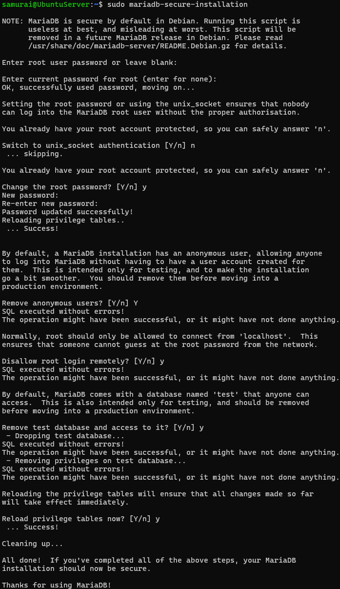
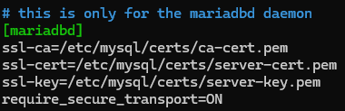
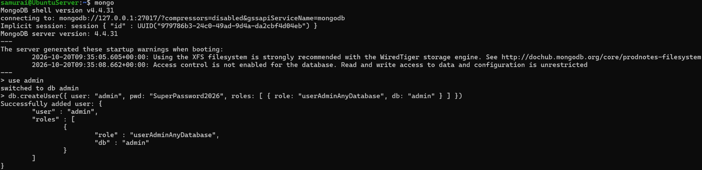
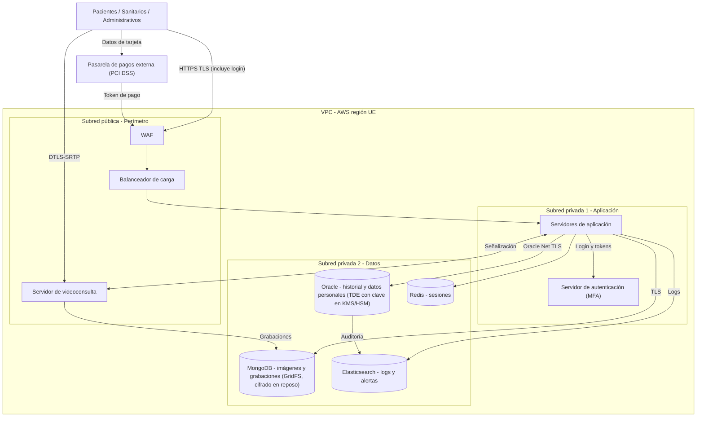

# PEC 1

## **Introducción y contexto del entorno de laboratorio**

En el panorama actual de la ciberseguridad, los servidores de bases de datos son el corazón de cualquier organización y, por tanto, la diana principal de la mayoría de los ciberataques. El objetivo de esta práctica es bajar al nivel de sistemas para comprender y aplicar técnicas de bastionado (hardening) sobre dos de los motores de bases de datos más utilizados hoy en día: MariaDB (modelo relacional) y MongoDB (modelo NoSQL).  A lo largo de este informe, documentaré paso a paso el despliegue seguro de ambos servicios partiendo desde cero en un entorno virtualizado basado en Ubuntu Server.

El enfoque de este trabajo no es simplemente lograr que las bases de datos arranquen y funcionen, sino garantizar que lo hacen bajo los estándares mínimos de seguridad. Para ello, detallaré la creación de roles bajo el principio de mínimo privilegio, la implementación de certificados para forzar el cifrado en tránsito y en reposo, y la configuración de auditorías de eventos para tener un registro claro de quién hace qué.

Finalmente, toda esta base técnica de configuración de servidores servirá para fundamentar la segunda parte del informe: el diseño de una arquitectura de red segura para una plataforma de telemedicina. Se trata de un escenario crítico donde la protección de la información (como historiales clínicos) está estrictamente regulada por normativas como el RGPD.

---

## Parte 1a: Despliegue y Bastionado Inicial de MariaDB

### **1a.1 Procedimiento de instalación y securización base**

Para llevar a cabo la instalación de la última versión estable de MariaDB en nuestro servidor Ubuntu Linux, el procedimiento recomendado comienza por la instalación y actualización de la lista de repositorios del sistema y la posterior instalación del paquete principal mediante el gestor APT.

```bash
sudo apt update && sudo apt install mariadb-server -y
```

Una vez instalado el motor de la base de datos, el primer paso es comprobar el estado del servicio y verificar la versión exacta que hemos desplegado. Tras ejecutar el comando correspondiente, confirmamos que estamos utilizando la versión `11.8.6-MariaDB`.

Sin embargo, una instalación por defecto no es segura para un entorno de producción. Para asegurar la instalación desde el principio, es estrictamente necesario ejecutar el script de seguridad integrado que proporciona el propio fabricante. Mediante la ejecución de la herramienta interactiva `mariadb-secure-installation`, hemos aplicado las siguientes medidas de bastionado clave:

- Establecimiento de una contraseña fuerte para el usuario administrador (root), preferiblemente generada y almacenada en un gestor de contraseñas.
- Eliminación de los usuarios anónimos que el motor crea por defecto, evitando así cualquier intento de conexión sin credenciales válidas.
- Deshabilitación del inicio de sesión remoto para el usuario root, lo que obliga a que cualquier tarea de administración crítica tenga que realizarse localmente desde el propio servidor.
- Eliminación de la base de datos "test", que suele venir por defecto y representa una superficie de ataque innecesaria.



### **1a.2 Habilitar autenticación y cifrado en tránsito mediante SSL/TLS**

Por defecto, las consultas y los datos que viajan entre los clientes y el servidor de bases de datos pueden ser interceptados en la red si no se aplica una capa de cifrado en tránsito. Para garantizar la confidencialidad e integridad de estas comunicaciones, MariaDB soporta conexiones seguras mediante el uso de certificados SSL/TLS.

Para habilitar este mecanismo de forma robusta, he llevado a cabo las siguientes acciones a nivel de sistema:

**Fase 1: Generación de certificados y mínimo privilegio**

En primer lugar, utilizando la herramienta `OpenSSL`, he creado nuestra propia Autoridad Certificadora (CA) autofirmada, así como la clave privada y el certificado específico para el servidor de MariaDB. Para evitar accesos no autorizados a las claves privadas a nivel de sistema operativo, he restringido la propiedad de la carpeta de certificados exclusivamente al usuario del sistema `mysql`con permisos estrictos de solo lectura.


**Fase 2: Configuración del motor**

Una vez generados los certificados, es necesario indicarle a MariaDB dónde se encuentran y forzar su uso. Para ello, he editado el archivo de configuración principal del servicio (`50-server.cnf`), añadiendo las rutas bajo el bloque principal del daemon y activando la directiva `require_secure_transport = ON`. Esta variable es la que fuerza al servidor a rechazar cualquier intento de conexión de un cliente que no utilice cifrado TLS.



**Fase 3: Verificación del cifrado**

Finalmente, tras reiniciar el servicio para aplicar los cambios, he accedido a la consola de MariaDB para comprobar el estado de las variables internas. Como se observa a continuación, el motor ha cargado correctamente los certificados y la directiva `have_ssl`marca "YES", confirmando que el tráfico ya viaja cifrado.


### **1a.3 Implementación de control de acceso basado en roles (RBAC)**

Para cumplir con el principio de mínimo privilegio y evitar la asignación de permisos excesivos o innecesarios, MariaDB permite implementar un modelo de seguridad basado en roles. En lugar de asignar permisos directamente a cada usuario de forma individual (lo que dificulta la auditoría y el mantenimiento), se definen roles abstractos con privilegios muy acotados y estos se asocian a las cuentas pertinentes.   

Para esta práctica, he implementado este mecanismo siguiendo cuatro fases desde la consola de administración:

1. **Creación del rol:** Se ha generado un rol específico llamado `rol_lectura`.
2. **Asignación de privilegios (Mínimo privilegio):** Se ha otorgado exclusivamente el permiso de lectura (`SELECT`) a este rol sobre todas las bases de datos y tablas, denegando implícitamente cualquier acción de escritura o modificación.
3. **Creación del usuario y vinculación:** Se ha creado el usuario `auditor` para acceso local y se le ha asignado el rol previamente creado.
4. **Activación predeterminada:** Se ha configurado el rol como predeterminado para que el usuario herede los permisos de lectura automáticamente al iniciar sesión, aplicando los cambios finalmente con un volcado de privilegios (`FLUSH PRIVILEGES`).


### **1a.4 Forzar el cifrado de datos en tránsito**

Tal y como se ha configurado de forma práctica en el apartado 1a.2, MariaDB permite obligar a que todas las conexiones entrantes estén cifradas mediante la inclusión de la directiva `require_secure_transport = ON` en el bloque principal del archivo de configuración del motor.   

Al activar y aplicar esta opción, el servidor rechaza automáticamente cualquier petición de conexión TCP/IP de un cliente que intente transmitirse en texto plano. Esta medida es crítica para mitigar el riesgo de ataques en la red, como la interceptación de credenciales o la fuga de información confidencial durante su tránsito entre la aplicación y la base de datos.

### **1a.5 Cifrado de datos en reposo y gestión de claves**

Para proteger la base de datos contra el acceso físico no autorizado o el robo del disco duro del servidor, MariaDB ofrece soporte nativo para el cifrado de datos en reposo a través del motor InnoDB.

Para habilitarlo y gestionar las claves de forma segura, he implementado el plugin `file_key_management`, estructurando el proceso en tres fases a nivel de sistema:

**Fase 1: Generación y protección de claves criptográficas**

En primer lugar, hemos creado un archivo que contiene una clave de cifrado generada aleatoriamente con OpenSSL. Para evitar almacenar esta clave en texto plano, la hemos protegido cifrando el archivo con una segunda clave maestra (`keyfile.key`), garantizando así que un atacante que lea el sistema de archivos no pueda comprometer la base de datos de forma directa. Además, he restringido los permisos de la carpeta criptográfica (`/etc/mysql/encryption`) para que solo el usuario `mysql`tenga acceso.


**Fase 2: Activación del plugin en el motor**

Una vez generadas las claves, he editado el archivo de configuración principal (`50-server.cnf`) añadiendo las directivas correspondientes bajo el bloque principal. He indicado al motor que cargue el plugin, le he pasado las rutas de la clave maestra y el archivo cifrado, y he forzado a que todas las tablas y logs de InnoDB se cifren automáticamente al escribirse en disco.


**Fase 3: Verificación del cifrado**

Por último, tras reiniciar el servicio, he comprobado en la consola de MariaDB que el motor ha cargado correctamente la configuración. La variable `innodb_encrypt_tables`en estado "ON" confirma que los datos ya se están cifrando en disco.


### **1a.6 Auditoría de acciones de usuarios y detección de incidentes**

Para garantizar la trazabilidad de las acciones y cumplir con los requisitos de monitorización y cumplimiento normativo, MariaDB permite registrar de forma persistente la actividad de los usuarios mediante el plugin de auditoría del servidor (`server_audit`).

El funcionamiento y la implementación de este mecanismo se basan en los siguientes puntos:

1. **Habilitación del plugin:** Se ha cargado el módulo de auditoría en caliente en el motor para interceptar y registrar las conexiones, desconexiones y consultas ejecutadas por cualquier cuenta en la base de datos.
2. **Eventos registrados:** El plugin almacena en un archivo de log específico información detallada de cada suceso, incluyendo la marca de tiempo (timestamp), el usuario que realiza la acción, la dirección IP de origen, la base de datos consultada y la sentencia SQL exacta ejecutada.
3. **Detección de incidentes de seguridad:** Estos registros (audit logs) son fundamentales para el análisis forense y la detección temprana de amenazas (como accesos fuera de horario, escaladas de privilegios o consultas anómalas sobre tablas sensibles), permitiendo a los equipos de ciberseguridad trazar un incidente paso a paso.


### **1a.7 Restricción de acceso por direcciones IP específicas**

Para reducir la superficie de ataque y evitar intentos de conexión no autorizados desde redes externas, es fundamental proteger la instalación de MariaDB limitando estrictamente desde qué direcciones IP se aceptan peticiones. En este motor, la restricción se implementa combinando dos niveles de seguridad:

1. **A nivel de red (`bind-address`):** En el archivo de configuración del servidor (`50-server.cnf`), la directiva `bind-address` determina en qué interfaces de red escucha el demonio. Si se establece en `127.0.0.1`, el servidor ignorará cualquier petición que venga de fuera de la propia máquina.
2. **A nivel de Control de Acceso (ACLs):** El método más granular para definir una lista de IPs permitidas es a través de la propia gestión de usuarios de MariaDB. Las cuentas se definen siempre como una combinación de `usuario@host`. Al sustituir el comodín global (`%`) por una dirección IP específica al crear o renombrar un usuario, el motor bloqueará automáticamente cualquier intento de inicio de sesión de ese usuario que provenga de una IP distinta a la autorizada.


### **1a.8 Cifrado a nivel de columna con AES_ENCRYPT() y AES_DECRYPT()**

Mientras que el cifrado en reposo protege los archivos físicos del servidor frente a robos, MariaDB permite añadir una capa extra de defensa en profundidad para datos extremadamente confidenciales (como historiales médicos o contraseñas) a nivel lógico dentro de la propia tabla.

Mediante las funciones criptográficas nativas `AES_ENCRYPT()` y `AES_DECRYPT()`, podemos cifrar y descifrar el contenido de columnas específicas utilizando una clave simétrica. La implementación práctica requiere que el tipo de dato de la columna destino sea binario (como `VARBINARY` o `BLOB`), ya que el resultado del cifrado AES no es texto plano legible.

La dinámica de uso es directa en las sentencias SQL:

1. **Para insertar datos:** En lugar de enviar el dato en claro, se envuelve en la función de cifrado junto a una clave secreta. Ejemplo: `INSERT INTO tabla (columna) VALUES (AES_ENCRYPT('DatoSensible', 'MiClave'));`
2. 
1. **Para consultar datos:** Si se hace un `SELECT` normal, el motor devuelve una cadena binaria ilegible. Para obtener el dato real, el cliente debe proveer la misma clave secreta en la consulta: `SELECT AES_DECRYPT(columna, 'MiClave') FROM tabla;`

A continuación, se demuestra esta técnica en un entorno de pruebas simulando la inserción de un diagnóstico clínico:


### **1a.9 Copias de seguridad automáticas y seguras**

En un entorno crítico, especialmente si manejamos datos sensibles, la disponibilidad y la integridad dependen de una estrategia de copias de seguridad robusta. En caso de un ataque de ransomware o una corrupción de la base de datos, los backups son la última línea de defensa para garantizar la recuperación.

Para automatizar y asegurar este proceso en MariaDB, la herramienta más recomendada a nivel de sistema es **Mariabackup**. A diferencia del clásico `mysqldump` (que hace copias lógicas y bloquea las tablas temporalmente), Mariabackup realiza copias físicas en caliente, lo que significa que el servidor no tiene que detenerse ni sufre caídas de rendimiento durante el proceso de backup.

Para automatizar las copias y hacerlas resistentes a ataques, se recomienda la siguiente estrategia:

1. **Scripting y automatización (`cron`):** Crear un script en bash que ejecute Mariabackup a intervalos regulares (ej. todas las madrugadas) y programarlo en el planificador de tareas `cron` de Linux.
2. **Cifrado del backup:** Modificar el script para que, una vez generada la copia, esta se comprima y se cifre utilizando herramientas estándar como GPG o AES, evitando que un atacante que acceda al repositorio de copias pueda leer su contenido.
3. **Almacenamiento externo (Regla 3-2-1):** El script debe estar configurado para exportar automáticamente el archivo cifrado a un servidor externo (por ejemplo, a través de `rsync` por SSH o a un bucket en la nube). Un backup almacenado en el mismo disco que la base de datos no ofrece protección real contra ataques que comprometan la máquina principal.

---

## Parte 1b: Despliegue y Bastionado Inicial de MongoDB

### **1b.1 Procedimiento de instalación y securización base**

A diferencia de otros motores, MongoDB Community Edition no suele encontrarse actualizado en los repositorios por defecto de Linux. Por ello, el procedimiento seguro y recomendado exige importar la clave criptográfica GPG oficial del fabricante y añadir su repositorio específico antes de proceder con la instalación.

En este laboratorio, hemos instalado el metapaquete oficial `mongodb-org` y verificado que el motor se encuentra en la versión 4.4.31.

```bash
samurai@UbuntuServer:~$ mongod --version
db version v4.4.31
Build Info: {
    "version": "4.4.31",
    "gitVersion": "0fdaf65411c54e22c8a3d708454d7450dac6b6bf",
    "openSSLVersion": "OpenSSL 1.1.1f  31 Mar 2020",
    "modules": [],
    "allocator": "tcmalloc",
    "environment": {
        "distmod": "ubuntu2004",
        "distarch": "x86_64",
        "target_arch": "x86_64"
    }
}
```

Para garantizar una instalación segura desde el despliegue inicial, hemos aplicado las siguientes mejores prácticas:

1. **Ejecución con privilegios mínimos:** El servicio se ha configurado para ejecutarse bajo su propio usuario del sistema (`mongodb`), totalmente aislado del usuario administrador (`root`), limitando así el impacto en caso de que el proceso sea vulnerado.
2. **Aislamiento de red por defecto:** La configuración base instalada (`mongod.conf`) fuerza al demonio a escuchar únicamente en la interfaz de bucle local (`127.0.0.1`), aislando la base de datos de la red pública hasta que se implementen los controles de acceso (RBAC).

### **1b.2 Protocolo, puertos y estructura de archivos**

El servidor de MongoDB utiliza un protocolo de red binario propio (MongoDB Wire Protocol) que opera sobre la capa TCP/IP para gestionar las comunicaciones entre los clientes y la base de datos. Por defecto, el servicio (`mongod`) queda configurado para escuchar peticiones entrantes a través del puerto **TCP 27017**.

A nivel de sistema operativo, la arquitectura del despliegue en Ubuntu Server distribuye los componentes en tres rutas fundamentales para la administración:

- **Archivo de configuración principal:** `/etc/mongod.conf`. Está basado en formato YAML y es el núcleo del servicio. Define parámetros vitales como la interfaz de red de escucha (`bindIp`), el puerto, el comportamiento del motor de almacenamiento y la habilitación de la seguridad.
- **Directorio de datos (Data Directory):** `/var/lib/mongodb`. Es la ruta física donde el motor de la base de datos (WiredTiger) almacena las colecciones, los índices y los metadatos. El acceso a esta carpeta está restringido exclusivamente al usuario `mongodb`.
- **Directorio de logs:** `/var/log/mongodb/mongod.log`. Archivo donde se registran los eventos del motor, errores de arranque y conexiones entrantes, siendo el primer punto de revisión en caso de incidente.


### **1b.3 Auditoría de eventos y limitaciones de la versión Community**

A la hora de configurar la auditoría de eventos para registrar la actividad de los usuarios y las consultas, existe una diferencia arquitectónica vital entre las versiones de MongoDB:

- **MongoDB Enterprise:** Incluye un framework de auditoría nativo y avanzado. Permite registrar eventos de seguridad (autenticaciones, creación de roles, operaciones CRUD) directamente en formato JSON o BSON, filtrar con granularidad quirúrgica qué acciones se guardan y enviarlas a sistemas SIEM de forma nativa.
- **Limitaciones en MongoDB Community Edition:** La versión gratuita carece de este framework de auditoría nativo. Para lograr un nivel básico de trazabilidad, los administradores deben recurrir a soluciones alternativas, o *workarounds*, que no están diseñadas específicamente para seguridad:
    1. **Habilitar el Database Profiler:** Permite registrar las operaciones CRUD a nivel de base de datos dentro de una colección especial llamada `system.profile`. Sin embargo, esto impacta negativamente en el rendimiento y no es un log inmutable de seguridad.
    2. **Aumentar la verbosidad del log del sistema:** Modificar el archivo `mongod.conf` para que el motor registre más detalles de los comandos y consultas en el archivo `/var/log/mongodb/mongod.log`, debiendo parsear este texto plano posteriormente con herramientas externas.

A nivel práctico para este entorno Community, hemos optado por habilitar el **Database Profiler** a nivel 2 (registrar absolutamente todas las operaciones) en una base de datos específica para demostrar la viabilidad del rastreo de consultas, a sabiendas de sus limitaciones en un entorno de producción.


```bash
> db.system.profile.find().pretty()
{
        "op" : "command",
        "ns" : "admin.system.users",
        "command" : {
                "usersInfo" : 1,
                "lsid" : {
                        "id" : UUID("e50aaf3d-b59c-45de-85da-b921e4cb92fc")
                },
                "$db" : "admin"
        },
        "keysExamined" : 0,
        "docsExamined" : 0,
        "cursorExhausted" : true,
        "numYield" : 0,
        "nreturned" : 0,
        "locks" : {
                "FeatureCompatibilityVersion" : {
                        "acquireCount" : {
                                "r" : NumberLong(2)
                        }
                },
                "ReplicationStateTransition" : {
                        "acquireCount" : {
                                "w" : NumberLong(2)
                        }
                },
                "Global" : {
                        "acquireCount" : {
                                "r" : NumberLong(2)
                        }
                },
                "Database" : {
                        "acquireCount" : {
                                "r" : NumberLong(2)
                        }
                },
                "Collection" : {
                        "acquireCount" : {
                                "r" : NumberLong(4)
                        }
                },
                "Mutex" : {
                        "acquireCount" : {
                                "r" : NumberLong(2)
                        }
                }
        },
        "flowControl" : {

        },
        "responseLength" : 50,
        "protocol" : "op_msg",
        "millis" : 0,
        "planSummary" : "EOF",
        "ts" : ISODate("2026-10-20T09:56:07.187Z"),
        "client" : "127.0.0.1",
        "appName" : "MongoDB Shell",
        "allUsers" : [ ],
        "user" : ""
}
```

### **1b.4 Configuración de la autenticación interna y Control de Acceso (RBAC)**

En una instalación por defecto de MongoDB, el motor arranca sin autenticación, lo que permite a cualquier cliente conectarse y realizar modificaciones sin restricciones (tal y como alerta el propio servicio en el inicio).

Para asegurar el entorno, hemos implementado el control de acceso basado en roles (RBAC) siguiendo un flujo estricto:

1. **Creación del Usuario Administrador:** Antes de cerrar el acceso público, es obligatorio crear una cuenta maestra. Nos hemos conectado por la interfaz local y hemos creado un usuario en la base de datos `admin` con el rol `userAdminAnyDatabase`, el cual otorga privilegios exclusivos para gestionar otros usuarios y roles en el sistema.   

```bash
> use admin
> db.createUser(
...   {
...     user: "admin",
...     pwd: "SuperPassword2026",
...     roles: [ { role: "userAdminAnyDatabase", db: "admin" } ]
...   }
... )
```

1. **Habilitación de la autenticación:** Una vez creada la llave maestra, se ha modificado el archivo de configuración principal (`/etc/mongod.conf`) para activar el motor de autorización, obligando al sistema a requerir credenciales válidas.

```yaml
security:
  authorization: enabled
```

1. **Reinicio y verificación:** Tras reiniciar el servicio de MongoDB (`sudo systemctl restart mongod`), el motor rechaza cualquier comando anónimo. A continuación se demuestra cómo el sistema bloquea una consulta de usuarios si no hay un *login* previo, y cómo la permite una vez nos autenticamos correctamente con la cuenta administradora:




### **1b.5 Habilitación de la autenticación SCRAM y su importancia en ciberseguridad**

En MongoDB, el mecanismo de autenticación por defecto es SCRAM (Salted Challenge Response Authentication Mechanism). Como se puede apreciar en el array `mechanisms` de la captura del apartado anterior, al crear el usuario administrador y habilitar la directiva de seguridad en el archivo `mongod.conf`, el motor asocia automáticamente las credenciales a los algoritmos **SCRAM-SHA-1** y **SCRAM-SHA-256**.

Para forzar su uso de forma explícita, al crear un usuario mediante `db.createUser()` se puede especificar el parámetro `mechanisms: ["SCRAM-SHA-256"]`, asegurando que la cuenta utilice exclusivamente la versión criptográfica más robusta.

Por tanto, la utilización de SCRAM es crítica por tres motivos fundamentales en ciberseguridad:

1. **Protección en tránsito (Challenge-Response):** El cliente y el servidor realizan un intercambio de desafíos matemáticos. La contraseña en texto plano jamás viaja por la red, previniendo que un atacante pueda robarla interceptando (sniffing) el tráfico (ataques Man-in-the-Middle).
2. **Protección contra ataques de Replay:** Como cada desafío de inicio de sesión es único, si un atacante captura el tráfico cifrado de un login legítimo y lo vuelve a enviar al servidor más tarde, el motor lo rechazará.
3. **Uso de Salts criptográficos:** MongoDB no guarda el hash de la contraseña de forma directa, sino que le añade una cadena aleatoria (el salt) antes de cifrarlo. Esto protege las credenciales almacenadas en el disco frente a ataques de diccionario o tablas Rainbow en caso de que la base de datos sea comprometida físicamente.

Para verificar y confirmar la habilitación de estos mecanismos a nivel global en el servidor, hemos ejecutado una consulta de parámetros administrativos, comprobando que SCRAM es el motor de autenticación principal exigido por la base de datos:

![Como se observa en la evidencia superior, el intento inicial de listar los parámetros del servidor devuelve un error de autorización (`Unauthorized`). Esto ocurre porque el rol asignado previamente (`userAdminAnyDatabase`) está diseñado bajo el principio de mínimo privilegio exclusivamente para la gestión de cuentas, no para la auditoría de configuración global del motor. Para superar esta restricción técnica, se ha realizado una escalada de privilegios concediendo el rol global `root` al usuario actual. Tras aplicar este cambio, la consulta finaliza con éxito y confirma que los mecanismos `SCRAM-SHA-1` y `SCRAM-SHA-256` están activos en el servidor.](Imagenes/image%2015.png)

Como se observa en la evidencia superior, el intento inicial de listar los parámetros del servidor devuelve un error de autorización (`Unauthorized`). Esto ocurre porque el rol asignado previamente (`userAdminAnyDatabase`) está diseñado bajo el principio de mínimo privilegio exclusivamente para la gestión de cuentas, no para la auditoría de configuración global del motor. Para superar esta restricción técnica, se ha realizado una escalada de privilegios concediendo el rol global `root` al usuario actual. Tras aplicar este cambio, la consulta finaliza con éxito y confirma que los mecanismos `SCRAM-SHA-1` y `SCRAM-SHA-256` están activos en el servidor.

### **1b.6 Cifrado de datos en reposo en MongoDB Community Edition**

El cifrado de datos en reposo (Data at Rest Encryption) es vital para proteger los archivos físicos de la base de datos en caso de robo o acceso indebido al servidor. Sin embargo, a diferencia de la versión Enterprise, MongoDB Community Edition no dispone de soporte nativo para el cifrado de almacenamiento (WiredTiger Encryption). Esta es una limitación conocida impuesta por el fabricante.

Para solventar esta carencia y garantizar la confidencialidad de la información almacenada en `/var/lib/mongodb`, es obligatorio delegar esta responsabilidad en el sistema operativo mediante el cifrado de disco a nivel de bloque. Las herramientas estándar para implementar esta medida de seguridad son:

1. **LUKS (Linux Unified Key Setup):** Es el estándar de cifrado de disco en Linux. Se requiere formatear una partición dedicada utilizando LUKS, montarla en la ruta de datos de MongoDB y configurarla para que se descifre automáticamente al arrancar el servidor mediante el gestor de claves.
2. **Sistemas de archivos cifrados (eCryptfs):** Como alternativa al cifrado de bloque completo, se puede configurar una capa de cifrado criptográfico montada directamente sobre el directorio de datos.

Al aplicar estas soluciones a nivel de sistema operativo, MongoDB escribe los datos de forma transparente, y es el kernel de Linux el que se encarga de aplicar los algoritmos AES antes de escribirlos físicamente en el disco.

### **1b.7 IPs y cambio de puerto**

Para proteger la superficie de red del motor NoSQL, hemos modificado la configuración de red en el archivo de configuración principal (`/etc/mongod.conf`).

1. **Restricción de IPs permitidas (`bindIp`):** Hemos modificado la directiva `bindIp` para que el servicio no escuche peticiones abiertas, sino que únicamente acepte conexiones desde la interfaz local (`127.0.0.1`) y una dirección IP de confianza de la red de administración (`192.168.1.100`).
2. **Cambio de puerto por defecto:** Se ha sustituido el puerto estándar de MongoDB (`27017`) por un puerto personalizado (`37017`).


El cambio del puerto por defecto a `37017` actúa como una capa inicial de ofuscación para evadir escaneos masivos y bots en Internet, mientras que la directiva `bindIp` restringe el acceso exclusivamente a la interfaz local (`127.0.0.1`) y al servidor backend autorizado (`192.168.1.100`), bloqueando a nivel de red cualquier otra conexión externa antes de llegar a solicitar credenciales.

**Importante:** El cambio de puerto es una técnica de seguridad por ofuscación. Su propósito es evitar los escaneos automatizados genéricos que buscan bases de datos expuestas en puertos conocidos. Sin embargo, no es una medida de seguridad real frente a un atacante dirigido. Por tanto, solo es efectivo si se combina con la restricción de `bindIp`, autenticación robusta y un firewall de sistema operativo.   


### **1b.8 Copias de seguridad automáticas y seguras en MongoDB**

Para garantizar la disponibilidad e integridad de los datos en MongoDB Community Edition frente a desastres o ataques de ransomware, es imperativo establecer una política de copias de seguridad robusta. La estrategia más fiable y estandarizada en esta versión consiste en automatizar volcados lógicos mediante la utilidad `mongodump` combinada con herramientas del sistema operativo.

El proceso seguro se implementa siguiendo esta arquitectura de backup:

1. **Extracción de datos:** Se utiliza `mongodump` con credenciales de un usuario dedicado a copias (con rol `backup`) para extraer las colecciones de la base de datos sin necesidad de detener el servicio.
2. **Compresión y cifrado:** El volcado se empaqueta y se cifra inmediatamente (por ejemplo, con AES-256 a través de `openssl` o `gpg`) para asegurar que, si el archivo es robado, la información siga siendo ilegible.
3. **Automatización:** Toda la lógica se encapsula en un script de Bash que se programa en el planificador `cron` de Linux para ejecutarse de forma desatendida en horario de baja carga.
4. **Externalización (Regla 3-2-1):** El archivo resultante se envía a un almacenamiento externo o a un bucket en la nube. Un backup almacenado en el mismo disco que la base de datos original es inútil si el servidor entero es comprometido.

A modo de prueba de concepto, a continuación se muestra la estructura del script de automatización propuesto para este entorno:

```bash
#!/bin/bash
FECHA=$(date +%F)
BACKUP_DIR="/tmp/mongobackup"
ARCHIVO_FINAL="/backups/mongo_secure_$FECHA.tar.gz.enc"

# 1. Volcado lógico de la BD
mongodump --port 37017 -u "admin" -p "SuperPassword2026" --authenticationDatabase "admin" --out $BACKUP_DIR

# 2. Compresión y cifrado simétrico
tar -czf - $BACKUP_DIR | openssl enc -aes-256-cbc -salt -pass pass:ClaveBackupExterna -out $ARCHIVO_FINAL

# 3. Limpieza de temporales
rm -rf $BACKUP_DIR
```

![En la imagen superior se muestra la creación y ejecución del script automatizado `backup_mongo.sh`. Durante el primer lanzamiento, el proceso falla en la fase de cifrado devolviendo el error `No such file or directory`. Esto ocurre porque el script intenta guardar el volcado final en la ruta absoluta `/backups`, un directorio que aún no existía en el sistema de archivos del servidor. Para solucionarlo, se procede a crear la carpeta manualmente y se le asignan los permisos de propietario al usuario local (`chown samurai:samurai`), garantizando que el script pueda escribir en ella sin necesidad de utilizar privilegios de superusuario (`root`). Tras aplicar esta corrección, la segunda ejecución se completa con éxito, generando el archivo comprimido y cifrado (`.tar.gz.enc`) verificado al final con el comando `ls -lh`.](Imagenes/image%2018.png)

En la imagen superior se muestra la creación y ejecución del script automatizado `backup_mongo.sh`. Durante el primer lanzamiento, el proceso falla en la fase de cifrado devolviendo el error `No such file or directory`. Esto ocurre porque el script intenta guardar el volcado final en la ruta absoluta `/backups`, un directorio que aún no existía en el sistema de archivos del servidor. Para solucionarlo, se procede a crear la carpeta manualmente y se le asignan los permisos de propietario al usuario local (`chown samurai:samurai`), garantizando que el script pueda escribir en ella sin necesidad de utilizar privilegios de superusuario (`root`). Tras aplicar esta corrección, la segunda ejecución se completa con éxito, generando el archivo comprimido y cifrado (`.tar.gz.enc`) verificado al final con el comando `ls -lh`.

### **1b.9 Gestión de roles y principio de mínimo privilegio**

MongoDB implementa un sistema de Control de Acceso Basado en Roles (RBAC) que permite definir con extrema precisión qué acciones puede realizar cada cuenta sobre los recursos del sistema. Para aplicar el principio de mínimo privilegio y minimizar el impacto de una posible brecha de seguridad, la gestión de identidades debe regirse por las siguientes directrices:

1. **Evitar roles de superusuario en aplicaciones:** Roles integrados con privilegios absolutos (como `root`, `dbOwner` o `userAdminAnyDatabase`) deben reservarse estrictamente para cuentas de administración humana. Las aplicaciones web o servicios que conectan a la base de datos jamás deben operar con estas credenciales.
2. **Aislamiento por bases de datos:** Se deben utilizar roles acotados al espacio de trabajo. Por ejemplo, asignar el rol `readWrite` de forma exclusiva a la base de datos de la aplicación, denegando el acceso implícito al resto del servidor.
3. **Creación de roles personalizados (Custom Roles):** Cuando los roles por defecto son demasiado permisivos, MongoDB permite crear roles a medida. Esto posibilita definir privilegios a nivel de colección, autorizando únicamente acciones matemáticas o de lectura exactas (ej. permitir `find` pero denegar `insert` o `delete`).

A modo de demostración de esta granularidad, he configurado en la base de datos `admin` un rol personalizado hiper-restrictivo. Este rol únicamente permite realizar operaciones de lectura sobre la colección `pacientes` de la base de datos `clinica`, asignándolo posteriormente a una nueva cuenta de auditoría externa.


---

## Parte 2: Bases de datos y seguridad

### 2.1 Criterios a tener en cuenta para decantarnos por un servidor de bases de datos

| **Servidor de Bases de Datos** | **Características Principales** | **¿En qué casos debemos considerar su uso?** | **Aspectos de seguridad relevantes** |
| --- | --- | --- | --- |
| **Oracle** | Relacional (RDBMS). Arquitectura cliente-servidor robusta, cumplimiento estricto de ACID y control de concurrencia avanzado. | Aplicaciones corporativas críticas (banca, ERPs) que requieren máxima consistencia (Teorema de CAP). | Autenticación nativa avanzada, cifrado de datos transparente (TDE), gestión de claves maestras y enmascaramiento de datos. |
| **MongoDB** | NoSQL orientada a documentos (BSON). Sin esquema fijo, escalabilidad horizontal nativa y alta disponibilidad. | Plataformas web modernas, catálogos de productos o sistemas donde la estructura de los datos cambia rápidamente. | Control de acceso basado en roles (RBAC) granular, autenticación SCRAM por defecto y auditoría nativa en versiones Enterprise. |
| **Apache Jena** | Base de datos orientada a grafos y framework Java para aplicaciones semánticas y Linked Data (RDF/SPARQL). | Proyectos de web semántica, ontologías y análisis de relaciones complejas entre conceptos. | Depende en gran medida de la seguridad a nivel de aplicación (Java) y restricciones de red, ya que su enfoque principal es la interoperabilidad abierta. |
| **Rocket U2** | Base de datos MultiValue (modelo navegacional moderno). Almacena datos en estructuras multidimensionales sin tablas rígidas. | Mantenimiento de sistemas heredados (*legacy*) y aplicaciones empresariales de alta eficiencia y bajo consumo de recursos. | Seguridad a nivel de sistema operativo y control de acceso basado en la capa de la aplicación, cifrado en tránsito soportado. |
| **Neo4j** | Base de datos orientada a grafos (NoSQL). Optimizada para recorrer relaciones y nodos a gran velocidad. | Redes sociales, motores de recomendación y sistemas de detección de fraudes (análisis de conexiones). | Integración con LDAP/Active Directory, control de acceso basado en roles a nivel de grafo y cifrado TLS. |
| **ElasticSearch** | Motor de búsqueda y analítica distribuida (NoSQL). Almacena documentos JSON indexados para búsquedas de texto completo. | Análisis de logs de ciberseguridad (SIEM), monitorización de infraestructura y buscadores internos de aplicaciones web. | Módulo de seguridad integrado (X-Pack): RBAC a nivel de índice/documento, cifrado TLS entre nodos y auditoría de accesos. |
| **db4o** | Base de datos orientada a objetos pura. Almacena objetos nativos de Java o .NET sin necesidad de mapeo relacional (ORM). | Aplicaciones embebidas, IoT antiguo o software de escritorio cerrado con modelos de objetos muy complejos. | Autenticación mínima integrada; la seguridad recae en la protección de los archivos físicos locales y la ofuscación del código. |
| **MSSQL** | Relacional (RDBMS) de Microsoft. Integración profunda con el ecosistema Windows y Active Directory, híbrido con NoSQL. | Entornos corporativos Microsoft, data warehouses y aplicaciones empresariales .NET. | Gestión de seguridad basada en esquemas y roles (sysadmin, dbo), cifrado transparente (TDE) y seguridad a nivel de fila. |
| **Milvus** | Base de datos vectorial orientada a la IA. Especializada en almacenamiento y búsqueda de *embeddings* (vectores de alta dimensión). | Sistemas de IA generativa (RAG), reconocimiento de imágenes, procesamiento de lenguaje natural (NLP) y motores de similitud. | Autenticación TLS, control de accesos mediante RBAC e integración con proveedores de gestión de identidades en la nube. |
| **Redis** | Base de datos en memoria (IMDB), NoSQL de tipo clave-valor. Rendimiento extremo de lectura/escritura (microsegundos). | Caché de aplicaciones, gestión de sesiones web, colas de mensajes y analítica en tiempo real. | Diseñada para estar aislada en red interna. Autenticación simple (contraseña plana en versiones antiguas, ACLs en versiones modernas). |
| **InfluxDB** | Base de datos de series temporales (TSDB). Optimizada para la ingesta rápida y compresión de datos con marcas de tiempo (*timestamps*). | Monitorización de servidores, métricas de DevOps, plataformas IoT e instrumentación de sensores en tiempo real. | Autenticación con tokens API, control de acceso por buckets de datos y conexiones seguras HTTPS por defecto. |

---

## Parte 3: Diseño de arquitectura para una plataforma de telemedicina

Propongo una arquitectura en AWS, en una región europea, dentro de una VPC dividida en tres zonas: una pública (el perímetro) y dos privadas (aplicación y datos). Como los datos de salud son categoría especial según el art. 9 del RGPD, la idea es que los usuarios no conecten directamente con las bases de datos desde Internet.

S3 y el gestor de claves (KMS) son servicios gestionados de AWS, así que no están dentro de mis subredes.

### Servidores y flujos

El usuario entra por HTTPS (TLS), incluido el login. Su petición pasa primero por el WAF, que filtra ataques web como inyecciones SQL o XSS, y luego por el balanceador, que reparte el tráfico cuando hay mucha carga. Después llega a los servidores de aplicación, que son los que hablan con Oracle, MongoDB, Redis y el servidor de autenticación. La subred de datos no tiene acceso directo desde Internet y solo acepta conexiones internas.

La videoconsulta tiene su propio servidor, colocado en la subred pública porque los clientes necesitan conectarse a él directamente (el tráfico de vídeo no pasa por el balanceador web). El vídeo va cifrado con DTLS-SRTP. Como el servidor reenvía el vídeo, no es cifrado de extremo a extremo, pero sí va protegido mientras viaja. La señalización (iniciar y coordinar la llamada) pasa por los servidores de aplicación. Las grabaciones, solo si el paciente da su consentimiento, se guardan cifradas en MongoDB. Este servidor solo tiene abiertos los puertos necesarios para la videollamada.

Los pagos se hacen con una pasarela externa certificada PCI DSS. El cliente manda los datos de la tarjeta directamente a la pasarela y nuestro backend solo recibe un token, que entra por el mismo camino que el resto de peticiones externas (WAF y balanceador). Así, los datos de tarjeta no pasan por nuestros servidores.

### Bases de datos

- **Oracle:** historial clínico, diagnósticos, prescripciones y datos identificativos. Lo elijo porque cumple bien ACID y da consistencia, algo importante con datos clínicos, y porque trae herramientas de seguridad útiles: TDE, enmascaramiento de datos según el rol y auditoría.
- **Redis:** base de datos en memoria (IMDB) para sesiones y tokens con caducidad corta. Es muy rápida, lo que ayuda cuando hay mucho tráfico. No guarda datos clínicos y solo se puede acceder desde la red interna.
- **MongoDB:** base de datos NoSQL orientada a documentos (BSON). La uso para las imágenes médicas y las grabaciones de videoconsulta con GridFS, que permite guardar ficheros grandes. Así no cargamos Oracle con archivos pesados. Además, al no tener esquema fijo, admite formatos muy distintos de imagen. Tiene control de acceso por roles (RBAC), autenticación SCRAM, TLS y auditoría en la versión Enterprise.
- **Elasticsearch:** guarda y analiza los logs de seguridad (hace de SIEM) y lanza alertas.

Uso varios motores porque cada uno encaja mejor en una función. Gestionar varias tecnologías aumenta el trabajo y el riesgo de errores de configuración, así que intento reducirlo aplicando las mismas medidas a todas: actualizaciones, accesos restringidos y cifrado.

### Autenticación y autorización

Hay un servidor de autenticación central con MFA obligatorio para sanitarios y administrativos, y recomendado para pacientes. El acceso se organiza por roles (RBAC) con mínimo privilegio:

- **Paciente:** solo ve su propio historial.
- **Sanitario:** solo accede a los historiales de sus pacientes asignados.
- **Administrativo:** gestiona citas y facturación, pero no ve los diagnósticos. Si algún dato sensible se le llegara a mostrar, Oracle lo enmascara según su rol.

### Monitorización y auditoría

Los servidores de aplicación y Oracle mandan sus logs a Elasticsearch, que está en la subred de datos con acceso restringido (solo reciben logs los servidores autorizados y solo lo consulta el equipo de seguridad), para que a un atacante le sea más difícil borrar sus huellas. Se registra cada consulta a un historial clínico: quién, cuándo y de qué paciente. Para eso, la aplicación tiene que pasarle a Oracle el usuario real y no solo la cuenta del servidor. También se configuran alertas para casos raros, como consultas masivas, accesos fuera de horario o un rol que intenta algo que no le toca. Además, el WAF y los logs de red ayudan a detectar tráfico extraño.

### Cifrado

- **En tránsito:** TLS en todas las comunicaciones (cliente-servidor y servidor-base de datos) y DTLS-SRTP en la videoconsulta.
- **En reposo:** TDE en Oracle y cifrado en reposo en MongoDB. Las claves no se guardan en el mismo servidor, sino en un gestor de claves externo (KMS/HSM), separado de quien administra las bases de datos.

### Resiliencia

Oracle tiene una réplica en otra zona de disponibilidad, para que el servicio pueda seguir funcionando si cae un servidor. Las copias de seguridad de Oracle y MongoDB siguen la regla 3-2-1: van cifradas, una se guarda en otra región y otra es inmutable para protegerse del ransomware. Además, se prueba cada cierto tiempo que las copias se pueden restaurar.

### Marco normativo

- **RGPD:** art. 9 (categorías especiales de datos), art. 25 (privacidad desde el diseño), art. 32 (seguridad del tratamiento), art. 33 (avisar de brechas en 72 horas) y art. 35 (evaluación de impacto, necesaria al tratar datos de salud a gran escala).
- **LOPDGDD y Ley 41/2002:** la segunda regula la historia clínica y quién puede acceder, por eso es importante registrar las consultas.
- **Proveedor cloud:** se firma con AWS un contrato de encargado del tratamiento (art. 28) y se usa una región europea.

### Diagrama de la arquitectura

Para finalizar, el diseño final de la arquitectura quedaría de la siguiente forma:


