# PR1 - Publicación de datos: ¿un riesgo para la privacidad?

# **Actividad 1. Reidentificación de registros y k-anonimato**

#### **(a) ¿Cuál de las siguientes combinaciones de atributos en los datos de alta hospitalaria se pueden utilizar para reidentificar un registro?**

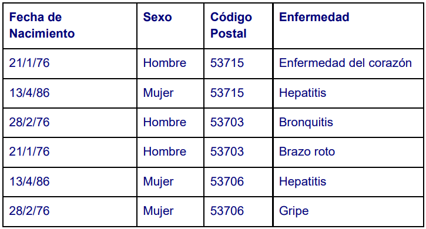

Datos de un hospital.

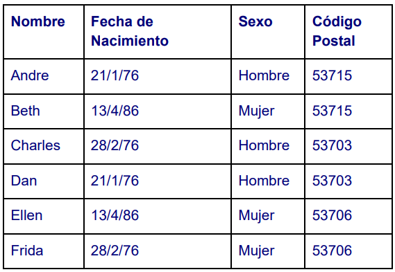

Registro de votantes.

Para resolver esta cuestión, he analizado los atributos basándome en el concepto de enlace de registros. Al cruzar los datos del hospital con el registro de votantes (que actuaría como conocimiento previo del atacante), he comprobado qué combinaciones de cuasi-identificadores permiten aislar al menos un registro y, por tanto, reidentificar a un individuo concreto.

Tras evaluar las combinaciones, he llegado a esta conclusión:

- **Atributos individuales (Fecha de Nacimiento, Sexo o Código Postal):** ninguno permite reidentificar, porque todos sus valores se repiten en al menos dos registros.
- **Fecha de Nacimiento y Sexo:** permite reidentificar parcialmente. Hay colisiones en (21/1/76, Hombre), con Andre y Dan, y en (13/4/86, Mujer), con Beth y Ellen. Pero (28/2/76, Hombre) y (28/2/76, Mujer) son únicos, así que quedan reidentificados Charles y Frida.
- **Sexo y Código Postal:** también permite reidentificar parcialmente. Hay colisiones en (Hombre, 53703) y (Mujer, 53706), pero (Hombre, 53715) y (Mujer, 53715) son únicos, así que quedan reidentificados Andre y Beth.
- **Fecha de Nacimiento y Código Postal:** permite reidentificar los 6 registros, porque cada pareja de valores es única. Por ejemplo, el único paciente nacido el 21/1/76 en el 53715 es Andre.
- **Fecha de Nacimiento, Sexo y Código Postal:** también es única para los 6 registros.

Por tanto, considero que se pueden usar para reidentificar un registro todas las combinaciones de dos o más atributos. Las que reidentifican los 6 registros son “Fecha de Nacimiento y Código Postal” y la combinación de los tres atributos.

#### **(b) ¿Qué nivel de k-anonimato tiene la siguiente tabla? ¿Por qué?**

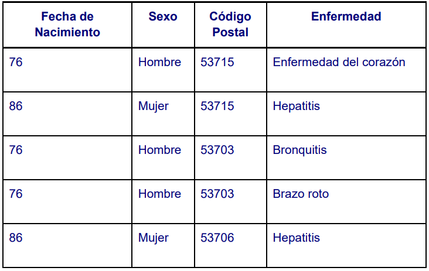

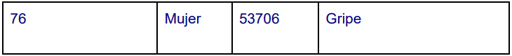

Tras analizar la tabla, determino que el nivel de k-anonimato es k=1.

Para llegar a esta conclusión, he aplicado el concepto teórico de la k-anonimidad, que exige que cualquier combinación de cuasi-identificadores en los datos publicados aparezca, al menos, k veces. El objetivo es garantizar que existan como mínimo k registros indistinguibles entre ellos respecto a sus cuasi-identificadores, formando así lo que se denomina como una clase de equivalencia o conjunto de anonimato.

Al revisar las combinaciones de los cuasi-identificadores (Fecha de Nacimiento, Sexo y Código Postal) en esta tabla, observo que la gran mayoría de las filas son únicas. Por ejemplo, solo hay un registro para la combinación `(76, Hombre, 53715)`, otro único para `(86, Mujer, 53715)`, otro para `(86, Mujer, 53706)` y otro para `(76, Mujer, 53706)`.

La única clase de equivalencia que agrupa más de un registro es la de `(76, Hombre, 53703)`, que aparece 2 veces. Sin embargo, dado que el nivel de k-anonimato de una tabla viene determinado siempre por el tamaño de su clase de equivalencia más pequeña, concluyo que el nivel global es 1.

#### **(c) ¿Qué nivel de k-anonimato tiene la tabla siguiente? ¿Por qué?**

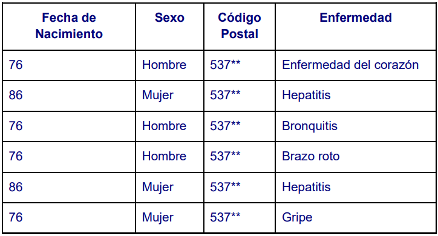

Tras analizar la tabla, observo que el nivel de k-anonimato vuelve a ser de k=1.

Para calcularlo, como he hecho en el apartado anterior, he agrupado los registros buscando las clases de equivalencia (conjuntos de anonimato) basándome en los cuasi-identificadores (Fecha de Nacimiento, Sexo y Código Postal), a los cuales se les ha aplicado un método de generalización no perturbativo para ocultar los dos últimos dígitos del código postal. Al contar las agrupaciones resultantes, veo lo siguiente:

- Una clase formada por tres registros idénticos: `(76, Hombre, 537**)`.
- Una segunda clase con dos registros idénticos: `(86, Mujer, 537**)`.
- Una tercera clase que contiene un único registro aislado: `(76, Mujer, 537**)`.

Dado que la k-anonimidad exige que absolutamente todas las combinaciones de cuasi-identificadores aparezcan, al menos, *k* veces para proteger contra la revelación de identidad, el valor global lo marca siempre la clase más pequeña. Como se sigue teniendo un registro único e indistinguible solo de sí mismo (la mujer nacida en el 76), considero que la tabla en su conjunto se queda en k=1.

#### **(d) ¿Qué nivel de k-anonimato tiene la siguiente tabla? ¿Por qué?**

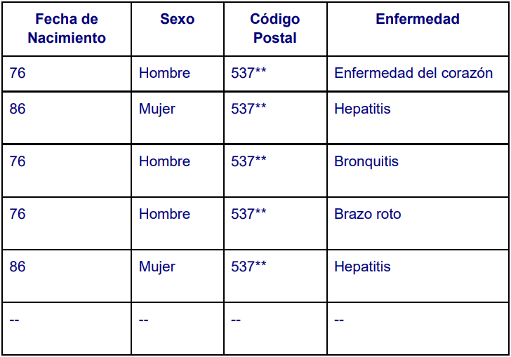

Tras analizar la tabla, observo que el nivel de k-anonimato ha subido a k=2.

Respecto al apartado anterior, se ha aplicado una técnica de supresión sobre el registro problemático (la mujer nacida en el 76), el único que quedaba aislado con k=1. En lugar de generalizar más el resto de los datos, sus valores se han suprimido y la fila queda como `--`. Al no conservar ningún valor, esa fila no aporta información sobre ningún individuo, así que no la considero una clase de equivalencia.

Al recalcular las clases con los cuasi-identificadores (Fecha de Nacimiento, Sexo y Código Postal), me quedan dos conjuntos de anonimato:

- La clase `(76, Hombre, 537**)` contiene 3 registros idénticos.
- La clase `(86, Mujer, 537**)` contiene 2 registros idénticos.

Como el nivel de k-anonimato de una tabla lo marca siempre la clase más pequeña, y aquí tiene 2 registros, el valor de k global es 2.

#### **(e) El k-anonimato garantiza que no podamos asociar un registro con un conjunto de menos de k personas. Sin embargo, no garantiza que la tabla no revele datos confidenciales. ¿Existe algún problema de privacidad en la tabla del apartado (d)? En caso afirmativo, indica cuál y cómo evitarlo**

Tras revisar la tabla del apartado d), considero que sí existe un problema de privacidad evidente. Estamos ante una vulnerabilidad frente a la revelación de atributo, concretamente mediante un ataque de homogeneidad.

Centrandonos en la clase de equivalencia formada por `(86, Mujer, 537**)`, veo que agrupa dos registros y que en ambos el atributo confidencial (Enfermedad) es exactamente el mismo (Hepatitis). Esto significa que si un atacante cruza los datos con el registro de votantes y averigua que Beth o Ellen (mujeres nacidas en el 86) pertenecen a ese grupo, descubrirá automáticamente que tienen Hepatitis, a pesar de no saber exactamente cuál de las dos filas corresponde a cada una. El k-anonimato (k=2) ha evitado la revelación de identidad aislando el registro exacto, pero ha fallado en proteger el dato sensible.

Para evitar este problema, considero que debemos aplicar modelos adicionales como la $l$-diversidad. Este modelo exige que dentro de cada clase de equivalencia existan al menos $l$ valores distintos (o bien representados) para el atributo confidencial, garantizando una mayor entropía y rompiendo la homogeneidad. Otra alternativa más estricta sería aplicar la $t$-proximidad, que obligaría a que la distribución de las enfermedades dentro de cada clase guarde una distancia máxima $t$ respecto a la distribución general de enfermedades de todo el conjunto de datos.

# **Actividad 2. Anonimización con ARX**

#### Parte 1. Preparación, carga y configuración de metadatos

**Tareas 1.1 y 1.2: carga de datos y clasificación de atributos**

Antes de importar el fichero `data.csv`, he insertado como primera fila mi registro de control (ID 0, Alejandro Torres, 24, 12346, Male, Student, Flu, 730), con valores dentro de los rangos del fichero. Después he importado los datos en ARX y he guardado el proyecto como `Alejandro_Torres_privseg_20252`.

He clasificado los atributos así:

| Atributo | Tipo en ARX | Tipo de dato | Motivo |
| --- | --- | --- | --- |
| ID, Name | Identifying | ID: String, Name: String | Identifican por sí solos a un individuo |
| Age, Zip Code, Gender, Occupation | Quasi-identifying | Age: Integer; Zip Code, Gender, Occupation: String | No identifican por sí solos, pero combinados o cruzados con información externa sí pueden hacerlo |
| Diagnosis | Sensitive | String | Es el dato confidencial que hay que proteger |
| Cost | Insensitive | Integer | Según el enunciado, no es sensible ni ayuda a reidentificar |

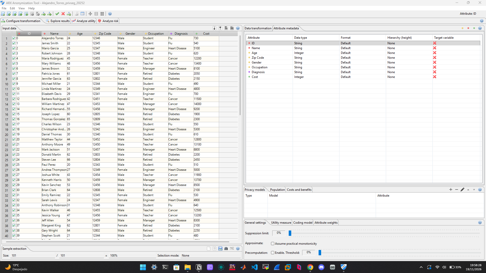

**Tarea 1.3: jerarquías de generalización**

He creado las jerarquías desde *Edit → Create hierarchy…* con el atributo seleccionado.

- **Age (intervalos).** He fijado el rango de 10 a 80 y he definido 14 intervalos de ancho 5, de [10,15[ a [75,80[. Con eso, el nivel 1 son intervalos de 5. El nivel 2 agrupa de dos en dos (intervalos de 10, como [10,20[ o [20,30[) y el nivel 3 es *.
    
    
    
    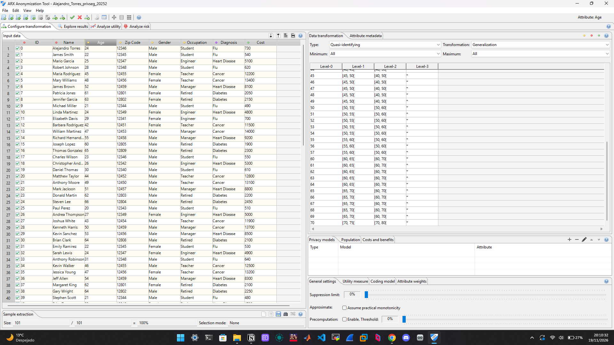
    
- **Zip Code (enmascaramiento).** He usado *masking* de derecha a izquierda con el carácter *, así que cada nivel oculta una cifra más: `12346 → 1234* → 123** → 12*** → 1**** → *****`.
    
    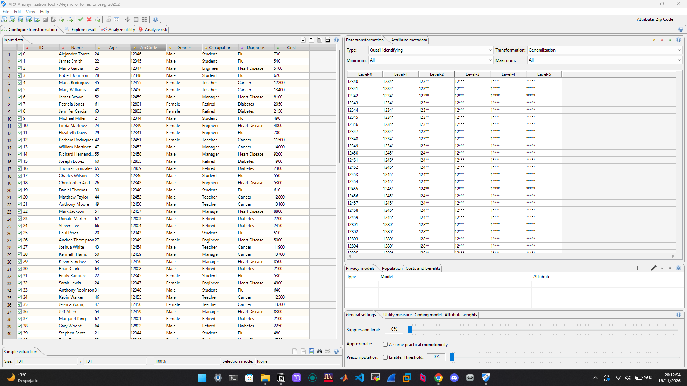
    
- **Occupation (ordenación y agrupación).** He ordenado los valores para que quedaran juntos los de cada grupo y he creado dos grupos con la función *Constant value*. El nivel 1 agrupa Engineer, Manager y Teacher como *Professional*, y Retired y Student como *Non-Professional*. El nivel 2 es *.
    
    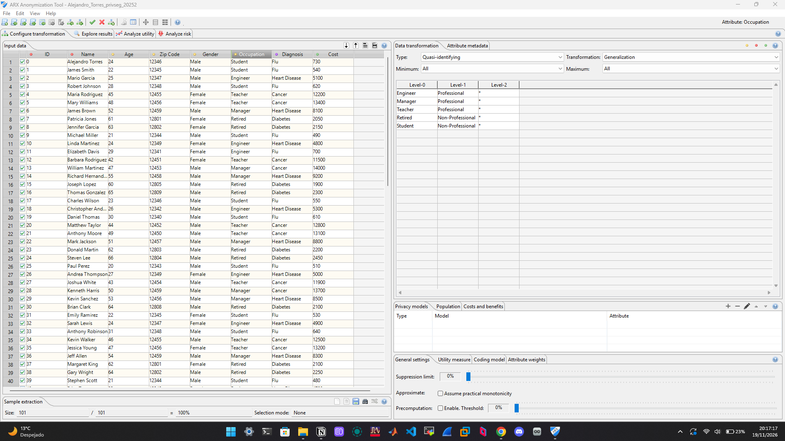
    

**Pregunta: ¿por qué `ID` y `Zip Code` es mejor tratarlos como String que como Integer?**

Al importar el fichero, ARX detectó `ID` y `Zip Code` como *Integer*, y no pude cambiarlo después en los metadatos, así que tuve que reimportar eligiendo *String*. Considero que es mejor así por dos motivos. Primero, ninguno de los dos es una cantidad: son códigos, y operar con ellos no tiene sentido. Segundo, la jerarquía de `Zip Code` genera valores como `1234*` o `12***`, que no son números; con texto el enmascaramiento carácter a carácter es natural y con un entero no.

### Parte 2: Anonimización con k-anonymity y l-diversity

#### Tarea 2.1: Aplicar 3-anonymity

Primero configuré el modelo de privacidad k-Anonymity con k = 3 y lancé la anonimización (búsqueda *Optimal*, transformación *Global*). ARX no la ejecutó y me devolvió este error:

```
Cannot anonymize data: No privacy model specified for sensitive attribute: 'Diagnosis'
```

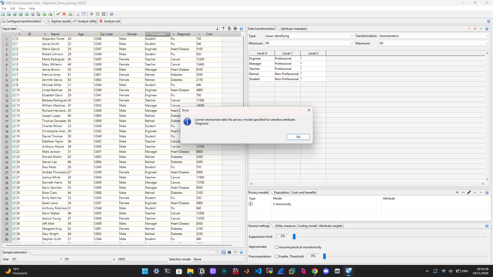

**¿Por qué ARX no permite aplicar solo k-anonymity?**

En la Parte 1 definí `Diagnosis` como atributo sensible, y ARX exige un modelo de privacidad para cada atributo de este tipo. Considero que tiene sentido por lo que vimos en teoría: k-anonymity solo asegura que cada registro es indistinguible de al menos otros k−1 según los cuasi-identificadores, así que protege frente a la revelación de identidad. No dice nada sobre los valores del atributo confidencial dentro de cada clase de equivalencia. Si todos los registros de una clase comparten el mismo diagnóstico, un atacante que sepa a qué clase pertenece una persona deduce su diagnóstico sin reidentificarla (ataque de homogeneidad). Es una revelación de atributo, que k-anonymity no evita. Por eso ARX pide un modelo que proteja el atributo sensible.

#### Tarea 2.2: Añadir l-diversity

Mantuve 3-anonymity y añadí el modelo **Distinct-l-diversity** sobre `Diagnosis` con l = 2, es decir, cada clase de equivalencia debe tener al menos 2 valores distintos de diagnóstico. Con esta configuración la anonimización sí se ejecutó.

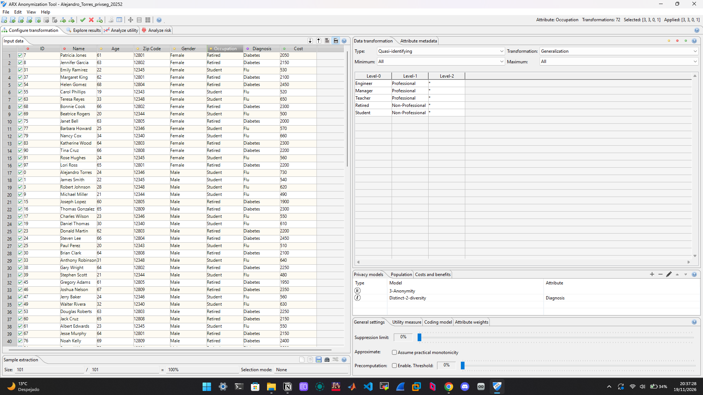

Los dos modelos activos son:

```
3-Anonymity
Distinct-2-diversity  (Diagnosis)
```

#### Tarea 2.3: Generalización óptima

En *Explore results → Lattice* vi que ARX evaluó 72 transformaciones posibles (4 niveles de Age × 6 de Zip Code × 1 de Gender × 3 de Occupation). Con el filtro *Anonymous* solo quedaban 5 nodos válidos, y ARX marca como óptimo `[3, 3, 0, 1]`:

```
Selected: [3, 3, 0, 1]   Applied: [3, 3, 0, 1]
```

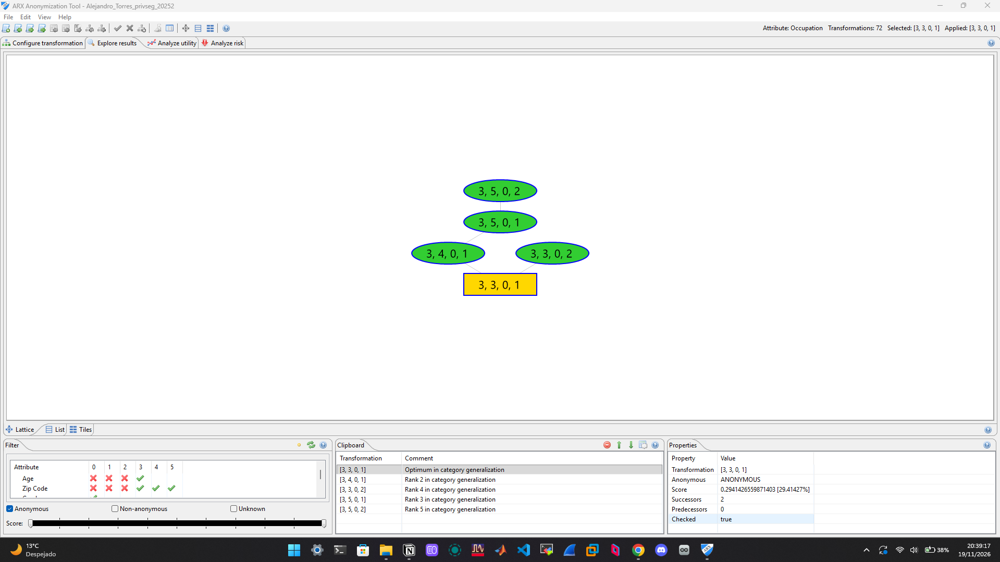

Los números son los niveles de generalización de cada cuasi-identificador, en el orden de las columnas:

| Atributo | Nivel | Resultado |
| --- | --- | --- |
| Age | 3 | `*` |
| Zip Code | 3 | `12***` |
| Gender | 0 | sin generalizar |
| Occupation | 1 | `Professional` / `Non-Professional` |

En el panel de filtros comprobé que, con mis jerarquías, para Age solo es válido el nivel 3, y para Zip Code los niveles 3, 4 y 5. Por tanto, para cumplir 3-anonymity y 2-diversity a la vez, la edad queda completamente generalizada.

#### **Parte 3: Análisis de riesgo**

Tarea 3.1: Quasi-identifiers (distinction y separation)

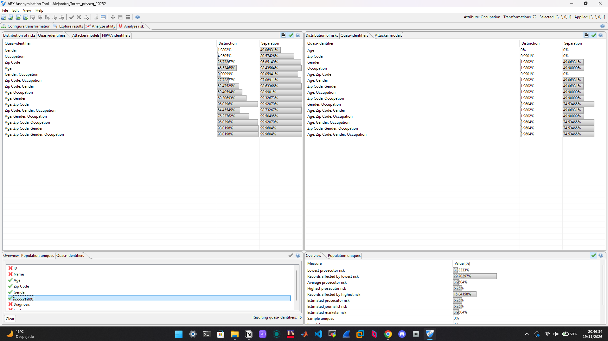

En *Analyze risk → Quasi-identifiers* seleccioné solo los cuatro QI (`Age`, `Zip Code`, `Gender` y `Occupation`). Para los cuatro a la vez, los valores son:

|  | Distinction | Separation |
| --- | --- | --- |
| Original | 98,0198 % | 99,9604 % |
| Anonimizado | 3,9604 % | 74,53465 % |

Con 101 registros, el distinction original equivale a 99 combinaciones distintas de QI y el anonimizado a solo 4. Esas 4 combinaciones salen de `Gender` (2 valores) y `Occupation` (2 valores), una vez que `Age` queda en `*` y `Zip Code` en `12***`. Casi cada registro era único en el original, y tras anonimizar se agrupan en muy pocas clases.

**¿Cómo debería ser el valor de distinction en el conjunto anonimizado? ¿Se cumple?**

Según el enunciado, con 2-anonymity cada combinación de QI se repite al menos 2 veces, así que el distinction debe ser inferior al 50 % e idealmente cercano a ese valor. Yo apliqué k = 3, por lo que cada combinación se repite al menos 3 veces y, con 101 registros, el distinction debería quedar por debajo de aproximadamente el 33 %.

El resultado es del 3,96 % (4 combinaciones distintas de QI sobre 101 registros), así que **sí se cumple**. Pero queda muy por debajo del valor ideal. Como indica el enunciado, esto significa menos granularidad en los QI de la que sería posible: he generalizado más de lo necesario, porque con mis jerarquías el óptimo de ARX deja `Age` completamente en `*`.

#### Tarea 3.2: Attacker models

En *Analyze risk → Attacker models* observé las medidas de los modelos *prosecutor* y *journalist* para el conjunto original y el anonimizado.

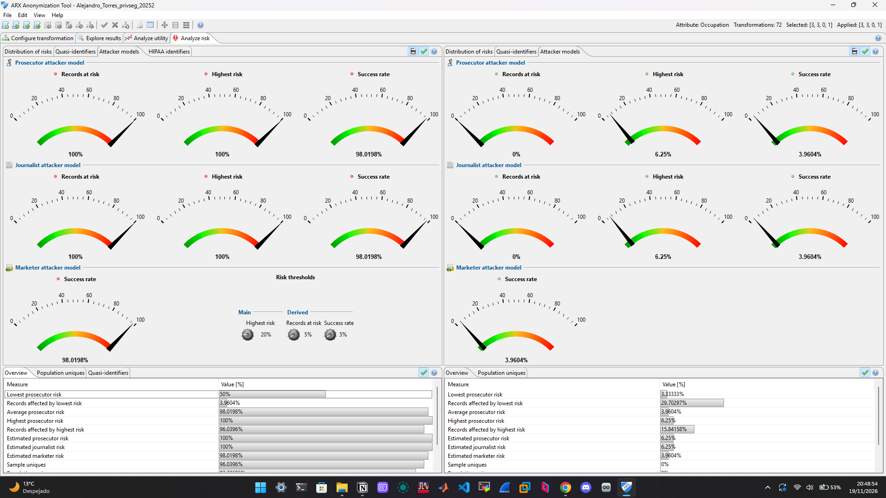

| Modelo | Medida | Original | Anonimizado |
| --- | --- | --- | --- |
| Prosecutor | Records at risk | 100 % | 0 % |
| Prosecutor | Highest risk | 100 % | 6,25 % |
| Prosecutor | Success rate | 98,0198 % | 3,9604 % |
| Journalist | Records at risk | 100 % | 0 % |
| Journalist | Highest risk | 100 % | 6,25 % |
| Journalist | Success rate | 98,0198 % | 3,9604 % |

En el original, los tres indicadores están en la zona roja, con todos los registros expuestos. En el anonimizado quedan por debajo de los umbrales que muestra ARX (20 % para *Highest risk*, 5 % para *Records at risk* y 5 % para *Success rate*), y los medidores pasan a la zona verde. El *Highest risk* del 6,25 % está muy por debajo del 33 % (1/3) que garantiza k = 3, lo que concuerda con lo que vi en la 3.1.

**Pregunta: Explica la diferencia entre «prosecutor attacker model» y «journalist attacker model».**

Según la documentación oficial de ARX ([https://arx.deidentifier.org/overview/privacy-criteria/](https://arx.deidentifier.org/overview/privacy-criteria/)), en el modelo *prosecutor* el atacante apunta a una persona concreta y ya sabe que sus datos están en el dataset, mientras que en el *journalist* también apunta a una persona concreta pero no tiene un conocimiento previo de que esté en el dataset.

Por tanto, el *prosecutor* es el caso de más riesgo, porque el atacante parte de una pertenencia confirmada. En mi análisis, los valores de ambos modelos coinciden. Considero que esto se debe a que no he proporcionado a ARX información sobre la población, y así no distingue entre el conjunto y su población de referencia. Es una hipótesis mía y no la he podido contrastar con una fuente.